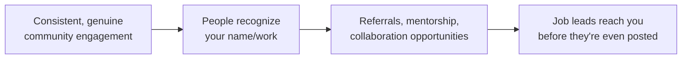

# Networking & community

Security is an unusually community-driven field — a huge share of junior hires, mentorship, and even bug bounty collaboration happens through relationships built well before any job application exists. This lesson covers how to build a genuine presence in the community, and why "networking" here means something quite different from awkward small talk at a conference.

## Why community matters more in security than in most fields

Security professionals share write-ups, tools, and CTF solutions openly, more so than in many other tech fields — a strong open-source and community culture. This means visibility compounds: someone who consistently shares useful things, asks thoughtful questions, and helps others gets *known* over time, which translates into real opportunities that never appear on a job board at all.

## Where to actually engage

- **Discord servers** — many active, beginner-friendly security and CTF communities exist (TryHackMe's and Hack The Box's official servers are large, welcoming starting points). Real-time discussion, help with stuck challenges, and genuine friendships form here.
- **Reddit** — r/cybersecurity, r/netsec, r/AskNetsec, and r/bugbounty are active, informative communities for both questions and staying current on industry news.
- **X/Twitter** — a surprisingly central platform in security for researchers sharing findings, tools, and commentary in real time; following and thoughtfully engaging with active researchers in your area of interest is genuinely valuable.
- **LinkedIn** — less real-time than Discord/X, but valuable for professional visibility; thoughtful comments on others' posts (not just likes) get noticed.
- **Local meetups and conferences** — DEF CON groups (DC groups), BSides events (regional, low-cost security conferences), and OWASP local chapters exist in most major cities and are far more accessible and beginner-friendly than their names might suggest.

## How to engage well (the part most people get wrong)

:::warn Don't lead with "asking for a job"
Cold-messaging someone you've never interacted with, immediately asking for a referral or job lead, has a low success rate and can come across as purely transactional. Community-building works the other way around: be genuinely helpful and present first, and opportunities tend to follow naturally as people get to know your work and character.
:::

- **Be genuinely helpful first.** Answer a beginner's question you know the answer to. Share a useful resource you found. Small, consistent contributions compound far more than occasional grand gestures.
- **Share what you're learning, not just finished expertise.** A short post about a CTF challenge you struggled with and eventually solved is often *more* engaging and relatable than a polished "I am an expert" post — and it's honest, which builds trust.
- **Ask good questions.** A specific, well-researched question ("I've tried X and Y for this SSRF bypass and both failed with this exact error — any ideas?") gets far better engagement and respect than a vague "how do I hack websites?"
- **Give credit generously.** If someone's write-up or tool helped you solve something, say so publicly. This is both good etiquette and quietly builds your own reputation as someone worth collaborating with.

## Introversion and community-building — it doesn't require being loud

A common, understandable worry: "I'm not a naturally outgoing person, does that rule out building a real community presence?" It doesn't. Community engagement in security skews heavily toward *written* contribution — a thoughtful GitHub issue comment, a well-researched forum question, a technical write-up — none of which requires the real-time verbal confidence that conferences or meetups demand. Many well-known, well-respected practitioners in this field built their entire reputation through consistent written contribution alone, rarely or never attending in-person events at all. If in-person networking genuinely drains you, lean into the asynchronous channels (Discord threads you can compose thoughtfully rather than respond to instantly, GitHub, technical blogging) where the same underlying principle — genuine, consistent, helpful contribution — works exactly as well without requiring extroversion as a prerequisite.

## Building relationships, not just contacts

The word "networking" often conjures an image of collecting business cards — the reality that actually works is closer to making a handful of genuine professional friendships over time. Regularly interacting with the same handful of people in a Discord server or on Twitter, being consistently helpful and present, naturally builds real relationships far more effectively than an aggressive one-time outreach campaign ever will.

:::tip Mentorship often happens informally, not by asking directly
Rather than cold-messaging "will you be my mentor?" (which can feel like a big, awkward ask to a stranger), engage genuinely with someone whose work you admire over time — ask a specific, well-thought-out question about something they posted, or share a thoughtful take on their write-up. Many real mentoring relationships in this field grow organically out of exactly this kind of low-pressure, repeated interaction.
:::

## 🧪 Hands-on lab — start building your presence

1. Join two communities from the list above that genuinely match your interests (e.g., a CTF-focused Discord and r/AskNetsec).
2. Introduce yourself in at least one — briefly mention what you're learning (referencing this course is completely fair game) and what you're currently working on or stuck on.
3. Find one piece of content (a write-up, a tool, an article) you genuinely found useful this month, and share it with a short note on why, either in a community or on a platform like X/LinkedIn.
4. Answer one beginner's question somewhere you're capable of answering confidently — teaching reinforces your own understanding and starts building your reputation simultaneously.

:::challenge Test yourself
Why does "being genuinely helpful first" tend to produce better long-term career outcomes in security than directly asking contacts for job leads or referrals?

Show answer
Security's community culture runs heavily on reputation built through consistent, visible contribution — write-ups, tool-sharing, and helping others in real time. When you're genuinely helpful over time, people form an organic, positive impression of both your skill and your character before any job-related conversation even happens, which makes a later referral or introduction feel natural and low-risk for the person making it. Leading with a direct ask to someone who doesn't know you yet, by contrast, gives them nothing to base that trust on — it reads as transactional, and most people are naturally hesitant to vouch for or refer someone they have no real basis to vouch for. Helpfulness-first builds the trust that later makes direct opportunities possible.

:::

## Key terms

- **BSides** — regional, low-cost, community-run security conferences held in most major cities worldwide.
- **DC groups** — local DEF CON-affiliated meetup groups.
- **Write-up** — a public walkthrough of how a CTF challenge or bug bounty finding was solved.

## Recap

- Security's community culture is unusually open and collaborative — visibility and reputation compound over time.
- Engage across Discord, Reddit, X/Twitter, LinkedIn, and local meetups/conferences depending on what fits you.
- Be genuinely helpful and present first; don't lead with direct asks for jobs or referrals.
- Real relationships (and often mentorship) tend to form organically through repeated, genuine interaction — not one-off outreach.

???refs
- [OWASP local chapters](https://owasp.org/chapters/) — find a beginner-friendly local security meetup near you.
- [BSides events](http://www.securitybsides.com/) — low-cost, community-run regional security conferences worldwide.
???

**Next up →** [Your first 90 days in a security job](#/lesson/13-career-prep/first-90-days)
