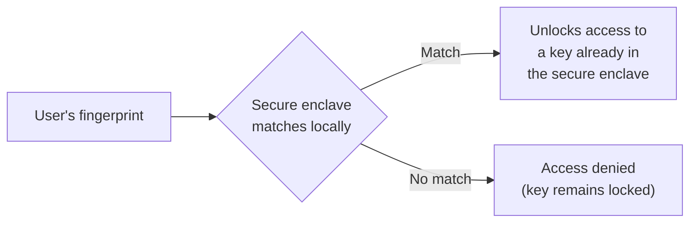

# Mobile Authentication & Biometrics

The insecure-data-storage lesson named the Keystore/Keychain as "the correct place for secrets." This lesson explains exactly why, and covers biometric authentication's real security model — genuinely different from how it's often assumed to work.

## The secure enclave: hardware-backed key storage

Modern mobile devices include a **secure enclave** (Apple's term; Android's equivalent is the **Trusted Execution Environment**, or a dedicated **StrongBox** module on supporting devices) — a physically isolated hardware component that stores cryptographic keys and performs sensitive operations, deliberately separated from the main operating system and its applications. A key generated inside the secure enclave can be used for signing or encryption operations, but its actual raw value can never be extracted, even by the operating system itself, even with root/jailbreak access.

## Why this matters more than app-level encryption alone

Directly connecting to Path 06's applied-crypto lesson: an app that encrypts data using a key it manages entirely in software, even carefully, still has that key present somewhere in the app's own accessible memory or storage at some point — a sufficiently privileged attacker (root access, a kernel exploit) could potentially extract it. A key that never leaves the secure enclave removes this entire risk category structurally, the same "eliminate the vulnerability, don't just mitigate it" principle this course has emphasized repeatedly.

## How biometric authentication actually works

A genuinely important, often-misunderstood point: **Face ID and fingerprint authentication don't send your biometric data anywhere, and don't function as a password replacement in the cryptographic sense.** Instead, a successful biometric match simply *unlocks access* to a key already stored in the secure enclave — the biometric check happens locally, on-device, and its only real job is authorizing use of a key that was going to stay in hardware either way.

## The security implication for app developers

An app should never treat "the user's fingerprint was accepted" as equivalent to "the user entered a password directly usable for authentication" — the correct pattern uses biometric confirmation specifically to gate access to a securely-stored key or token, not as a standalone authentication factor sent to a server. Apps that misuse biometric APIs (treating a successful local match as sufficient proof of identity for a remote server-side action, without any actual cryptographic operation tied to the secure enclave) reintroduce exactly the vulnerability the secure enclave was designed to prevent.

## Why this connects to the OWASP Mobile Top 10's insecure-storage findings

The insecure-data-storage lesson noted the Keystore/Keychain is genuinely "underused" in real apps — this lesson explains the concrete cost of that mistake: an app storing an authentication token in SharedPreferences instead of the Keystore has a token that's extractable by anyone with root access, while the exact same token stored properly, gated behind biometric confirmation, would require compromising the secure enclave itself — a dramatically higher bar.

:::challenge Test yourself
Why is it inaccurate to describe Face ID or fingerprint authentication as "sending your biometric data to verify who you are"?

Show answer
Biometric matching happens entirely locally, within the device's secure enclave — your fingerprint or face data is captured, compared against a securely stored local template, and the match result never leaves the device at all, let alone gets transmitted anywhere for verification. The actual security function biometrics serve is narrower and more specific than "proving identity to a server": a successful local match simply unlocks access to a cryptographic key that was already sitting in the secure enclave, and it's <em>that key</em> — not the biometric data itself — that ultimately gets used for any actual authentication or encryption operation. This distinction matters directly for developers: correctly implemented biometric authentication ties into a real cryptographic operation gated by the secure enclave, while an incorrect implementation might just check "did the local biometric prompt return success" and treat that alone as sufficient proof — reintroducing exactly the extractable, less-secure pattern the secure enclave exists to prevent.

:::

## Key terms

- **Secure enclave / Trusted Execution Environment (TEE)** — a physically isolated hardware component storing cryptographic keys that can never be extracted, even with root access.
- **Biometric authentication** — using a fingerprint or face match, performed entirely on-device, to unlock access to a securely-stored key.

## Recap

- The secure enclave / TEE stores cryptographic keys in isolated hardware, structurally preventing extraction even by a fully compromised operating system.
- Biometric authentication doesn't transmit biometric data anywhere — it performs a local match that unlocks access to an already-stored key, not a standalone remote authentication factor.
- Correctly using the Keystore/Keychain, gated by biometric confirmation, is dramatically more secure than the SharedPreferences-based storage the insecure-data-storage lesson flagged as a common real-world mistake.

**Next up →** [Intercepting Mobile Traffic](#/lesson/13-mobile-security/intercepting-mobile-traffic)
