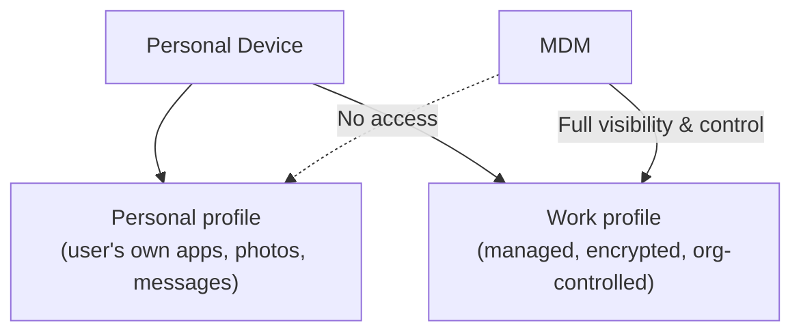

# Mobile Device Management (MDM)

Every lesson so far has focused on a single app's security. This lesson zooms out to how organizations manage security across an entire fleet of mobile devices at once — directly connecting to Path 24's device-trust-posture lesson, now applied specifically to phones and tablets.

## What MDM actually does

**Mobile Device Management (MDM)** software lets an organization enforce security policy, deploy apps, and remotely manage a fleet of mobile devices — setting password requirements, enforcing encryption, remotely wiping a lost or stolen device, and controlling which apps can be installed, all centrally, without requiring an administrator to physically handle each device.

## Corporate-owned vs. BYOD: two genuinely different models

- **Corporate-owned devices (COBO/COPE)** — the organization owns the device outright, giving MDM full control over its configuration, exactly the strongest enforcement position but with obvious cost and flexibility tradeoffs
- **BYOD (Bring Your Own Device)** — directly connecting to Path 24's remote-work lesson's coverage of this exact tension: an employee's personal device is enrolled in MDM, but the organization doesn't own it, creating a genuine balance to strike between security control and personal privacy

## Containerization: solving the BYOD privacy tension

Modern MDM solutions commonly use **containerization** (also called work profiles on Android) — creating a genuinely separate, encrypted, managed workspace on a personal device, containing only work apps and data, entirely isolated from the user's personal apps and data on the same physical phone. The organization can enforce policy and even remotely wipe the work container without ever touching (or even being able to see) the user's personal photos, messages, or apps.

## Why MDM matters for the security fundamentals covered earlier in this path

- **Enforcing encryption and passcode requirements** device-wide, directly connecting to Path 06's applied-crypto principles and Path 00's passwords lesson, applied at fleet scale rather than trusting each individual user's own choices
- **App allow-listing** — restricting which apps can be installed at all, directly reducing exposure to the sideloading and malicious-app risks from the previous lesson
- **Remote wipe** — a genuine, high-value corrective control (Path 10's control-types lesson) for a lost or stolen device, preventing the data-extraction risks covered throughout the insecure-storage and authentication lessons from ever mattering if the device itself falls into the wrong hands
- **Conditional access** — directly extending Path 24's Zero Trust device-posture concept: an unmanaged or non-compliant device can be denied access to corporate resources entirely, regardless of whether the user's credentials are otherwise valid

## The genuine privacy tension worth naming honestly

Even with containerization, MDM enrollment involves real tradeoffs an employee should understand — some MDM configurations retain visibility into device-level information (location, installed app inventory, network activity) beyond just the work container, and the specific boundaries vary meaningfully by product and configuration. This is exactly the same "be deliberate and transparent about the tradeoff, not just assume it's fine" principle Path 09's family-privacy lesson raised for parental monitoring, applied here to the employer-employee relationship instead.

:::challenge Test yourself
Why does containerization specifically address the core tension in BYOD security, rather than just being a nice-to-have feature?

Show answer
Without containerization, an organization enforcing meaningful security policy on a personal device (remote wipe capability, mandatory encryption, app restrictions) would need visibility and control over the <em>entire device</em> — including the user's personal photos, messages, and unrelated apps — creating a genuine, reasonable reason for an employee to resist enrollment entirely, since accepting corporate security policy would mean surrendering control over clearly personal, unrelated data. Containerization resolves this by creating a genuinely separate, isolated managed workspace: the organization gets full enforcement capability over the work container specifically (encryption, remote wipe, app control), while the user's personal profile remains genuinely outside the organization's reach, addressing the legitimate privacy concern directly rather than asking the employee to simply trust that the organization won't misuse broader access it doesn't actually need to have in the first place.

:::

## Key terms

- **MDM (Mobile Device Management)** — software for centrally enforcing security policy and managing a fleet of mobile devices.
- **Containerization / work profile** — a separate, encrypted, organization-managed workspace isolated from a personal device's personal data.
- **COBO/COPE** — corporate-owned device ownership models, giving an organization full device control.

## Recap

- MDM extends Path 24's Zero Trust device-posture concept to fleet-scale mobile device management, enforcing encryption, app restrictions, and remote wipe centrally.
- Containerization resolves BYOD's core privacy tension by creating a genuinely isolated, organization-managed work profile separate from an employee's personal data on the same device.
- Real privacy tradeoffs remain even with containerization, and being deliberate and transparent about them mirrors the same principle Path 09 raised for personal device-monitoring decisions.

**Next up →** [Mobile Security Careers & Certifications](#/lesson/13-mobile-security/mobile-security-careers-certifications)
