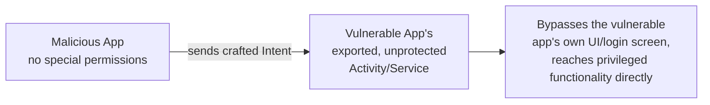

# Mobile Privilege Escalation & Root Detection

This lesson covers two related mobile-specific topics: how apps try to detect (and refuse to run on) rooted/jailbroken devices, and the ways insecure inter-app communication can let one app escalate access via another — a genuinely mobile-specific twist on the privilege escalation concepts from Path 16.

## Why apps care about root/jailbreak status

A rooted Android device or jailbroken iPhone removes the OS-level protections this path has relied on throughout (Path 13's fundamentals lesson) — sandboxing can be bypassed, any app's private storage becomes readable, and runtime instrumentation tools like Frida (covered in the traffic interception lesson) become possible. Banking apps, DRM-protected media apps, and anti-cheat-conscious games in particular often refuse to run at all on a detected rooted/jailbroken device, specifically to reduce their own exposure to exactly the kind of analysis this path teaches.

## Common root detection techniques (and their bypasses)

| Detection technique | What it checks | Common bypass |
|---|---|---|
| **Binary presence check** | Looks for `su`, `Superuser.apk`, Magisk-related files | Hide/rename these via root management tools |
| **Build tag check** | Checks `Build.TAGS` for `test-keys` (a sign of a non-stock ROM) | Frida hook to spoof the returned value |
| **Writable system partition check** | Tests if `/system` is writable (shouldn't be on a stock device) | Root-hiding tools that restore expected read-only behavior |
| **Package manager check** | Looks for known rooting-related apps installed | Uninstall/hide the detected packages |

In practice, tools like **Magisk's** built-in hiding features, or targeted Frida scripts (extending directly from the SSL-pinning bypass technique in the traffic interception lesson) handle most of these automatically — the same instrumentation approach that patches certificate validation can just as easily patch a root-detection function to always return "not rooted."

```bash
# Same pattern as SSL pinning bypass, applied to root detection:
frida -U -f com.example.bankingapp -l root-detection-bypass.js --no-pause
```

## Insecure inter-app communication — Android's IPC surface

Android apps can communicate with each other through defined mechanisms: **Intents**, **Content Providers**, **Broadcast Receivers**, and **Services**. When one of these components is marked `exported="true"` in the manifest (covered in the APK analysis lesson) without a matching permission requirement, *any other app installed on the device* — even a malicious one with no special permissions of its own — can potentially interact with it directly.



A classic real-world example: an exported Activity intended only to be launched from within the app itself (say, an "admin settings" screen assuming the user already authenticated through the main UI) can sometimes be launched directly by any other app via an explicit Intent, completely bypassing whatever authentication gate the normal UI flow enforces — the mobile equivalent of a broken access control finding from Path 11.

## Content Provider SQL injection — a distinct exported-component risk

Beyond simply reaching restricted screens, an exported **Content Provider** carries its own specific, more severe risk: many Content Providers are backed directly by a SQLite database, and if the provider builds its underlying query by concatenating caller-supplied input rather than using parameterised queries, it's vulnerable to exactly the SQL injection technique from Path 11.6 — just reached via Android's IPC mechanism instead of an HTTP request:

```bash
# Querying an exported Content Provider directly, probing for injection:
adb shell content query --uri content://com.example.vulnerableapp.provider/users \
  --where "id=1 OR 1=1"
```

If that query returns every row instead of just the intended one, the provider is vulnerable to the exact same injection class as any web application's login form — a genuinely common finding on real Android apps, since Content Providers are frequently written with less security scrutiny than an app's network-facing API code, on the mistaken assumption that "it's just internal Android IPC" makes it inherently safer.

## Testing exported components

```bash
# List an app's exported activities directly from an installed package:
adb shell dumpsys package com.example.vulnerableapp | grep -A 3 "android:exported=\"true\""

# Attempt to launch a specific exported activity directly, bypassing the app's normal flow:
adb shell am start -n com.example.vulnerableapp/.AdminActivity
```

If that command successfully opens a screen you were never meant to reach without prior authentication within the app, you've just demonstrated exactly the class of vulnerability described above.

:::danger Only test on your own apps or authorized targets
As with every other lesson in this path, root-detection bypass and exported-component testing must stay confined to your own test devices, apps you built, or explicitly authorized vulnerable practice apps (DIVA and InsecureBankv2 both include exported-component challenges specifically for this purpose).
:::

:::challenge Find and exploit an exported component
Using DIVA or InsecureBankv2 on your rooted emulator, use `dumpsys package` to find an exported component, and attempt to launch or interact with it directly via `adb shell am start` (or `adb shell content query` for an exported Content Provider). Document what you were able to reach, and what the correct fix would look like (setting `exported="false"`, or adding a custom permission requirement).
:::

## Key takeaway

Root/jailbreak detection is a genuine but ultimately bypassable speed bump, not a real security control — real security must come from proper server-side authorization and data protection, not from hoping the client environment stays untampered. Separately, exported components represent a mobile-specific access control risk with no web equivalent, and checking for them is a standard, high-value step in any Android security review.

**Next up →** [Mobile App Hardening](#/lesson/13-mobile-security/mobile-app-hardening)
