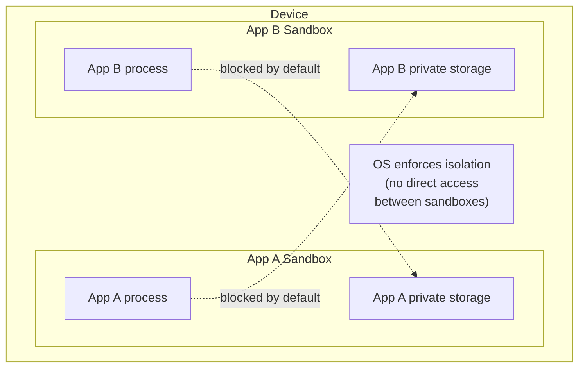
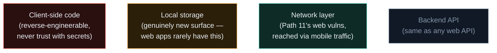

# Mobile Security Fundamentals

Everything you've learned so far — web security, network security, Linux — transfers partially to mobile, but mobile apps live in a genuinely different world: a sandboxed, permission-gated environment running on a device the user carries everywhere, constantly handling location, contacts, camera, and payment data. This path adapts everything you know to that specific context.

## Why mobile security is its own discipline

Over half of all internet traffic now originates from mobile devices, and mobile apps routinely handle more sensitive data than their web counterparts — location history, biometric data, contact lists, camera and microphone access. Yet mobile app security testing remains less mature and less consistently practiced than web security testing across the industry, making it a genuinely valuable specialization to build.

## The two major platforms, at a glance

| | **Android** | **iOS** |
|---|---|---|
| **Kernel** | Linux-based | Darwin (XNU) |
| **App format** | APK (Android Package) | IPA (iOS App Store Package) |
| **Language** | Java / Kotlin (compiled to Dalvik/ART bytecode) | Swift / Objective-C (compiled to native ARM) |
| **App store control** | Looser — sideloading allowed | Strict — Apple's App Store is the only official channel |
| **Openness for testing** | Much easier to analyze, root, and instrument | Requires a jailbroken device for full analysis |

Android's relative openness is exactly why most of this path's hands-on labs focus there first — it's dramatically more accessible for learning without expensive jailbreak tooling, and the underlying security concepts transfer directly to iOS once you understand them.

## App sandboxing — the core security model

Both platforms enforce **app sandboxing**: every app runs in its own isolated environment with its own private storage, and by default cannot read another app's data or interfere with its execution. This is the mobile equivalent of process isolation and user permissions from Path 03's Linux material — but enforced far more strictly, since mobile apps come from far less trusted sources (any developer can publish to app stores) than the software most people install on a traditional computer.

## The permission model

Rather than trusting an app with everything by default, both platforms use **runtime permissions** — an app must explicitly request access to sensitive resources (camera, location, contacts, microphone), and the user grants or denies each one, often individually, often at the moment the app first tries to use it rather than all at once at install time. This is a direct, hands-on illustration of the **principle of least privilege** referenced throughout this course: an app should only be granted the specific access it genuinely needs, nothing more.

:::tip Check your own phone's permissions right now
Go to your phone's Settings → Apps → [any app] → Permissions, and look at what it's been granted. You'll likely find at least one app with access that seems disproportionate to what it actually needs (a flashlight app requesting contacts access, for instance) — a genuinely common real-world red flag, and exactly the kind of over-permissioning this path's later lessons teach you to identify and test for deliberately.
:::

## The mobile attack surface, mapped to what you already know

Every mobile app has roughly four distinct layers worth reasoning about separately, and each maps directly onto a concept from earlier in this course. The **client-side code** itself (the compiled app on the device) is analogous to a desktop application's binary — reverse-engineerable, and never trustworthy to store secrets in, exactly the "never trust the client" principle from Path 05.3, just with the client now living on a device the attacker can physically hold. The **local storage** layer (databases, preference files, cached data sitting on the device) is a genuinely new attack surface with no clean web parallel — a web app's "storage" mostly lives server-side, while a mobile app routinely persists substantial data directly on a device an attacker might gain physical or rooted access to. The **network layer** (API calls to a backend) is almost entirely familiar territory from Path 11 — the same injection, IDOR, and authentication vulnerabilities apply, just reached via a mobile app's traffic instead of a browser's. And the **backend API** itself is, again, just Path 11's entire web security curriculum, since most mobile apps are ultimately thin clients calling the same kinds of REST or GraphQL APIs a web app would.

Recognising which of these four layers a given finding belongs to is genuinely useful triage — it tells you immediately which earlier path's toolkit and mindset to reach for, rather than treating "mobile security" as an entirely foreign discipline requiring completely new first principles.

## Where mobile vulnerabilities actually come from

Despite sandboxing and permissions, mobile apps remain vulnerable in ways this path covers in depth: insecure local data storage (sensitive data saved unencrypted where a rooted/jailbroken device — or a stolen, unlocked one — can read it), weak network communication (skipping certificate validation, allowing traffic interception), reverse-engineerable code (since APKs can be decompiled far more easily than most people expect), and the same web-adjacent vulnerabilities from Path 11 wherever an app embeds a web view or talks to a backend API.

:::challenge Test yourself
Why does mobile app sandboxing alone not guarantee an app's data is actually safe, even though it prevents other apps from directly reading it?

Show answer
Sandboxing only protects data <em>from other apps</em> on the same device under normal conditions — it says nothing about whether the data itself is stored securely within the app's own sandbox. If an app stores sensitive data in plain text inside its private storage, that data is still exposed to anyone with physical access to an unlocked device, anyone who can extract a backup of the device, or — critically — anyone using a rooted or jailbroken device, where the sandboxing boundary itself can be bypassed entirely. Sandboxing narrows <em>who</em> can normally reach the data; it does nothing to protect the data's confidentiality once that boundary is crossed, which is exactly why proper encryption of sensitive local data (covered later in this path) remains essential regardless of sandboxing.

:::

## Key terms

- **Sandboxing** — isolating each app's process and storage from every other app by default.
- **Runtime permissions** — explicit, often individually-grantable user consent for sensitive resource access.
- **APK / IPA** — the packaged app file formats for Android and iOS respectively.
- **Principle of least privilege** — granting only the minimum access genuinely required, applied here to app permissions.

## Recap

- Mobile security adapts core concepts from earlier in this course (sandboxing, least privilege, network security) to a distinct platform context.
- Android and iOS differ significantly in openness, but share the same core sandboxing and permission-based security model.
- Sandboxing isolates apps from each other but doesn't guarantee the security of data within an app's own storage.
- The rest of this path focuses primarily on Android for hands-on labs, since it's far more accessible for learning without specialized jailbreak hardware.

???refs
- [OWASP Mobile Application Security](https://owasp.org/www-project-mobile-app-security/) — the definitive, free, industry-standard mobile security resource, referenced throughout this path.
- [Android Developers: App Sandbox](https://developer.android.com/privacy-and-security/security-tips) — Google's own security documentation.
???

**Next up →** [Android Permissions Deep Dive](#/lesson/13-mobile-security/android-permissions-deep-dive)
