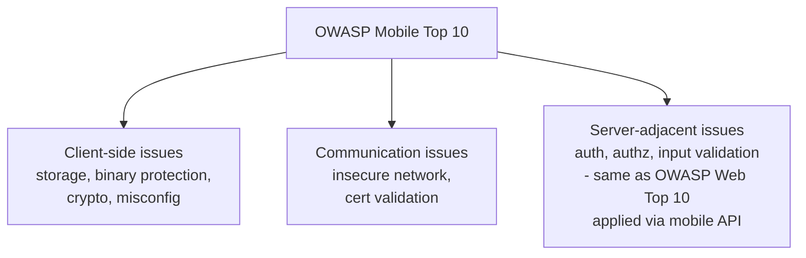

# OWASP Mobile Top 10

Just as the OWASP Top 10 (Path 11) gives web testers a shared checklist, the **OWASP Mobile Top 10:2024** provides risk categories for mobile apps. OWASP's separate Mobile Application Security (MAS) project maintains detailed requirements, weaknesses, and tests. Use the 2024 list for broad orientation and the MAS resources for an assessment.

## The list, explained plainly

1. **Improper Credential Usage** — hardcoded API keys, credentials embedded in app code, or weak session handling specific to mobile contexts.
2. **Inadequate Supply Chain Security** — vulnerable third-party SDKs and libraries bundled into the app, or a compromised build pipeline — mobile's version of the software supply chain risks referenced throughout this course.
3. **Insecure Authentication/Authorization** — weak biometric implementation, missing server-side authorization checks (the mobile equivalent of Path 11's IDOR), or authentication logic that can be bypassed by manipulating the client.
4. **Insufficient Input/Output Validation** — the mobile equivalent of injection flaws (Path 11's SQLi/XSS lessons), often overlooked because developers assume mobile apps are "safer" than web apps.
5. **Insecure Communication** — missing or broken TLS, disabled certificate validation, or apps that fall back to plaintext HTTP under certain conditions.
6. **Inadequate Privacy Controls** — collecting more personal data than necessary, or exposing personal data through logs, backups, or insecure storage.
7. **Insufficient Binary Protections** — apps with no obfuscation or anti-tampering measures, making reverse engineering (covered in this path's APK analysis lesson) trivially easy.
8. **Security Misconfiguration** — debug flags left enabled in production builds, verbose error messages, or overly permissive file/component permissions.
9. **Insecure Data Storage** — sensitive data saved unencrypted in local storage, databases, or backups (this path has a dedicated lesson on exactly this).
10. **Insufficient Cryptography** — weak or custom-rolled encryption, hardcoded encryption keys, or using deprecated algorithms — the mobile-specific version of the "never roll your own crypto" principle from Path 11's XOR cipher discussion.

## Why this list looks different from the Web Top 10

Notice how several items (#3, #4) are essentially the web vulnerabilities from Path 11, just triggered through a mobile app's API calls instead of a browser — a mobile app is still, ultimately, a client talking to a server, and every server-side lesson from earlier in this course applies directly to that backend regardless of what kind of client calls it. What's genuinely new here is everything related to the **client itself**: local storage, binary protection, and the app's own code being distributable and inspectable in ways a web server's backend code never is.

## How mobile findings translate to bug bounty severity

Recall Path 15.1's severity/reward table for web findings — mobile-specific categories map onto that same general framework, but with some notably different weighting worth knowing before you start hunting. Hardcoded API keys or credentials (#1) found via APK decompilation are often surprisingly high-severity if that key grants broad backend access, precisely because unlike a web app's server-side secrets, a mobile app's compiled code is distributed directly to every user's device — meaning "extracting a secret from the app" is a baseline capability any attacker has, not a sophisticated technique. Insecure data storage (#9) severity depends heavily on whether exploitation requires physical device access (generally rated lower, since it requires the attacker to have the specific victim's device) versus being remotely triggerable (rated much higher). Certificate pinning bypasses (#5, covered in this path's traffic-interception lesson) are frequently rated as informational or low on their own, specifically because most programs consider "attacker has installed a custom root CA on their own rooted device" a reduced-severity scenario — the real severity comes from *what* that bypass then reveals, not the bypass technique itself.

:::tip This list evolves — always check the current version
This lesson describes the **2024 edition**, which OWASP still lists as its released Mobile Top 10 in September 2026. Check the [project page](https://owasp.org/projects/mobile-top-10) for a newer edition before citing it in a report.
:::

## MASVS — the verification standard behind the checklist

Beyond the Top 10, use the **MASVS (Mobile Application Security Verification Standard)** for requirements and the **MASTG (Mobile Application Security Testing Guide)** for tests, techniques, tools, and demos. MASVS v2 groups requirements under storage, cryptography, authentication, network communication, platform interaction, code quality, resilience, and privacy. The older L1, L2, and R verification levels have been reworked as **MAS Testing Profiles** in MASTG; do not cite them as if they were MASVS v2 requirement levels.

The **MASWE (Mobile Application Security Weakness Enumeration)** bridges requirements and tests. Its v1.0.0 release in August 2026 describes 78 mobile weaknesses, with mappings to MASVS controls, CWEs, and available MASTG tests. For example, [MASWE-0004](https://mas.owasp.org/MASWE/MASVS-STORAGE/MASWE-0004/) covers secrets hardcoded in an app package. An assessment can move from a MASVS requirement, to the matching MASWE weakness, to a reproducible MASTG test and remediation.

## How this list shapes the rest of this path

The remaining lessons in this path map directly onto specific items here: **Android APK Analysis** targets #7 (binary protection) and #8 (misconfiguration); **Insecure Data Storage** targets #9 directly; **Intercepting Mobile Traffic** targets #5; and the capstone lab pulls several of these together against a real deliberately-vulnerable app.

:::challenge Test yourself
Why do items #3 and #4 on this list ("Insecure Authentication/Authorization" and "Insufficient Input/Output Validation") look so similar to vulnerabilities you already learned in Path 11's web security material?

Show answer
A mobile app's authentication and input handling logic almost always lives on the same backend server infrastructure that a web application would use — the mobile app itself is fundamentally just a different kind of client sending requests to that server, exactly like a browser is. If the server fails to properly validate authorization (checking whether the requesting user actually owns the resource they're requesting) or fails to sanitize input before using it in a database query, that vulnerability exists regardless of whether the request came from a web browser, a mobile app, or a raw API call crafted by hand — the underlying server-side flaw, and the fix, are identical. This is exactly why the web security skills from Path 11 remain directly relevant once you start testing the backend APIs mobile apps talk to.

:::

## Key terms

- **OWASP Mobile Application Security (MAS)** — the project behind MASVS requirements, MASWE weaknesses, and MASTG testing guidance; the Mobile Top 10 is a separate OWASP project.
- **Binary protection** — anti-tampering and anti-reverse-engineering measures applied to a compiled app.
- **Supply chain security** — securing the third-party components and build process behind an app, not just its own code.

## Recap

- The OWASP Mobile Top 10 is the mobile-specific equivalent of Path 11's web Top 10, and shares several categories directly with it, applied to mobile's API-driven client-server model.
- What's genuinely mobile-specific is everything about the client itself — local storage, binary protection, cryptography, and platform-level misconfiguration.
- This list frames and motivates every remaining lesson in this path.

???refs
- [OWASP Mobile Top 10](https://owasp.org/www-project-mobile-top-10/) — the official, current list.
- [OWASP MASTG (Mobile Application Security Testing Guide)](https://mas.owasp.org/MASTG/) — the definitive free, detailed hands-on testing methodology, well worth exploring beyond this course.
- [OWASP MASWE v1.0.0 release](https://mas.owasp.org/news/2026/08/17/maswe-v100-release/) — the current weakness catalog and how it maps to controls and tests.
- [OWASP MASVS testing profiles](https://mas.owasp.org/MASVS/03-Using_the_MASVS/) — how L1, L2, and R are used in the current MAS framework.
???

**Next up →** [Android APK Analysis](#/lesson/13-mobile-security/android-apk-analysis)
