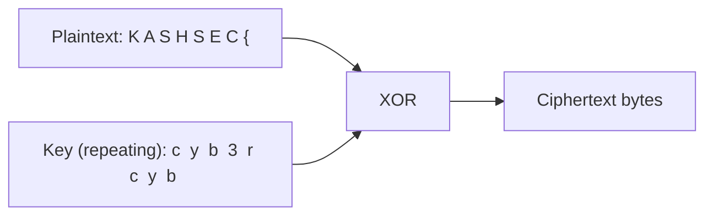

# Crypto — Break the XOR Cipher

**Category:** Crypto · **Difficulty:** Hard

## Scenario

You've intercepted a message encrypted with a **repeating-key XOR cipher** — a genuinely weak but historically common encryption scheme where a short secret key is repeated over and over and XORed byte-by-byte against the plaintext. This challenge is harder than the others in this section: no encoding-format shortcuts, just a real (if classic) known-plaintext cryptanalysis technique.

## Provided data

The ciphertext, as hex bytes:

```
2838317b21263a194b421126100002504d16402d044814562d520d3d070557001f
```

Remember from the briefing lesson: every flag in this section starts with the exact same 8 characters — `KASHSEC{`.

## Your task

Recover the encryption key, then decrypt the full message.

## Background — how repeating-key XOR works

XOR (exclusive-or) has a property that makes it perfectly reversible with the same key: `plaintext XOR key = ciphertext`, and `ciphertext XOR key = plaintext` again. With a **repeating** key shorter than the message, the key is just cycled: byte 0 of the plaintext is XORed with byte 0 of the key, byte 1 with byte 1 of the key, and once the key runs out, it wraps back to byte 0 again.



This repetition is exactly the cipher's fatal weakness, and exactly what makes it breakable with a **known-plaintext attack**: if you already know (or can guess) even a small chunk of the plaintext, XORing that known plaintext against the corresponding ciphertext bytes recovers the key directly — because `ciphertext XOR known_plaintext = key`.

:::challenge Recover the key and decrypt
<details><summary>Hint 1 — the crib</summary>You already know the first 8 plaintext bytes with certainty: <code>KASHSEC{</code>. That's your "known plaintext," or <strong>crib</strong>, in cryptanalysis terms. Convert both the first 8 bytes of the ciphertext and the string <code>KASHSEC{</code> to their raw byte values, and XOR them together, position by position.</details>
<details><summary>Hint 2 — spotting the key length</summary>Once you XOR the first 8 ciphertext bytes against <code>KASHSEC{</code>, write out the resulting 8 bytes as characters. You should see a short, readable sequence start repeating partway through — that repetition tells you exactly how long the real key is, and the non-repeating portion before it starts over <em>is</em> the key.</details>
<details><summary>Hint 3 — decrypting the rest</summary>Once you have the key (it should be a short, readable word), XOR it — repeating it to match length — against the <em>entire</em> ciphertext, not just the first 8 bytes, to recover the complete plaintext message.</details>
<details><summary>Show full answer</summary>XORing the first 8 ciphertext bytes against the known crib <code>KASHSEC{</code> recovers the byte sequence <code>c y b 3 r c y b</code> — and the repetition of <code>c-y-b</code> starting at position 5 makes it clear the actual key is just the first 5 bytes: <strong><code>cyb3r</code></strong>. Repeating that 5-byte key across the <em>entire</em> ciphertext (cycling <code>c-y-b-3-r-c-y-b-3-r...</code> for as many bytes as the message is long) and XORing it against every ciphertext byte recovers the full original plaintext.</details>
:::

## The flag

```
KASHSEC{x0r_r3p34ts_g1ve_1t_4w4y}
```

## Why this matters beyond the CTF

Known-plaintext attacks against repeating-key XOR are a genuine, historically significant cryptanalysis technique — this exact class of weakness broke real ciphers long before modern cryptography existed, and it's a staple beginner exercise on platforms like CryptoPals for exactly this reason: it teaches the core insight that **any predictable structure in your ciphertext (a known or guessable prefix, letter-frequency patterns, repeated blocks) can be leveraged to attack it.** This is precisely why modern, properly designed encryption (AES in an authenticated mode, for instance) is built specifically to resist these categories of structural attack — repeating-key XOR predates that generation of cryptographic engineering by decades and shows exactly what it was designed to fix.

:::danger Never roll your own crypto
This challenge exists to build attacker intuition, not to suggest XOR ciphers belong anywhere near real systems. If you ever need real confidentiality in a project, use established, audited libraries and algorithms (AES-GCM, ChaCha20-Poly1305) — never a custom scheme, no matter how "obfuscated" it seems. This exact principle is echoed throughout Path 06 and Path 07's discussions of cryptography done wrong.
:::

**Next up →** [Linux — The Privesc Puzzle](#/lesson/14-ctf-challenges/linux-privesc-challenge)
