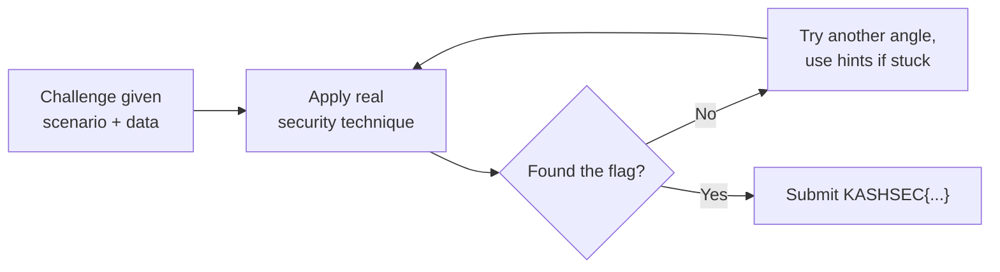

# Welcome to the CTF Zone

Every other path in this course teaches you a specific skill, one concept at a time. This one is different: it's a **standalone practice arena**. No new material to learn here — just puzzles that make you *apply* everything from the paths before, under the same kind of pressure a real CTF competition or bug bounty program puts you under: incomplete information, a specific goal, and no one holding your hand through the steps.

## What is a CTF?

**Capture The Flag (CTF)** is the security industry's dominant competition format — used everywhere from weekend hobbyist competitions to DEF CON's world championship. The structure is simple: challenges hide a secret string called a **flag**, and your job is to find it using real security techniques. Whoever (or whichever team) collects the most flags first wins.

## The flag format used in this section

Every challenge here uses the same flag format: **`KASHSEC{...}`** — the curly braces contain the actual answer, in lowercase-with-hyphens unless a challenge says otherwise. This is a real, universal CTF convention (competitions typically use their own name as the flag prefix), so getting comfortable with it here transfers directly to real platforms.

## The challenge categories you'll see

| Category | What it tests | Which path taught the foundation |
|---|---|---|
| **Web** | Finding and exploiting flaws in web applications | Path 07 — Web Security & Hacking |
| **Crypto** | Decoding, breaking, or analyzing encoded/encrypted data | Referenced across Paths 06, 07, 11 |
| **Forensics** | Analyzing logs, artifacts, or captured data for evidence | Path 08 — Network Security, Path 11 — DFIR |
| **Misc** | Doesn't fit a clean category — lateral thinking required | Everywhere — this is the "creativity" bucket |
| **Linux/Privesc** | Finding a path from limited access to full control | Path 03 — Linux, Path 11 — Advanced |

Difficulty is marked on every challenge as **Easy**, **Medium**, or **Hard** — start with Easy regardless of how confident you're feeling; CTF-style puzzle-solving is its own skill on top of the underlying technical knowledge, and building that muscle gradually pays off.

## How to actually approach a CTF challenge

This is the part most beginners skip, and it's the actual skill being tested — not just technical knowledge:

1. **Read the scenario twice before touching anything.** CTF challenges hide clues in the framing, not just the technical data. A detail that seems like flavor text is often load-bearing.
2. **Enumerate everything you're given.** List every piece of data provided — headers, encoded strings, log lines — before deciding what to do with any of it. Jumping straight to an attempt usually means missing something.
3. **Form a hypothesis, then test it cheaply.** Don't commit to one theory and grind on it for an hour — if a quick test doesn't support it, move to the next hypothesis.
4. **Use hints as a last resort, not a first move.** Every challenge in this section includes progressively revealing hints hidden in `
` blocks — try genuinely stuck for at least 10–15 minutes before opening the first one. The struggle is where the actual learning happens.
5. **Once solved, read the full walkthrough anyway.** Even (especially) if you solved it your own way, the walkthrough often shows a cleaner or more realistic approach — comparing methods is how you actually improve.

:::tip This mirrors real bug bounty and pentest work
The exact loop above — read carefully, enumerate everything, form and test a hypothesis, iterate — is precisely what a real penetration test or bug bounty hunt looks like day to day. CTF practice isn't just a game bolted onto this course; it's rehearsal for the actual job.
:::

## A note on scope and safety

Every challenge in this section is entirely self-contained — you're working with data provided directly in the lesson (log excerpts, encoded strings, request/response examples), not attacking any live system. This means you can practice freely with zero legal or ethical concerns. When you're ready to test these same skills against real (legally sanctioned) targets, revisit the **golden rule of permission** from Path 01, and use platforms like TryHackMe, Hack The Box, or PortSwigger's free labs, all referenced throughout this course.

:::challenge Test yourself
Why does "read the scenario twice before touching anything" matter more in CTF challenges than it might seem at first?

Show answer
CTF challenge authors deliberately embed clues in the framing and context of a scenario, not only in the raw technical data — a mentioned timestamp, an offhand detail about who a fictional user is, or the specific wording of the goal can all be the exact hint needed to narrow down which technique applies. Beginners who skip straight to poking at the technical artifact often miss this context entirely and end up trying techniques essentially at random, which is both slower and less educational than deliberately reading for clues first. This mirrors real security work directly: a client's scope document or a bug bounty program's policy page often contains details that meaningfully change your approach, and skimming past them costs real time later.

:::

## Recap

- CTFs test applied security skill through self-contained puzzles that hide a flag (`KASHSEC{...}` in this section).
- Challenges span Web, Crypto, Forensics, Misc, and Linux/Privesc categories, each tied back to a path earlier in this course.
- The real skill is the approach: read carefully, enumerate everything, hypothesize and test cheaply, use hints sparingly, and review the walkthrough even after solving it yourself.
- Everything here is self-contained and safe to practice freely — no live systems, no legal gray areas.

???refs
- [CTFtime](https://ctftime.org/) — the central hub for real, live CTF competitions worldwide, most of them free to join.
- [PicoCTF](https://picoctf.org/) — a free, beginner-friendly, always-available CTF platform built by Carnegie Mellon University.
- [OverTheWire: Bandit](https://overthewire.org/wargames/bandit/) — a classic free wargame for building exactly the Linux skills this section's privesc challenge draws on.
???

**Next up →** [Web — The IDOR Hunt](#/lesson/14-ctf-challenges/web-idor-hunt)
