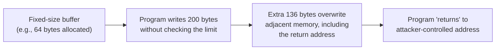

# Exploit Development Basics

The exploitation lesson covered using Metasploit's existing exploit modules. This lesson pulls back the curtain slightly on where those modules actually come from — a genuinely deep specialization, introduced here at a conceptual level appropriate for this stage of the course.

## The gap between "vulnerability" and "exploit"

Path 10's vulnerability-management lesson defined a vulnerability as a weakness that *could* be exploited — this lesson addresses the gap between that theoretical possibility and an actual, working exploit. Not every vulnerability has a publicly available, ready-to-use exploit; **exploit development** is the process of turning a discovered vulnerability into working code that reliably triggers it.

## Exploit-DB and searchsploit: where public exploits actually live

The scan-and-enumerate lesson mentioned `searchsploit`, the command-line interface to **Exploit-DB**, a public archive of exploit code contributed by the security research community. Genuinely useful to understand: an exploit found here was written by someone who went through exactly the process this lesson describes, then published it for others to use — directly connecting to the open, community-driven culture Path 01's community-joining lesson described.

## A conceptual overview: buffer overflows

The classic, foundational exploit development topic, worth understanding conceptually even without writing one yourself at this stage: a **buffer overflow** occurs when a program writes more data into a fixed-size memory buffer than it was allocated to hold, potentially overwriting adjacent memory — including, in the classic case, the return address controlling what code executes next. A carefully crafted overflow can redirect execution to attacker-controlled code, turning a memory-safety bug into full code execution.

## Why memory-safe languages matter here

Directly connecting to Path 04's Python-focused material: buffer overflows are largely a risk specific to languages like C and C++, which give direct, unchecked memory access for performance reasons. Languages with built-in memory safety (Python, among many others) structurally prevent this entire vulnerability class — a genuinely important reason "which language was this written in" is a real, practical security-relevant question, not just a stylistic preference.

## The exploit development process, at a high level

1. **Vulnerability discovery** — finding the actual flaw, often through fuzzing (automatically feeding a program large volumes of malformed input to find crashes) or manual code review
2. **Crash analysis** — understanding exactly why and how the discovered input causes abnormal behavior
3. **Control flow hijacking** — determining whether and how the crash can be turned into genuine control over program execution, not just a denial-of-service crash
4. **Payload development** — crafting the actual code that runs once execution has been redirected, directly connecting to the exploitation lesson's coverage of reverse shells
5. **Reliability testing** — ensuring the exploit works consistently across the range of target configurations it's meant to affect, not just once under ideal lab conditions

## Why this remains a specialized, deep skill

This lesson is deliberately conceptual rather than hands-on — genuine exploit development requires assembly-language fluency, deep operating-system internals knowledge, and considerable practice, representing one of the most specialized, advanced tracks within offensive security, well beyond this path's introductory scope. Recognizing the process and vocabulary now is exactly the same "recognition before depth" pattern this course has used throughout, with genuine hands-on depth available through dedicated resources like the ones this lesson's references point to.

:::challenge Test yourself
Why does a memory-safe language like Python structurally prevent the buffer overflow vulnerability class this lesson described, rather than just making it less common?

Show answer
A buffer overflow specifically requires a program to write data past a fixed memory boundary without the language or runtime catching the error — C and C++ allow this because they provide direct, unchecked access to memory as a deliberate performance and control tradeoff, trusting the developer to manage bounds correctly themselves. Memory-safe languages like Python (and many other modern languages) automatically track buffer and array boundaries at the language or runtime level, raising an exception or otherwise refusing the operation the moment code attempts to write past an allocated boundary — meaning the specific memory-corruption mechanism buffer overflow exploitation depends on simply cannot occur in the first place, not just that it's statistically less likely. This is exactly the "eliminate the vulnerability class structurally" pattern this course has emphasized repeatedly, here applied at the programming-language level rather than through a specific coding practice.

:::

## Key terms

- **Exploit development** — the process of turning a discovered vulnerability into working code that reliably triggers it.
- **Buffer overflow** — writing data past a fixed-size memory buffer's boundary, potentially overwriting adjacent memory including control-flow data.
- **Fuzzing** — automatically feeding a program large volumes of malformed input to discover crashes and vulnerabilities.

## Recap

- Exploit development bridges the gap between a discovered vulnerability and a working, reliable exploit — genuinely deep, specialized work most public Exploit-DB entries represent the finished product of.
- Buffer overflows are the classic foundational topic, largely specific to memory-unsafe languages like C/C++, and structurally prevented by memory-safe languages like Python.
- This remains one of the most advanced offensive security specializations, introduced here conceptually rather than hands-on, consistent with this course's recognition-before-depth approach.

**Next up →** [Post-exploitation & pivoting](#/lesson/14-ethical-hacking/post-exploitation)
