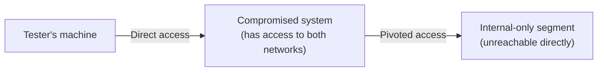

# Pivoting & Tunneling

The lateral-movement lesson covered reaching other systems on the *same* network. This lesson covers the genuinely distinct technique for reaching systems on a *different*, otherwise unreachable network segment — using an already-compromised system as a relay point.

## What pivoting actually solves

Directly connecting to Path 12's network-segmentation lesson: a well-segmented network means a tester's (or attacker's) machine, positioned outside the target network entirely, simply cannot directly reach an internal-only segment — no route exists. **Pivoting** uses an already-compromised system that genuinely does have access to that internal segment as a relay, routing further traffic through it to reach systems that would otherwise be completely unreachable.



## SSH tunneling: the foundational technique

Path 03's SSH lesson mentioned tunneling as a "genuinely useful (and sometimes risky) side feature." This is exactly that feature, applied offensively: an SSH connection to a compromised system can forward traffic through it, letting a tester's tools interact with internal systems as if directly connected, using the compromised system purely as a relay.

```bash
ssh -D 9050 user@compromised-system    # dynamic port forwarding, creating a SOCKS proxy
```

## Port forwarding: local vs. remote

- **Local port forwarding** — makes a remote internal service accessible on the tester's own local machine, as if it were running locally
- **Remote port forwarding** — the reverse: makes a service on the tester's machine accessible from the compromised system's network, useful for delivering additional tools into an otherwise-isolated segment

## Proxychains: routing existing tools through a pivot

**Proxychains** lets standard tools (Nmap, from Path 12; curl, from Path 03) route their traffic through an established SSH tunnel or SOCKS proxy without needing to be specifically rewritten for pivoting — meaning the entire toolkit this course has built throughout can be reused against a pivoted network, not just specialized pivot-only tools.

## Multi-hop pivoting: chains of compromised systems

Real engagements sometimes require pivoting through *multiple* compromised systems in sequence — network A reachable only through a foothold in network B, itself only reachable through an initial foothold in network C — directly reflecting how real enterprise network segmentation (Path 12, Path 24) often layers multiple boundaries rather than just one, requiring a tester to chain multiple pivots to reach a genuinely deep target.

:::challenge Test yourself
Why does well-designed network segmentation (Path 12) make pivoting necessary at all, rather than an attacker simply being blocked from ever reaching an internal segment?
<details><summary>Show answer</summary>Segmentation controls <em>which network paths exist and are permitted</em> — it doesn't eliminate the possibility that a legitimately positioned system (one that genuinely needs access to both an external-facing segment and an internal-only one, for entirely legitimate operational reasons) exists somewhere within the architecture. Pivoting doesn't defeat segmentation directly — it uses a system that segmentation was <em>designed</em> to allow through, as a relay for additional traffic beyond what that system's own legitimate function requires. This is exactly why Path 12's own segmentation lesson emphasized designing segments around genuine trust boundaries and monitoring what crosses them, rather than assuming a segmented network is inherently safe from lateral reach — a compromised, legitimately-positioned relay point remains a real and predictable risk that segmentation alone doesn't fully close, which is exactly why monitoring what crosses segment boundaries (not just the boundaries' existence) matters as much as the segmentation itself.</details>
:::

## Key terms

- **Pivoting** — using an already-compromised system as a relay to reach an otherwise unreachable network segment.
- **SOCKS proxy** — a proxy created via SSH dynamic port forwarding, letting tools route traffic through a compromised system.
- **Proxychains** — a tool routing standard command-line tools' traffic through an established pivot.

## Recap

- Pivoting reaches network segments a tester can't access directly, using an already-compromised system with legitimate access to both networks as a relay.
- SSH tunneling (local and remote port forwarding) is the foundational technique, and Proxychains lets existing tools be reused against a pivoted network without modification.
- Multi-hop pivoting through several compromised systems in sequence reflects how real enterprise segmentation often layers multiple boundaries, requiring chained pivots to reach a genuinely deep target.

**Next up →** [Writing a penetration test report](#/lesson/14-ethical-hacking/reporting)
