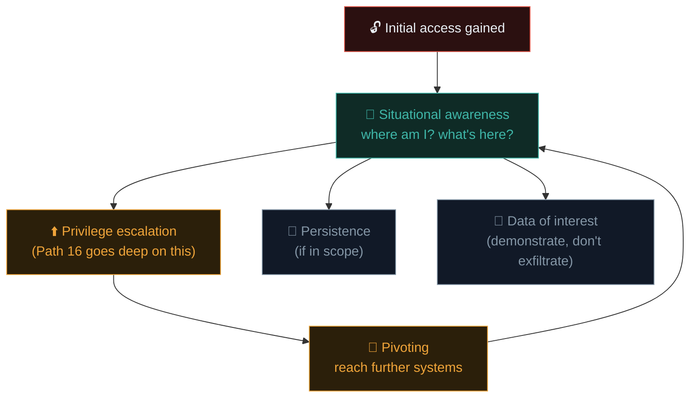
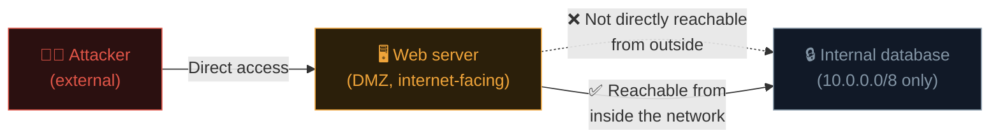

# Post-exploitation & pivoting

Getting initial access is rarely the end goal in a real assessment — it's the beginning of demonstrating **actual business impact**. This phase is what separates "I found a vulnerability" from "here's exactly what a real attacker could achieve with it."

## Why post-exploitation matters so much

Recall the kill chain from Path 10.3 — exploitation (gaining initial access) is just one link. Real attackers, and therefore realistic testing, continue toward **actions on objectives**. A single low-privilege foothold on one machine rarely represents the full risk to an organisation — the question post-exploitation answers is: *from here, how much further could a real attacker actually get?*

## The core post-exploitation objectives



## Situational awareness — the first move on any new foothold

Once you have a shell, before doing anything else, understand exactly where you are:

```bash
# On Linux:
whoami; id; hostname; uname -a
ip a
cat /etc/passwd                    # what users exist?
sudo -l                            # what can I run as another user?
history                            # what has this user done recently?
find / -writable -type d 2>/dev/null   # writable directories (privesc clues)

# On Windows (if using Meterpreter or a Windows shell):
whoami /all
systeminfo
ipconfig /all
net user
net localgroup administrators
```

This is exactly the enumeration mindset from Path 14.4, now applied **from inside** a compromised machine rather than from outside.

## Privilege escalation — a preview

Path 16 dedicates entire lessons to Linux and Windows privilege escalation in depth. The core idea, briefly: your initial foothold is often a **low-privilege** account, and the real business impact usually requires becoming **root/Administrator**, or at least a more privileged user, through misconfigurations, vulnerable software, weak permissions, or credential reuse discovered on the compromised host itself.

```bash
# A quick privesc-hunting habit worth building now:
find / -perm -4000 -type f 2>/dev/null   # SUID binaries (recall Path 03.10!)
sudo -l                                    # sudo misconfigurations
```

## Pivoting — using one compromised host to reach others

**Pivoting** means using access to one compromised machine as a stepping stone to reach other systems that weren't directly reachable before — often internal systems with no direct internet exposure, discoverable only from *inside* the network you've now gained a foothold in.



This is exactly why "one compromised web server" can turn into "the entire internal network is at risk" — the compromised server becomes the attacker's new vantage point, with its own network access used as a bridge.

### Practical pivoting with Metasploit

```bash
# Once you have a Meterpreter session on a dual-homed host:
meterpreter > run autoroute -s 10.0.0.0/24
meterpreter > background

# Now Metasploit can route further scans/exploits through that session:
use auxiliary/scanner/portscan/tcp
set RHOSTS 10.0.0.0/24
run
```

### SSH tunneling — a manual pivoting technique

```bash
# Local port forward: reach an internal service through a compromised SSH host:
ssh -L 8080:internal-server:80 user@compromised-host

# Now http://localhost:8080 on YOUR machine actually reaches
# internal-server:80, tunneled through the compromised host.

# Dynamic port forward (a full SOCKS proxy through the compromised host):
ssh -D 9050 user@compromised-host
# Then configure tools (proxychains, Burp) to route through 127.0.0.1:9050
```

```bash
# proxychains lets you run ANY tool through that SOCKS tunnel:
proxychains nmap -sT 10.0.0.5
```

## Credential harvesting from a compromised host

A high-value target on nearly any foothold: credentials already sitting on the machine, left behind by legitimate users and processes. Worth checking systematically: browser-saved passwords, plaintext credentials in configuration files or scripts (a genuinely common finding — connection strings, API keys, and service account passwords hardcoded rather than stored in a proper secrets manager), SSH private keys sitting unencrypted in a user's `.ssh` directory, and command history files that sometimes reveal a password typed directly on the command line by mistake. On Windows specifically, tools like **Mimikatz** can extract credentials directly from memory (LSASS) — a technique Path 16's Active Directory material covers in real depth, since a single set of harvested domain credentials can sometimes unlock far more of a network than the original vulnerability alone ever would.

```bash
# Quick manual credential-hunting on a fresh Linux foothold:
grep -ri "password" /etc/*.conf /var/www/**/*.php 2>/dev/null
cat ~/.bash_history | grep -i "pass\|ssh\|mysql"
find / -name "*.pem" -o -name "id_rsa" 2>/dev/null
```

Any credentials found this way should be **tested, not blindly trusted** — a stale password in a config file might belong to an account that's already been rotated, but a working one can dramatically expand what the rest of the engagement is able to demonstrate.

## Persistence — usually carefully scoped, sometimes excluded entirely

**Persistence** means establishing a way to regain access even if the original vulnerability is patched or the session is lost (a scheduled task, a new user account, a backdoor). In professional engagements, persistence testing is often:

- **Explicitly scoped and time-limited** in the RoE — testing whether persistence *would* be possible, without necessarily leaving it in place for the engagement's full duration.
- **Always documented precisely** — exactly what was created, where, so it can be **fully removed** during cleanup (the next section).
- Sometimes **excluded entirely** from scope, especially in engagements focused purely on initial-access vulnerability discovery rather than full attack-chain simulation.

## Demonstrating impact without causing harm

The goal of accessing sensitive data during a test is to **prove the risk**, not to actually exfiltrate or misuse it:

- Take a screenshot showing *access* to a sensitive file/database table exists, rather than downloading and retaining the actual data.
- Note the **type and volume** of accessible sensitive data ("access to a table containing ~50,000 customer records including names, emails, and hashed passwords") without copying the full dataset out.
- Never modify, delete, or leak anything found — the entire point is responsible demonstration, echoing the white-hat distinction from Path 14.1.

## Cleanup — an essential, often-overlooked final step

Before an engagement concludes, professional testers must **remove every artifact** created during testing:

- Delete any test accounts, backdoors, or scheduled tasks created for persistence testing.
- Remove any uploaded tools, scripts, or web shells.
- Restore any configuration files that were modified for testing purposes.
- Document this cleanup explicitly in the final report, confirming what was removed and when.

Leaving testing artifacts behind — even accidentally — is both a professional failure and a potential new vulnerability the client didn't ask for and doesn't know about.

## 🧪 Lab — Practise pivoting concepts in your lab

Using your Metasploitable VM from previous labs (assume you've gained a shell via Path 14.5's vsftpd exploit):

```bash
# From within your Meterpreter session:
meterpreter > sysinfo
meterpreter > ipconfig    # or 'ifconfig' depending on target OS

# Check what other networks this host can see that you couldn't reach directly:
meterpreter > run autoroute -s <discovered-internal-subnet>
```

Even without a true second internal segment set up, practise the **situational awareness** commands (`whoami`, `sudo -l`, `find / -perm -4000`) on your compromised Metasploitable shell, and write a short note on what you'd look at next if you were trying to escalate privileges or find a path deeper into a network from this exact position.

:::challenge Test yourself
A tester gains a low-privilege shell on an internet-facing web server during an authorized engagement, and discovers that server also has network access to an internal database server that isn't directly reachable from the internet. What's the name for using the web server as a stepping stone to reach that internal database?

<details><summary>Show answer</summary><strong>Pivoting.</strong> The compromised web server's own network position and access becomes the attacker's (or tester's) new vantage point, letting them reach systems that were never directly exposed to their original external position — exactly the scenario diagrammed in this lesson.</details>
:::

## Key terms

- **Post-exploitation** — activity after initial access, demonstrating actual business impact.
- **Pivoting** — using one compromised host's network access to reach otherwise-unreachable systems.
- **Persistence** — establishing a way to regain access even after the original vulnerability is fixed.
- **SSH tunneling / SOCKS proxy** — manual techniques for routing traffic through a compromised host.
- **Cleanup** — removing all testing artifacts before an engagement concludes.

## Recap

- Post-exploitation demonstrates real business impact — situational awareness, privilege escalation, and pivoting all build toward this.
- Pivoting uses one compromised host's network position to reach otherwise-unreachable internal systems.
- Sensitive data access should be demonstrated, not exfiltrated — proving risk without causing harm.
- Persistence testing is carefully scoped and always followed by thorough documentation for cleanup.
- Cleanup — removing every testing artifact — is an essential, non-optional final step before an engagement ends.

???refs
- [Metasploit Unleashed — Pivoting](https://www.offsec.com/metasploit-unleashed/pivoting/) — official, detailed pivoting guide.
- [HackTricks — Pivoting](https://book.hacktricks.xyz/generic-methodologies-and-resources/pivoting-to-the-cloud) — extensive practical techniques reference.
- [SSH tunneling — a practical guide (SSH Academy)](https://www.ssh.com/academy/ssh/tunneling)
- [PTES — Post Exploitation](http://www.pentest-standard.org/index.php/Post_Exploitation) — methodology reference.
???

**Next up →** [Writing a penetration test report](#/lesson/14-ethical-hacking/reporting)
