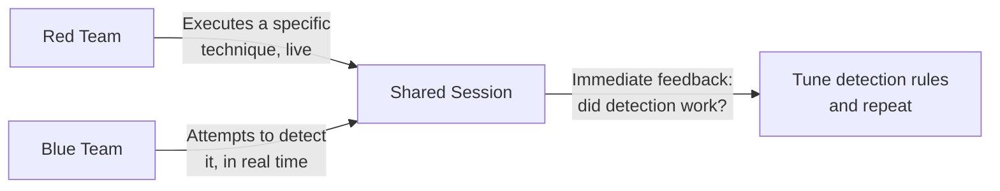

# Purple Teaming Basics

The red-team-vs-pentest lesson previewed purple teaming as a collaborative alternative. This closing conceptual lesson covers exactly what that collaboration looks like in practice, before this path's roadmap and hands-on labs — genuinely the approach that ties offense and defense together most directly.

## What purple teaming actually is

**Purple teaming** isn't a separate team at all — it's a collaborative methodology where red team (offense, everything this path has taught) and blue team (defense, Path 08's monitoring and Path 16's DFIR material) work together in real time, rather than the red team operating covertly the way a true red team engagement does.

## Why the collaborative approach solves a real limitation

A covert red team engagement (from the previous lesson) tests detection capability, but only reveals the *outcome* — did the blue team catch it or not — without necessarily revealing *why* a specific technique succeeded or failed to trigger detection. Purple teaming closes this gap directly: the red team executes a specific, known technique, and the blue team simultaneously attempts to detect it, with immediate feedback and discussion about exactly what did or didn't trigger an alert.

## MITRE ATT&CK as the shared vocabulary

Purple team exercises commonly organize around the **MITRE ATT&CK framework** — a structured catalog of real-world adversary tactics and techniques (directly connecting to the MITRE ATT&CK mapper tool elsewhere in this course) — systematically testing detection coverage across specific, named techniques rather than an unstructured, ad-hoc exercise, ensuring genuine breadth of coverage rather than only testing whatever techniques happen to come to mind.

## A practical purple team exercise, step by step

1. **Select a specific technique** from the ATT&CK framework (Pass-the-Hash, from the lateral-movement lesson, for instance)
2. **Red team executes it**, in a controlled, observed manner
3. **Blue team monitors in real time**, checking whether their existing detection rules and tools actually caught it
4. **Immediate joint review** — if detection succeeded, confirm it worked as intended; if it failed, understand exactly why and tune detection rules accordingly
5. **Repeat across the ATT&CK matrix**, building genuine, measured detection coverage technique by technique

## Why organizations increasingly prefer this approach

Directly connecting to Path 10's security-metrics lesson: purple teaming produces genuinely measurable, technique-by-technique detection coverage data — a concrete answer to "which specific attacker techniques would we actually catch" — rather than the more binary, less specific "did the red team get caught or not" signal a covert engagement alone provides. This makes purple teaming genuinely well-suited to organizations wanting to systematically build and measure detection capability over time, not just periodically test it.

:::challenge Test yourself
Why does purple teaming provide more actionable, specific feedback than a covert red team engagement, even though both ultimately test detection capability?

Show answer
A covert red team engagement provides a valuable but relatively coarse signal — the blue team either detected the overall campaign or didn't, often without clear visibility into exactly which specific techniques, among potentially dozens used throughout the engagement, actually triggered (or failed to trigger) a detection response. Purple teaming isolates and tests one specific, named technique at a time with both teams collaborating and observing simultaneously, producing immediate, specific feedback: "this exact technique, executed this exact way, did or didn't generate an alert, and here's precisely why." This technique-by-technique granularity is exactly what lets a blue team make targeted, specific improvements to their detection rules — tuning the exact gap just identified — rather than needing to infer, from a single overall pass/fail outcome, which of many possible techniques used throughout a longer covert engagement was actually the one that slipped past detection.

:::

## Key terms

- **Purple teaming** — a collaborative methodology where red and blue teams work together in real time to test and improve detection capability.
- **MITRE ATT&CK framework** — a structured catalog of real-world adversary tactics and techniques, commonly used to organize purple team exercises.

## Recap

- Purple teaming brings red and blue teams together in real time, providing immediate, specific feedback about exactly which techniques a blue team's detection actually catches, closing a gap covert red team engagements alone leave open.
- The MITRE ATT&CK framework provides shared, structured vocabulary for systematically testing detection coverage technique by technique.
- Purple teaming's measurable, technique-specific results make it genuinely well-suited to organizations building detection capability over time, directly connecting to Path 10's emphasis on measuring security programs rather than assuming they work.

**Next up →** [Your ethical hacking roadmap](#/lesson/14-ethical-hacking/eh-roadmap)
