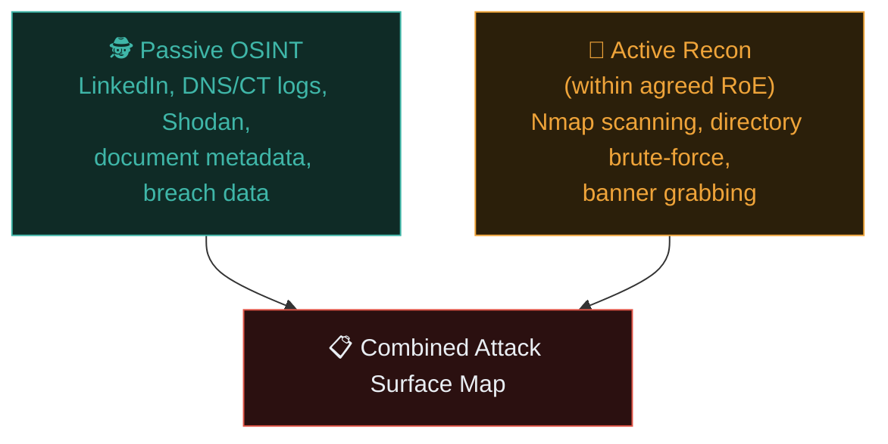

# Reconnaissance in practice

Path 11.3 taught web-focused recon techniques. This lesson broadens that into the fuller reconnaissance discipline used across an entire professional engagement — covering people, infrastructure, and organisational context, not just a single web application.

## OSINT — Open Source Intelligence

**OSINT** is the practice of gathering intelligence entirely from publicly available sources — no direct interaction with the target's systems required, echoing "passive recon" from Path 11.3, now applied organisation-wide.

### People-focused OSINT

Relevant especially when social engineering (Path 10.6) is in scope:

- **LinkedIn** — employee names, roles, org structure, technologies mentioned in job postings (a company hiring for "Kubernetes experience" tells you their infrastructure stack).
- **Company websites** — "About us" and team pages, press releases, case studies mentioning specific vendors/technologies.
- **Social media** — employees' public posts sometimes reveal internal tool names, office locations, travel schedules (useful for physical security assessments), or technology complaints ("ugh, our VPN is so slow again").
- **Breach databases** — checking whether employee emails appear in known breaches (Have I Been Pwned, Path 10.5) — a compromised personal password reused at work is a realistic initial-access vector many real attackers exploit.

### Infrastructure-focused OSINT

Direct extensions of Path 11.3's techniques, now systematically covering an entire organisation:

```bash
# Subdomain enumeration across the whole company, not just one app:
subfinder -d example.com -all

# Certificate transparency for the full picture:
curl -s "https://crt.sh/?q=%.example.com&output=json" | jq -r '.[].name_value' | sort -u

# ASN and IP range discovery — what does this company actually own?
whois -h whois.radb.net -- '-i origin AS64512'

# Shodan for exposed infrastructure across all discovered IP ranges:
shodan search net:203.0.113.0/24
```

### Document metadata — an often-overlooked goldmine

Publicly posted PDFs, Word documents, and images frequently contain **metadata** revealing usernames, software versions, internal file paths, and sometimes even printer/device names:

```bash
# Download some public PDFs from the target's site, then:
exiftool document.pdf

# Or use a dedicated metadata harvesting tool:
metagoofil -d example.com -t pdf,doc,xls -l 20 -o metadata-results
```

Finding real internal usernames (`jsmith`, `a.patel`) via document metadata is a classic, quietly effective recon technique — those usernames become the basis for later password-spraying attempts (within agreed RoE) in the exploitation phase.

## Combining OSINT with active recon

Recall the passive/active distinction from Path 11.3. A full professional recon phase layers both:



The output of this phase is a genuinely comprehensive picture: every subdomain, every employee name that could inform password guessing or phishing simulation (if in scope), every technology in use and its likely CVEs, and every publicly-exposed document that might contain something sensitive.

## Building a recon report — even at this early stage

Professional recon doesn't just collect data — it's organised into something the next phases (and eventually the client) can act on:

```markdown
## Reconnaissance Summary — Example Corp

### Infrastructure
- 47 subdomains identified, 12 resolving to live hosts
- Primary tech stack: nginx, PHP 7.4 (EOL — flag as finding), MySQL
- 3 IP ranges owned (ASN lookup), all in AWS us-east-1

### People
- 340 employees identified via LinkedIn
- 15 employee emails found in prior public breach datasets (2019 Collection #1)
- Engineering team job postings mention Kubernetes, Terraform, Jenkins

### Documents
- 8 public PDFs analysed; metadata revealed 4 internal usernames
  and confirmed Microsoft Office 2016 in use internally

### Preliminary observations
- PHP 7.4 reached end-of-life in Nov 2022 — no further security patches (A06)
- Multiple employee emails in breach data suggest credential-stuffing risk
```

Even this early-stage document is genuinely valuable — some organisations commission **recon-only** engagements specifically to understand their own external footprint, without any active exploitation at all.

## Recon-specific ethical considerations

- **Passive OSINT is generally lower legal risk** (you're querying third-party public records, not the target), but always respect the RoE's boundaries around what's considered fair game — some clients explicitly exclude employee social-engineering-style OSINT even in an otherwise broad engagement.
- **Never contact employees directly** during recon unless social engineering testing is explicitly authorized in the RoE — casual "just checking" outreach can itself constitute an unauthorized action.
- **Document everything as you go** — which source, what you found, when — both for the eventual report and to maintain a clear record if any scope question arises later.

## GitHub and code-hosting reconnaissance

Public code repositories are consistently one of the highest-value, most overlooked recon sources — developers routinely commit things they shouldn't, and even after deletion, Git's history often preserves them permanently unless the repository is fully rewritten. Worth checking systematically: an organisation's public GitHub org for repos with internal-sounding names accidentally left public, commit history for hardcoded API keys or credentials (tools like **TruffleHog** and **Gitleaks** automate scanning entire commit histories for exactly this pattern), and even individual employees' personal repositories, which sometimes contain internal scripts, config file templates, or infrastructure-as-code snippets referencing real internal hostnames. This directly extends the JavaScript source-mining technique from Path 11.3 — the same "developers leave more in public artifacts than they realise" principle, applied to source control instead of shipped client-side code.

```bash
# Scanning a public repo's full commit history for leaked secrets:
trufflehog git https://github.com/example-org/example-repo
```

## Automating recon with your Python skills

Recall Path 04's tool-building lessons — professional recon is very often partially automated:

```python
#!/usr/bin/env python3
"""
recon-aggregator.py — Pull together subdomain enum, live-host check,
and basic tech fingerprinting into one summary report.
"""
import subprocess
import json

def get_subdomains(domain: str) -> list[str]:
    result = subprocess.run(
        ["subfinder", "-d", domain, "-silent"],
        capture_output=True, text=True
    )
    return result.stdout.strip().splitlines()

def check_alive(subdomains: list[str]) -> list[dict]:
    # httpx checks which hosts actually respond and grabs basic info
    result = subprocess.run(
        ["httpx", "-silent", "-json", "-tech-detect"],
        input="\n".join(subdomains), capture_output=True, text=True
    )
    return [json.loads(line) for line in result.stdout.strip().splitlines() if line]

def main():
    domain = "example.com"
    subs = get_subdomains(domain)
    print(f"[*] Found {len(subs)} subdomains")
    alive = check_alive(subs)
    print(f"[*] {len(alive)} hosts responded")
    for host in alive:
        print(f"  {host.get('url')} — {host.get('tech', [])}")

if __name__ == "__main__":
    main()
```

This is a genuinely realistic starting point for the kind of recon automation Path 15 (Bug Bounty) will build much further.

## 🧪 Lab — A full OSINT pass on a company you're comfortable researching

Pick a public company (not for testing — purely OSINT research, which is legal against any public information). Spend 30 minutes building a small recon summary:

1. How many subdomains can you find via crt.sh?
2. What technologies does their careers page mention needing?
3. Search for any of their public PDFs/documents — any interesting metadata?
4. Compile a short summary in the format shown above.

This is a genuinely safe way to practise the *research and synthesis* skill of recon without any active-technique legal concerns at all.

:::challenge Test yourself
A tester finds an employee's personal email address in a public breach dataset during OSINT recon. Is directly emailing that employee to "test" whether they'd click a phishing link an appropriate next step?

<details><summary>Show answer</summary>Only if <strong>social engineering testing of employees is explicitly authorized</strong> in the signed Rules of Engagement. Absent that specific authorization, contacting employees directly — even with good intentions, even using legitimately-found public information — falls outside the recon phase's passive/OSINT boundary and could constitute an unauthorized action. This finding should instead be documented as a <em>risk observation</em> ("credential reuse risk identified") for the report, not acted upon directly without explicit separate approval.</details>
:::

## Key terms

- **OSINT** — intelligence gathered entirely from publicly available sources.
- **Document metadata** — hidden data embedded in files, often revealing usernames or internal software versions.
- **ASN (Autonomous System Number)** — identifies which organisation owns a block of IP address space.
- **Recon report** — the organised output of the reconnaissance phase, actionable even before any exploitation begins.

## Recap

- Full professional recon covers people, infrastructure, and documents — not just a single web application's surface.
- OSINT (passive) and active recon (within RoE) combine into a comprehensive attack surface map.
- Document metadata is an often-overlooked but genuinely valuable recon source.
- Recon output should be organised into a clear summary, valuable even as a standalone deliverable.
- Employee-focused OSINT requires explicit separate authorization before any direct action — recon findings about people are documented as risk, not acted upon without permission.

???refs
- [OSINT Framework](https://osintframework.com/) — a categorised index of OSINT tools and techniques.
- [Have I Been Pwned](https://haveibeenpwned.com/) — checking for employee credential exposure in breach data.
- [ExifTool](https://exiftool.org/) — the standard tool for extracting file metadata.
- [ProjectDiscovery — httpx](https://github.com/projectdiscovery/httpx) — fast, scriptable live-host probing and tech detection.
???

**Next up →** [OSINT Tools, Deep Dive](#/lesson/14-ethical-hacking/osint-tools-deep-dive)
