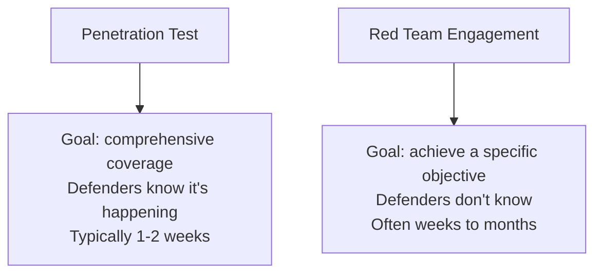

# Red Team vs. Penetration Testing

You've now covered the full 5-phase pentest methodology. This lesson clarifies a genuinely common point of confusion — "red teaming" and "penetration testing" get used almost interchangeably in casual conversation, but they're meaningfully different engagement types with different goals, scope, and success criteria.

## Penetration testing: comprehensive, time-boxed, goal is coverage

A traditional **penetration test**, exactly as this path has taught it, aims for *comprehensive* coverage within an agreed scope and timeframe — finding and reporting as many genuine vulnerabilities as possible across the defined target, typically over one to two weeks, with the client's security team generally aware testing is happening (even if specific timing isn't disclosed in advance).

## Red teaming: narrow, stealthy, goal is a specific objective

A **red team engagement** has a fundamentally different goal: rather than comprehensive coverage, it simulates a real, specific adversary pursuing a specific objective (reaching a particular sensitive database, demonstrating a path to domain admin) using whatever techniques a real attacker realistically would — and critically, the target organization's own defensive team (the "blue team") typically does *not* know an engagement is happening, testing genuine detection and response capability, not just technical vulnerability.

## Why the distinction matters practically

- **Success criteria differ fundamentally** — a pentest is judged by how many genuine vulnerabilities were found and documented; a red team engagement is judged by whether the specific objective was achieved, and just as importantly, whether the defensive team detected and responded to the activity at all
- **Stealth is the entire point of red teaming** — a pentest generally doesn't need to avoid detection (and detection isn't really the point); a red team engagement specifically measures an organization's actual detection and response capability, meaning being caught partway through can be a valid, informative outcome, not necessarily a failure
- **Scope differs accordingly** — a pentest's RoE (from earlier in this path) typically defines specific in-scope systems comprehensively; a red team's RoE often defines a specific objective and broader "rules" (what's off-limits) rather than an exhaustive system list, since the whole point is simulating how a real attacker would actually find their own path

## Purple teaming, previewed

A collaborative approach where red team (offense) and blue team (defense) work together in real time, rather than the red team operating covertly — genuinely useful for training and capability-building rather than pure assessment, covered fully in this path's next lesson.

:::challenge Test yourself
Why might an organization specifically choose a red team engagement over a penetration test, even though it covers less ground comprehensively?

Show answer
A comprehensive pentest answers "what vulnerabilities exist across our defined scope," which is genuinely valuable — but it doesn't answer a different, equally important question: "if a real, determined attacker specifically targeted us and used whatever techniques worked, would our security team actually notice and respond in time?" An organization with a mature security program that's already run several comprehensive pentests and addressed the findings may get more genuine value from testing their <em>detection and response capability</em> specifically — exactly what a red team engagement is designed to measure, since a pentest's typical "defenders know it's happening" assumption doesn't test detection capability the same realistic way an undisclosed, objective-driven red team engagement does. The choice between the two depends entirely on what question the organization actually needs answered: broad vulnerability coverage, or realistic detection-and-response capability.

:::

## Key terms

- **Red team engagement** — a covert, objective-driven simulation of a specific adversary, testing detection and response capability, not just vulnerability coverage.
- **Blue team** — an organization's defensive security team, whose detection and response capability a red team engagement specifically tests.

## Recap

- Penetration testing aims for comprehensive vulnerability coverage within a known, agreed timeframe; red teaming aims for a specific objective, covertly, testing whether an organization actually detects and responds to realistic attack activity.
- Success criteria, stealth requirements, and scope definition all differ fundamentally between the two engagement types, despite sharing many of the same underlying technical techniques this path has taught.
- Purple teaming offers a collaborative middle ground, covered fully in the next lesson.

**Next up →** [Social Engineering in Pentests](#/lesson/14-ethical-hacking/social-engineering-in-pentests)
