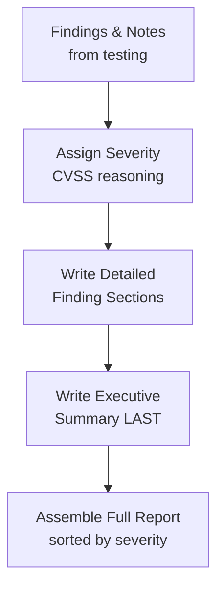

# Reporting Lab

This is the final lab in Path 14, and arguably covers the single most underrated skill in offensive security: **writing the report.** A brilliant finding that's poorly communicated often gets deprioritized or ignored entirely — the report is the actual deliverable a client pays for, not the exploitation itself.

## Tasks

1. **Take notes during exploitation, as you go.** Revisit one of your earlier labs (the Metasploit lab or the practical recon lab are good candidates) and, if you didn't already, reconstruct your process from memory and any screenshots you have: what you tried, what worked, what didn't. Real testers take notes continuously during an engagement — reconstructing everything from memory afterward, as you're doing here, is exactly the painful lesson that teaches why.
2. **Write an executive summary.** This is the single most-read section of any report — often the *only* section a non-technical stakeholder reads. In 3–4 sentences, plain language, no jargon: what was tested, what was found overall, and how serious it is. Practice writing this section *last*, once you know your full findings, even though it appears first in the document.
3. **Document findings with severity ratings.** For each finding, use the CVSS reasoning from the main Reporting lesson to justify a severity (Critical/High/Medium/Low), and write it up with: **Title**, **Description**, **Steps to Reproduce**, **Impact**, and **Evidence** (screenshots or request/response pairs).
4. **Provide clear, specific remediation steps.** "Fix the SQL injection" is not a useful remediation. "Use parameterized queries for all database calls involving user input; specifically, replace the string-concatenated query in `login.php` line 42" is. Specificity is what makes a remediation section actually actionable for a development team.
5. **Assemble a complete sample report.** Combine everything into one document (Markdown is perfectly fine, and genuinely common in the industry) with a clear structure: Executive Summary → Scope & Methodology → Findings (sorted by severity, highest first) → Appendix (raw evidence/logs).

6. **Peer-review someone else's finding for clarity.** Swap your written finding from Task 3 with a fellow learner (or, if working solo, set it aside for a day and re-read it cold) and specifically check: could someone with zero prior context reproduce the exact steps without needing to ask a single clarifying question? Ambiguity that felt obvious while you were writing it — because you already knew what you meant — is often invisible to the person who wrote it and glaringly obvious to a fresh reader, which is exactly why real security teams build peer review into their reporting process rather than shipping a single author's first draft.

:::tip A report is written for two audiences at once
Every real pentest report needs to work for both a non-technical executive (who reads only the executive summary and cares about business risk) and a technical engineer (who reads the detailed findings and needs exact reproduction steps to fix the issue). Writing with both audiences in mind — plain language up top, precise technical detail below — is a skill worth deliberately practicing, not an afterthought.
:::

:::challenge Write a full report from an earlier lab
Choose any lab you've completed earlier in this course (Metasploit, XSS, SQLi, or any other) and write a complete report using the structure above: executive summary, at least two findings with full detail and CVSS-based severity, and specific remediation for each. If possible, get feedback from a peer or mentor — Path 20's networking lesson covers exactly where to find people willing to review this kind of work.
:::

## Key takeaway

Technical skill finds the vulnerability; clear reporting is what actually gets it fixed. A finding that never gets communicated in a way stakeholders can act on has essentially zero real-world impact, no matter how impressive the exploit behind it was — which is exactly why reporting is treated as a core skill throughout this entire path, not an afterthought tacked onto the end.

**Explore more →** [Path 15 — Bug Bounty](#/lesson/15-bug-bounty)
