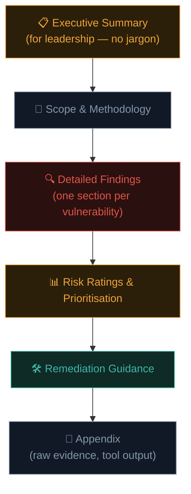

# Writing a penetration test report

Here's an uncomfortable truth every professional tester eventually learns: **a brilliant finding that's poorly communicated helps no one.** The report is the actual deliverable a client pays for — not the exploitation itself. This lesson teaches you to write one properly.

## Why the report matters more than beginners expect

The client didn't hire you to have fun hacking their systems — they hired you to **understand their risk and know how to fix it**. A report that's technically impressive but unclear, poorly prioritised, or missing remediation guidance fails the actual purpose of the entire engagement, no matter how skilled the underlying testing was.

## The anatomy of a professional report



### Executive Summary

Written for **non-technical leadership** — the people who read one page and make budget/priority decisions based on it. No jargon, no CVE numbers, no code snippets. Answer three questions: *What did we test? What did we find, in business terms? What should you do about it, urgently or otherwise?*

```markdown
## Executive Summary

Between June 1–14, 2026, KashSec Security conducted an authorized penetration
test of Example Corp's customer portal (app.example.com). We identified 3
critical, 5 high, and 8 medium-severity findings.

The most significant issue allows any authenticated user to access other
customers' private financial records without authorization (a critical
access-control flaw), representing substantial regulatory and reputational
risk given the sensitivity of the data involved. We recommend this be
remediated immediately, ahead of the other findings in this report.

Overall, the application demonstrates [reasonable/concerning/poor] baseline
security practices, with the majority of findings falling into [access
control / injection] categories.
```

### Scope & Methodology

A factual record of what was actually tested, when, by whom, and how — directly drawing from Path 14.2's pre-engagement documentation and the phase-by-phase work of this entire path.

### Detailed Findings — the core of the report

Each individual finding should consistently answer four things, echoing the structure introduced back in Path 11.9:

```markdown
### Finding #3: IDOR in Invoice Retrieval Endpoint

**Severity:** Critical
**CVSS 3.1 Score:** 8.2 (High) — AV:N/AC:L/PR:L/UI:N/S:U/C:H/I:N/A:N
**OWASP Category:** A01:2021 - Broken Access Control

**Description:**
The `/api/invoices/{id}` endpoint does not verify that the requesting
user owns the requested invoice ID, allowing any authenticated user to
retrieve any other user's invoice data by simply modifying the ID
parameter.

**Steps to Reproduce:**
1. Log in as a low-privilege test account (user_a@test.com)
2. Navigate to "My Invoices" and note your own invoice ID (e.g., 1024)
3. Using Burp Repeater, change the request to `/api/invoices/1025`
4. Observe the response returns another user's invoice data in full

**Evidence:**
[Screenshot of Burp Repeater request/response showing the data leak]

**Impact:**
An attacker with any valid account could enumerate and access every
customer's financial invoice data, including names, addresses, and
billing details — a severe privacy and potentially regulatory
(GDPR/PCI) violation.

**Remediation:**
Implement server-side authorization checks on every invoice retrieval,
verifying the requesting user's ID matches the invoice's owner_id
before returning data. See OWASP's Access Control Cheat Sheet for
detailed guidance: [link]
```

This four-part structure — **description, steps to reproduce, impact, remediation** — plus severity/scoring, is the industry-standard skeleton for every individual finding, regardless of report template or company.

## Severity ratings — using CVSS properly

Recall Path 10.2's introduction to CVSS. Real reports use it (or a similarly structured internal rating scale) to give findings an objective, comparable severity score rather than relying purely on subjective "this seems bad" judgment:

| CVSS Score | Severity |
|---|---|
| 9.0–10.0 | Critical |
| 7.0–8.9 | High |
| 4.0–6.9 | Medium |
| 0.1–3.9 | Low |

Use the [official CVSS calculator](https://www.first.org/cvss/calculator/3.1) to generate both the score and the vector string (`AV:N/AC:L/...`) shown in the example above — this gives clients (and any auditors reviewing the report later) a transparent, reproducible basis for the assigned severity, not just your personal opinion.

## Writing for two very different audiences, simultaneously

A single report typically needs to satisfy both:

- **Executives/management** — care about business risk, regulatory exposure, and "how much will this cost to fix, and how urgently." Read the Executive Summary only, most of the time.
- **Engineers/developers** — need exact technical detail, reproduction steps, and specific remediation guidance to actually *fix* the issue. Read the Detailed Findings section closely.

Writing findings that satisfy both audiences (a clear one-paragraph business-impact statement, followed by precise technical reproduction steps) is a genuinely valuable, learnable skill — and one of the biggest differentiators between junior and senior testers in practice.

## Common reporting mistakes to avoid

- **Vague reproduction steps** ("try some SQL injection payloads") instead of the exact request/payload that worked.
- **Missing business impact** — a CVE number and a CVSS score alone don't tell a non-technical stakeholder *why they should care*.
- **Inconsistent severity ratings** across findings — always ground severity in a consistent methodology (CVSS or an internally documented equivalent), not gut feeling that varies finding to finding.
- **No remediation guidance**, or generic, unhelpful guidance ("fix the vulnerability") instead of specific, actionable direction.
- **Overwhelming the reader with raw tool output** in the main body — raw Nmap/Burp/sqlmap output belongs in an **appendix**, referenced from the finding, not pasted inline disrupting the narrative.

## The readout call — the report isn't the final step

A written report is rarely the last thing a client receives — most professional engagements close with a **readout call**, where the tester walks through the findings live with both the executive and engineering audiences together, in real time. This matters because reports get skimmed, misread, or shelved, while a live conversation lets a client ask "wait, does this affect our payment system too?" and get an immediate, precise answer — the kind of nuance a static document can't anticipate for every reader. Being able to explain a critical finding clearly out loud, adjusting your language on the fly for whoever's actually in the room, is a genuinely distinct skill from writing the report itself, and it's exactly the kind of communication ability that separates testers clients want to hire again from those who technically did fine work nobody remembers fondly.

## Retesting — closing the loop on remediation

The engagement doesn't truly end at report delivery either — most contracts include a **retest window**, typically 30-90 days later, where the tester specifically re-verifies that each reported finding was actually fixed, rather than just trusting the client's word for it. A retest report is much shorter than the original, structured simply as a per-finding status: **Fixed** (re-attempted and confirmed no longer exploitable), **Not Fixed** (still exploitable exactly as before), or **Partially Fixed** (the original exact reproduction steps no longer work, but a related, weaker variant of the issue remains). This closing-the-loop step is precisely what turns a one-time snapshot of risk into genuine risk *reduction* — a report full of findings that never get verified as fixed provides far less real security value than the same report followed by a rigorous retest.

## Responsible disclosure — reporting outside a formal contract

The reporting discipline in this lesson applies just as directly to **bug bounty submissions** (Path 15) and **responsible disclosure** to vendors without a formal contract — the same four-part structure (description, reproduction, impact, remediation) is exactly what a well-written bug bounty report or CVE submission needs, just typically shorter and without the Executive Summary/Scope sections meant for a formal client relationship.

## 🧪 Lab — Write a real finding from your own lab work

Using any vulnerability you successfully exploited in your Metasploitable labs across Paths 14.4–09.6 (the vsftpd backdoor, an SMB misconfiguration, whatever you found), write a **complete finding** following the exact template in this lesson:

1. Title and severity (look up a real or reasonable CVSS score if applicable)
2. Description
3. Steps to reproduce (precise enough that someone else could follow them exactly)
4. Impact (in both technical and business terms)
5. Remediation guidance (specific, actionable)

This single exercise — writing one finding properly — is more valuable practice than reading ten more pages of theory, and directly transferable to real bug bounty submissions in the very next path.

:::challenge Test yourself
A report states: "SQL injection was found in the login form. This is bad and should be fixed." What's missing that would make this a professional-quality finding?

<details><summary>Show answer</summary>Nearly everything from the four-part structure: <strong>exact reproduction steps</strong> (which field, what payload, what request), <strong>concrete impact</strong> (what could actually be accessed/done — full database dump? authentication bypass?), a <strong>severity rating</strong> grounded in a consistent methodology like CVSS, and <strong>specific remediation guidance</strong> (parameterised queries, not just "fix it"). "This is bad and should be fixed" is an opinion, not a professional finding — it gives the reader no way to verify, prioritise, or act on it.</details>
:::

## Key terms

- **Executive Summary** — the non-technical, business-focused opening section for leadership readers.
- **CVSS score/vector** — the standardised severity scoring system (Path 10.2), giving objective comparability across findings.
- **Four-part finding structure** — description, reproduction steps, impact, remediation — the universal skeleton for any professional finding.
- **Responsible disclosure** — reporting vulnerabilities outside a formal contract, following the same core reporting discipline.

## Recap

- The report is the actual deliverable clients pay for — technical skill without clear communication fails the engagement's real purpose.
- Every finding should include description, exact reproduction steps, business and technical impact, and specific remediation guidance.
- CVSS scoring grounds severity ratings in a consistent, defensible methodology rather than subjective judgment.
- Reports must serve both executive and engineering audiences simultaneously — a skill that distinguishes senior testers.
- This exact reporting discipline transfers directly to bug bounty submissions and responsible vendor disclosure.

???refs
- [OWASP Testing Guide — Reporting](https://owasp.org/www-project-web-security-testing-guide/) — methodology-aligned reporting guidance.
- [FIRST — CVSS 3.1 Calculator](https://www.first.org/cvss/calculator/3.1) — the official scoring tool used throughout this lesson.
- [SANS — Sample penetration test report templates](https://www.sans.org/security-resources/) — real-world template examples.
- [HackerOne — How to write a great vulnerability report](https://www.hackerone.com/blog/introduction-writing-great-bug-bounty-reports) — directly applicable to Path 15's bug bounty context.
???

**Next up →** [Your ethical hacking roadmap](#/lesson/14-ethical-hacking/eh-roadmap)
