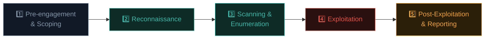

# The 5 phases of penetration testing

Every professional penetration test follows a broadly consistent structure. Understanding this framework turns scattered technique knowledge (Paths 11-08) into a repeatable, professional methodology.

## The five phases



This lesson gives the overview of all five; the next lessons in this path go deep on Recon, Scanning/Enumeration, Exploitation, and Post-Exploitation/Reporting individually.

## Phase 1: Pre-engagement & Scoping

Before any technical activity begins, the tester and client agree on:

- **Scope** — exactly which systems, IP ranges, domains, and applications are in bounds. Equally important: what's explicitly **out of scope** (e.g., "do not test the payment processor's actual production systems, use the sandbox").
- **Rules of Engagement (RoE)** — testing windows (business hours only? 24/7?), prohibited techniques (no DoS testing without prior approval), emergency contact procedures if something breaks.
- **Type of test** — black box (tester has zero prior knowledge, simulating an external attacker), grey box (some information provided, like valid credentials, simulating an insider or post-phishing scenario), or white box (full source code and architecture access, simulating the deepest possible review).
- **Legal authorization** — the signed contract and explicit written permission from Path 14.1.

```
Example scope excerpt:
IN SCOPE:      *.example.com, 203.0.113.0/24
OUT OF SCOPE:  payments.example.com (third-party PCI processor)
TESTING WINDOW: Mon-Fri, 09:00-18:00 UTC only
PROHIBITED:    Denial-of-service testing, social engineering of employees
                without separate written approval
EMERGENCY CONTACT: security-oncall@example.com, +1-555-0100
```

Skipping or rushing this phase is the single most common cause of legal and professional problems in this field — a huge fraction of "accidental" scope violations trace back to ambiguous or poorly-documented pre-engagement agreements.

## Phase 2: Reconnaissance

Exactly what you practised in Path 11.3 — gathering information about the target, both passively (OSINT, DNS, certificate transparency) and actively (within the agreed RoE). The next lesson in this path goes deeper specifically on recon in the context of a *formal, scoped* engagement, including social-engineering-adjacent OSINT relevant to Path 14.3.

## Phase 3: Scanning & Enumeration

Building directly on Path 12's Nmap skills — systematically discovering live hosts, open ports, running services, and their versions across the *entire* in-scope environment (not just one target, as in earlier single-lesson labs). **Enumeration** goes a level deeper than scanning: actively querying discovered services for more detail — listing shares on an SMB server, usernames from an SNMP service, directories on a web server (Path 11.3's brute-forcing). This phase produces the **attack surface map** that the exploitation phase will actually work against.

## Phase 4: Exploitation

Actively attempting to leverage discovered vulnerabilities to gain access, exactly as practised throughout Path 11 (SQLi, XSS, IDOR) and touched on in Path 12 (Wi-Fi cracking, MITM). In a professional engagement, this phase is disciplined and **methodical** — every attempted exploit, successful or not, is logged with a timestamp, exactly what was tried, and the result, both for the eventual report and in case anything needs to be traced back or explained later.

## Phase 5: Post-Exploitation & Reporting

Once access is gained, professional testers typically go further than "I got in" — demonstrating **real business impact** (what data could actually be accessed, could you escalate privileges, could you pivot to other systems) within the agreed scope and RoE, then **clean up** (removing any tools, backdoors, or test accounts created during testing), and finally produce a **clear, actionable report** — covered in full depth in Path 14.7.

## A worked example, phase by phase

Imagine a scoped web application test:

1. **Pre-engagement:** Client signs SOW; scope is `app.example.com` only, testing window is next two weeks, grey-box with one low-privilege test account provided.
2. **Recon:** Subdomain enum finds `staging.example.com` accidentally also resolving — flagged to the client as a potential scope question before touching it further (proper professional judgment, not assumed permission).
3. **Scanning/Enumeration:** Nmap identifies the web server, an exposed API on a non-standard port, and outdated jQuery version via tech fingerprinting.
4. **Exploitation:** Using the provided low-privilege account, an IDOR is found (Path 11.4) allowing access to other users' data; further testing finds a stored XSS (Path 11.5) in a comment field.
5. **Post-exploitation/Reporting:** The IDOR is chained with the XSS to demonstrate a realistic attack: a malicious comment steals another user's session cookie, then that stolen session is used to access their private data via the IDOR — a much stronger, more business-relevant finding than either bug reported in isolation. This chained scenario, along with clear remediation guidance for each issue, becomes the centerpiece of the report.

That chaining — connecting multiple individually "medium" findings into one higher-impact scenario — is a hallmark of experienced, high-quality penetration testing versus a purely automated scan.

## Assumed breach — starting from "the attacker is already inside"

A distinct engagement model worth knowing about: rather than starting from zero external access and working through all five phases to gain a foothold, an **assumed breach** test deliberately hands the tester a foothold from the start — a low-privilege domain account, a workstation on the internal network — and skips straight to phases 3 through 5 from that internal starting point. The reasoning is pragmatic: real breaches very often *do* start from a successful phishing email or a single compromised credential, so testing "what happens after that inevitable first foothold" produces more realistic, more useful findings about lateral movement and privilege escalation (Path 16's dedicated territory) than spending the entire engagement's limited time budget on the initial-access phase alone. Many mature organisations run assumed-breach tests specifically *because* they've already invested heavily in perimeter defence and want to know what happens if — not if, but when — that perimeter is eventually bypassed.

## Purple teaming — collaboration instead of pure adversary simulation

Where a traditional penetration test (or the more adversarial "red team" from Path 14.1's discipline comparison) deliberately withholds its findings until the final report, **purple teaming** takes a fundamentally collaborative approach: the offensive tester (red) and the defensive SOC team (blue) work together in real time, with the red side narrating each technique as they execute it so the blue side can immediately check whether their detection tooling actually caught it. The explicit goal isn't "did we get in" — it's "did our detection and response actually work, and if not, exactly which specific rule or process needs fixing." This tight feedback loop, directly building on the SIEM/detection-coverage concepts from Path 12.5, tends to improve an organisation's actual defensive posture faster than a traditional report-and-wait engagement, precisely because gaps get identified and understood in the moment rather than discovered weeks later in a PDF.

## Why methodology matters more than tool knowledge alone

A beginner with deep tool knowledge but no methodology tends to jump randomly between techniques, missing systematic coverage and losing track of what's already been tried. A professional with strong methodology, even with more modest tool depth, produces **complete, reliable, defensible** results — because the process itself ensures nothing is skipped and everything is properly documented. This is precisely why this path exists as a distinct topic from Paths 11-08's technique-focused content.

## 🧪 Lab — Draft a mini scope document

For a hypothetical engagement (invent a small fictional company, or use one of the legal practice targets from Path 11/08 as your "client"), draft a short scope document covering:

1. What's explicitly in scope and out of scope.
2. Testing window and any prohibited techniques.
3. Black box, grey box, or white box — and why you chose that approach for this scenario.
4. An emergency contact process (invented, but realistic).

This exercise — thinking like the *client* defining boundaries, not just the tester executing techniques — is genuinely valuable perspective-building for anyone entering this field professionally.

:::challenge Test yourself
During reconnaissance, a tester discovers a subdomain that appears to belong to the target company but wasn't explicitly listed in the agreed scope document. What's the correct professional action?

<details><summary>Show answer</summary><strong>Pause and clarify with the client before testing it further.</strong> Scope documents are the legal and ethical boundary of the entire engagement — an unlisted subdomain might be intentionally excluded (third-party hosted, a different business unit, explicitly out of bounds for a specific reason), or it might simply be an oversight the client would want added. Either way, assuming permission and proceeding without clarification is exactly the kind of scope-boundary mistake that turns legitimate work into a serious professional and legal problem.</details>
:::

## Key terms

- **Scope** — the explicitly defined systems/applications authorized for testing.
- **Rules of Engagement (RoE)** — the formal document defining testing windows, prohibited techniques, and procedures.
- **Black box / grey box / white box** — testing approaches differing by how much prior information the tester is given.
- **Enumeration** — actively querying discovered services for deeper detail beyond simple scanning.
- **Chaining** — combining multiple individual findings into one higher-impact, realistic attack scenario.

## Recap

- The 5 phases — pre-engagement, recon, scanning/enumeration, exploitation, post-exploitation/reporting — structure every professional penetration test.
- Pre-engagement scoping and RoE are the most legally and professionally critical phase, despite being the least "technical."
- Methodology, not just tool knowledge, is what separates professional-quality results from ad-hoc technique application.
- Chaining multiple findings into one realistic scenario demonstrates far greater business impact than reporting bugs in isolation.
- Encountering unscoped systems during testing always requires pausing for clarification, never assumed permission.

???refs
- [PTES — Penetration Testing Execution Standard](http://www.pentest-standard.org/) — the detailed methodology this lesson's structure is based on.
- [NIST SP 800-115 — Technical Guide to Information Security Testing and Assessment](https://csrc.nist.gov/pubs/sp/800/115/final) — official US methodology guidance.
- [OWASP Testing Guide](https://owasp.org/www-project-web-security-testing-guide/) — detailed phase-by-phase web-specific methodology.
???

**Next up →** [Pentest Methodologies & Standards](#/lesson/14-ethical-hacking/pentest-methodologies-standards)
