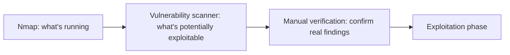

# Vulnerability Scanning Tools

The scan-and-enumerate lesson covered Nmap's role in this phase. This lesson introduces the other major tool category in this same phase: dedicated **vulnerability scanners** — automated tools that go beyond "what's open" to "what's actually exploitable."

## What a vulnerability scanner actually adds beyond Nmap

Nmap (from the scan-and-enumerate lesson) identifies open ports and running services. A dedicated vulnerability scanner takes this further, checking discovered services against a continuously updated database of known vulnerabilities (directly connecting to Path 10's CVE/CVSS lesson) — essentially automating the process of asking "given that this specific service and version is running, what known vulnerabilities might apply?"

## Nessus and OpenVAS: the standard tools

- **Nessus** — a widely-used commercial vulnerability scanner (with a limited free tier), performing comprehensive scans across network services, web applications, and configuration issues, producing detailed reports mapped to CVE identifiers and CVSS scores
- **OpenVAS** — a genuinely capable open-source alternative, providing similar core functionality without Nessus's licensing cost, a common choice for a home lab or for organizations wanting to avoid commercial licensing

## Why automated scanning has real, honest limitations

Directly connecting to Path 11's WAF-limitations lesson's honest framing: a vulnerability scanner checks for *known* vulnerability signatures — it has no way to discover a genuinely novel flaw, and it's particularly weak against the business-logic vulnerabilities Path 11 covered, since those require understanding an application's actual intended workflow rather than matching a known signature. A scanner is a starting point for a real assessment, never a substitute for the manual technique this entire path teaches.

## False positives: a genuine, time-consuming reality

Automated scanners routinely flag findings that turn out not to actually apply — a service reporting an outdated version string in its banner without actually being vulnerable to the associated CVE, for instance. Verifying scanner output manually before including it in a final report (the reporting lesson later in this path) is a genuinely essential, unglamorous part of real vulnerability-assessment work, directly connecting to Path 10's vulnerability-management lesson's point about exposure-based prioritization over raw automated output.

## Where scanning fits in a real engagement

A thorough engagement uses automated scanning to efficiently cover broad ground, then applies the manual verification and deeper technique this entire path teaches to the specific findings a scanner surfaces — combining automation's scale with human judgment's accuracy.

:::challenge Test yourself
Why is a vulnerability scanner particularly weak at finding the business-logic vulnerabilities covered in Path 11?

Show answer
A vulnerability scanner works fundamentally by matching discovered services and software versions against a database of <em>known</em> vulnerability signatures — it has no understanding of what a specific application is actually supposed to do, or what a legitimate business workflow within that application should look like. Business logic vulnerabilities, as Path 11 explained, don't involve any malformed input or recognizable attack signature at all — every individual request looks completely legitimate; the flaw only becomes apparent when a human tester understands the intended workflow well enough to recognize that a particular sequence of otherwise-valid actions produces an unintended outcome. A scanner has no generic mechanism for understanding "what should this specific application's checkout flow actually allow," which is exactly why this category of vulnerability requires genuine manual testing and understanding, no matter how sophisticated the automated scanning tooling becomes.

:::

## Key terms

- **Vulnerability scanner** — automated tooling checking discovered services against a database of known vulnerabilities.
- **False positive (scanning context)** — a flagged finding that, on manual verification, doesn't actually apply to the target.

## Recap

- Nessus and OpenVAS are the standard vulnerability scanning tools, extending Nmap's service discovery into actual known-vulnerability matching against CVE databases.
- Automated scanning has genuine, honest limitations — no ability to find novel flaws, and particular weakness against business logic vulnerabilities — directly echoing Path 11's WAF-limitations framing.
- A thorough engagement combines automated scanning's efficient coverage with manual verification and technique, never relying on scanner output alone.

**Next up →** [Exploitation techniques](#/lesson/14-ethical-hacking/exploitation)
