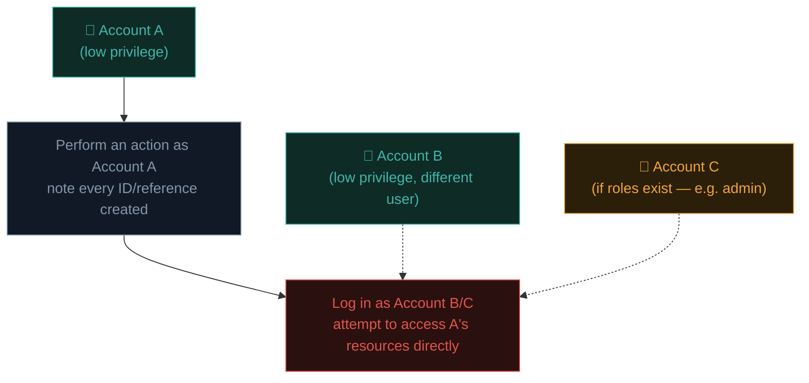

# Hunting for IDOR & access control bugs

Recall Path 11.1: Broken Access Control is the #1 OWASP category, and it's consistently one of the most-reported bug classes on every major bounty platform. This lesson turns Path 11.4's IDOR fundamentals into a systematic, repeatable hunting methodology.

## Why IDOR is a bug bounty hunter's best friend

- **High frequency** — genuinely common across nearly every application with multi-user data.
- **Low tooling barrier** — no exotic tools required, mostly manual testing with Burp (which you already know from Path 11.2).
- **Clear, demonstrable impact** — "I can see another user's private data" is immediately, viscerally understandable to any triager, unlike more abstract vulnerability classes.
- **Scales with account creation** — most programs allow (even encourage) creating multiple test accounts specifically to test exactly this bug class.

## The systematic multi-account methodology

The single most important habit: **always test with two (or more) accounts of your own.**



1. Create **at least two** separate accounts (many programs explicitly permit and expect this for exactly this kind of testing).
2. Using **Account A**, perform every meaningful action the application supports — create an order, upload a document, send a message, update a profile — and **note every ID, reference, or token** generated along the way (Burp's HTTP history from Path 11.2 makes this straightforward to review afterward).
3. Log in as **Account B**, and systematically attempt to access every one of Account A's resources **directly**, by ID, bypassing the normal UI navigation entirely.
4. If a third privilege tier exists (admin, moderator, premium tier), repeat with Account C testing both directions — can a lower-privilege account reach higher-privilege functionality, and does higher-privilege functionality properly verify it's operating on data it's actually authorised for?

## Where to systematically look — a comprehensive checklist

Beyond the obvious URL-parameter IDOR from Path 11.4, sweep every one of these locations for **every** feature in an application:

- **URL path segments and query parameters** — `/orders/1024`, `?user_id=42`
- **JSON request bodies** — `{"account_id": 55}`
- **Multi-step workflows** — an ID captured in step 1 of a wizard, reused (and potentially swappable) in step 3
- **File download/export endpoints** — `/export?report_id=88`, `/download/invoice/1024.pdf`
- **WebSocket messages** — increasingly common in modern SPAs (Path 05.7), often less rigorously tested by developers than standard REST endpoints
- **GraphQL queries** — explicitly requesting another user's ID in a query's variables (Path 05.5's GraphQL mention)
- **Batch/bulk endpoints** — `/api/users/bulk?ids=1,2,3,4` — sometimes only the *first* ID in a batch request is authorization-checked, with the rest processed blindly
- **"Duplicate" or "clone" features** — cloning another user's object by referencing its ID, sometimes without checking source ownership
- **Password reset / invite tokens** — are these truly random and unguessable, or sequential/predictable?

## Testing for both flavours systematically

Recall Path 11.4's horizontal vs vertical distinction:

```bash
# Horizontal — same privilege level, different user's data:
curl "https://example.com/api/orders/1024" -H "Cookie: session=ACCOUNT_B_SESSION"
# (Order 1024 belongs to Account A — does Account B see it anyway?)

# Vertical — lower privilege reaching higher-privilege functionality:
curl -X DELETE "https://example.com/api/admin/users/42" -H "Cookie: session=REGULAR_USER_SESSION"
# (Does a regular user's session succeed at an admin-only action?)
```

## Automating ID enumeration responsibly

Once you've confirmed the *pattern* manually (per Path 15.2's rate-limit discipline):

```python
#!/usr/bin/env python3
"""
idor-scan.py — Sweep a range of IDs to check for IDOR, respecting
program rate limits (adjust delay per program policy).
"""
import requests
import time

BASE = "https://example.com/api/invoices"
SESSION_COOKIE = "session=ACCOUNT_B_SESSION_HERE"
YOUR_OWN_IDS = {1025, 1026}   # IDs known to belong to YOUR OWN test accounts

headers = {"Cookie": SESSION_COOKIE}

for invoice_id in range(1000, 1100):
    r = requests.get(f"{BASE}/{invoice_id}", headers=headers, timeout=5)
    if r.status_code == 200 and invoice_id not in YOUR_OWN_IDS:
        print(f"[!] Potential IDOR: invoice {invoice_id} accessible — {len(r.text)} bytes")
    time.sleep(0.5)   # respect rate limits — always check program policy first
```

**Critical ethical note**, directly extending Path 14.6's discipline: the moment you confirm access to **real other users' data** (not your own test accounts), **stop immediately** — do not continue enumerating or downloading further data. Note the pattern, take a screenshot/PoC of the *minimum* evidence needed, and report it right away. Continuing to sweep further "just to see how bad it is" crosses from responsible demonstration into actual data access exceeding what's necessary — exactly the line Path 14.6 and Path 15.4 both warned against.

## Predictable vs random identifiers — a related, adjacent finding

Even *without* a confirmed authorization bypass, **sequential or predictable IDs** are frequently worth reporting as a lower-severity finding in their own right (or as supporting evidence strengthening an IDOR report) — they make any future authorization bug trivially exploitable at scale. Compare:

```
Sequential (risky pattern):  /invoices/1024, /invoices/1025, /invoices/1026
Random UUID (safer pattern): /invoices/f47ac10b-58cc-4372-a567-0e02b2c3d479
```

Recall Path 11.4's defence-in-depth point: switching to unpredictable identifiers doesn't fix a missing authorization check by itself, but it substantially raises the bar for exploitation, and its absence is itself worth documenting.

## GraphQL-specific IDOR hunting

Given GraphQL's rising prevalence (Path 05.5):

```graphql
# A GraphQL query directly requesting another user's data by ID:
query {
  user(id: "1024") {
    email
    billingAddress
    creditCardLast4
  }
}
```

If this query succeeds using Account B's authentication token, targeting Account A's ID, that's a GraphQL-flavoured IDOR/BOLA — test every resolver that accepts an ID argument this same systematic way.

## Indirect IDOR — when the ID isn't obviously an ID

Not every access-control bug involves an obvious numeric identifier. **Indirect IDOR** happens when the vulnerable reference is disguised as something else — a filename that embeds a user's email address (`export_alice@example.com.pdf`), a base64-encoded string that decodes to a predictable internal ID, or a JWT (Path 11.8) whose payload itself contains a swappable user reference the server trusts without re-verifying ownership. These are systematically underreported precisely because they don't *look* like the classic `?id=1024` pattern beginners are trained to spot first — worth developing the habit of decoding and inspecting every opaque-looking token or filename you encounter during testing, rather than only sweeping obviously numeric parameters. A base64 string that decodes into readable JSON containing a user ID is functionally identical to a plain `?user_id=` parameter — it's just wearing a disguise.

## 🧪 Lab — Full IDOR sweep on PortSwigger + your shortlisted program

1. Revisit [PortSwigger's Access Control labs](https://portswigger.net/web-security/access-control) (from Path 11.4) — this time, deliberately practise the **two-account methodology** from this lesson on every lab, even ones that don't strictly require it, to build the habit.
2. On the program you shortlisted in Path 15.2 (only if scope/policy explicitly permits creating multiple test accounts), create two accounts and systematically work through the comprehensive checklist above against every feature the application offers.
3. Document every ID/reference you find using the Burp HTTP history review technique, building your own personal checklist of "features tested" vs "features still to test" for that specific target.

:::challenge Test yourself
While testing an IDOR pattern on a real bug bounty program, you successfully access what appears to be a real customer's private data (not your own test account). What's the correct immediate next action?

<details><summary>Show answer</summary><strong>Stop testing immediately</strong> — do not continue enumerating further IDs or exploring additional data. Capture only the minimum evidence needed to demonstrate the vulnerability (a single screenshot/response showing the access, without saving or exposing the actual customer's sensitive data further), and submit the report right away following Path 15.4's structure. This directly mirrors Path 14.6's "demonstrate, don't exfiltrate" principle — continuing to explore real user data beyond what's necessary to prove the bug crosses from responsible research into a genuine data privacy violation, regardless of good intentions.</details>
:::

## Key terms

- **Multi-account testing methodology** — the systematic practice of using 2+ accounts to test every feature for access control flaws.
- **Horizontal / vertical IDOR** — same-level vs cross-privilege-level unauthorized access (Path 11.4, revisited).
- **Predictable identifier** — sequential or guessable IDs that lower the bar for exploitation even absent a confirmed bypass.
- **GraphQL resolver** — the server-side function fulfilling a GraphQL query, each requiring its own authorization check.

## Recap

- IDOR/access control bugs are high-frequency, low-tooling-barrier, and produce immediately understandable impact — ideal for bug bounty hunting.
- The multi-account methodology (create 2+ accounts, note every ID, cross-test access) is the core systematic technique.
- Sweep every location an ID can appear — URLs, JSON bodies, multi-step workflows, exports, WebSockets, GraphQL, batch endpoints.
- Automated ID sweeping must respect rate limits and stop immediately upon confirming access to real user data.
- Predictable/sequential identifiers are worth reporting even independent of a confirmed authorization bypass.

???refs
- [PortSwigger — Access control vulnerabilities](https://portswigger.net/web-security/access-control) — the definitive free hands-on labs (Path 11.4).
- [OWASP — Insecure Direct Object References](https://owasp.org/www-community/attacks/Insecure_Direct_Object_Reference)
- [HackerOne Hacktivity — IDOR reports](https://hackerone.com/hacktivity?querystring=IDOR) — real, disclosed examples for study.
- [OWASP API Security Top 10 — BOLA](https://owasp.org/API-Security/editions/2023/en/0xa1-broken-object-level-authorization/) — the API-specific parallel.
???

**Next up →** [Hunting XSS & injection bugs](#/lesson/15-bug-bounty/hunting-xss-and-injection)
