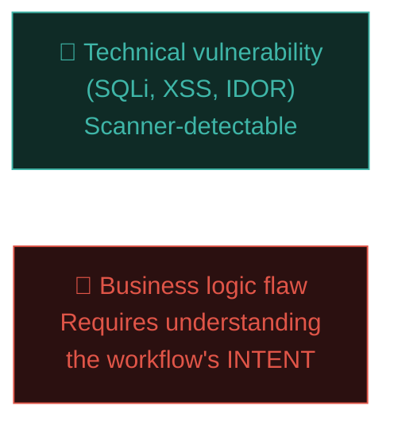
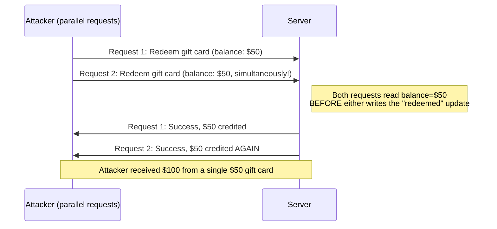
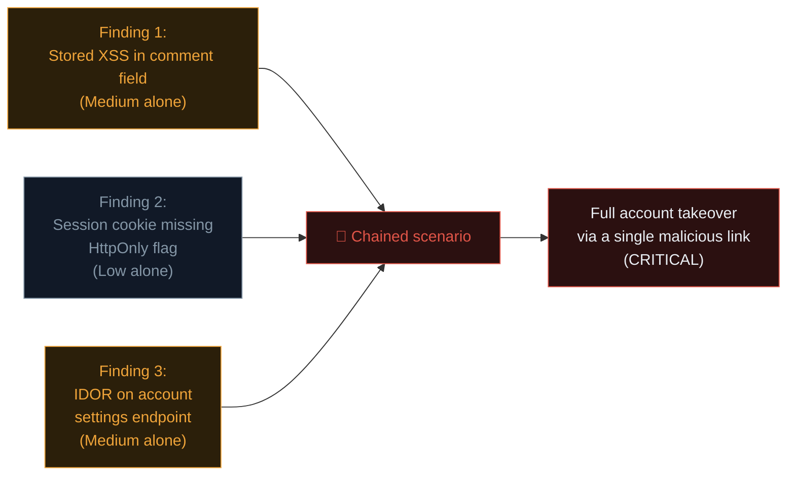

# Business logic flaws & chaining bugs

The bugs covered so far — SQLi, XSS, IDOR — all have a recognisable *technical* signature a scanner could theoretically flag. **Business logic flaws** are different: the code works exactly as written, with no technical vulnerability at all — the *design itself* has a flaw that only a human thinking like an attacker (or a creative user) would spot. This is where experienced hunters consistently find what automated tooling never will.

## What makes business logic flaws different

Recall Path 11.9's brief mention of this category. A SQL injection is a **technical** mistake — input isn't properly parameterised. A business logic flaw might have **flawless** code from a purely technical standpoint, but the *sequence of allowed actions* itself creates an exploitable scenario the developers never anticipated.



## Classic business logic flaw patterns

### Price/quantity manipulation

```
Intended flow: Add item to cart → quantity: 1 → price: $100
Exploited flow: Add item to cart → quantity: -1 → price: -$100
                (some systems then CREDIT the attacker's account balance!)
```

Negative quantities, negative prices, or quantities exceeding available stock are all classic checks developers sometimes forget to validate — because the *UI* only ever lets you select positive integers, the developer assumes the *API* never needs to check for anything else (directly echoing Path 05.3's "never trust the client" lesson).

### Coupon/discount code abuse

```
Intended flow: Apply ONE discount code per order
Exploited flow: Apply the SAME discount code multiple times in rapid
                succession before the "already used" flag is written to
                the database — a race condition (see below) allowing
                the discount to stack far beyond intended limits
```

### Workflow step-skipping

```
Intended flow: Step 1 (enter details) → Step 2 (verify email) →
               Step 3 (payment) → Account activated
Exploited flow: Submit Step 3's request directly, without ever
                completing Step 2's email verification — if the
                server only checks "is this a valid session token"
                rather than "has this user actually completed step 2"
```

### Referral/reward program abuse

```
Intended flow: Refer a friend → both parties get $10 credit
Exploited flow: Create fake "friend" accounts (multiple emails,
                same person) → refer yourself repeatedly →
                accumulate unlimited credit
```

### Password reset / account recovery logic flaws

```
Intended flow: Reset token is single-use, expires in 15 minutes
Exploited flow: Reset token doesn't actually get invalidated after
                use, or doesn't expire — an old, previously-used
                reset link found in an old email still works months later
```

## Race conditions — timing-based logic flaws

A **race condition** exploits the tiny window between a system **checking** a condition and **acting** on it — if an attacker can fire multiple requests fast enough, they can squeeze through that window multiple times before the first request's effects are fully recorded.



```python
#!/usr/bin/env python3
"""
race-condition-test.py — Fire concurrent requests to test for race conditions
(only against systems you're authorized to test).
"""
import requests
import concurrent.futures

URL = "https://example.com/api/redeem-gift-card"
HEADERS = {"Cookie": "session=YOUR_TEST_SESSION"}
PAYLOAD = {"code": "GIFT-CARD-CODE-1024"}

def redeem():
    return requests.post(URL, json=PAYLOAD, headers=HEADERS, timeout=5)

# Fire 20 requests as close to simultaneously as possible:
with concurrent.futures.ThreadPoolExecutor(max_workers=20) as pool:
    futures = [pool.submit(redeem) for _ in range(20)]
    results = [f.result().status_code for f in futures]

success_count = results.count(200)
print(f"Successful redemptions: {success_count} (expected: 1)")
```

If a single-use gift card, discount code, or "claim your free item" action succeeds more than once when fired concurrently, that's a genuine, often high-severity race condition — and increasingly well-understood and actively hunted across major bounty programs today.

## OAuth flow logic flaws

OAuth ("Sign in with Google/GitHub/Facebook") deserves its own specific attention, since its multi-step, multi-party redirect flow creates exactly the kind of "developer assumption" surface this lesson focuses on. A few patterns worth checking systematically: **redirect_uri validation gaps** — if an app doesn't strictly validate the `redirect_uri` parameter against an exact allowlist, an attacker can sometimes redirect the OAuth authorization code to their own server instead of the legitimate app, hijacking the login flow entirely; **state parameter misuse** — the `state` parameter exists specifically to prevent CSRF (Path 05.4) on the OAuth callback, and its absence or predictability lets an attacker link their own OAuth session to a victim's account; and **account-linking confusion** — if an app links accounts by email address alone without verifying the OAuth provider actually confirmed that email, an attacker can sometimes create an account at a *different* OAuth provider using a victim's email (one that doesn't verify ownership as strictly) and get automatically linked into the victim's existing account. Each of these is, at its core, the exact same "the code works as written, but the workflow's assumptions don't hold" pattern as every other business logic flaw in this lesson — just applied to a widely-reused, multi-party protocol most developers integrate without fully understanding.

## The real skill: thinking like a creative user, not just an attacker

Business logic hunting rewards a specific mindset shift: instead of asking *"what technical exploit can I try here?"*, ask ***"what did the developer assume would always be true, that I could make false?"***

Useful prompts to ask of every workflow you test:

- What happens if I do steps **out of order**?
- What happens if I submit the **same request twice**, or many times **simultaneously**?
- What happens with **negative numbers**, **zero**, or **extremely large numbers**?
- What happens if I **stop halfway** through a multi-step process, then resume differently?
- What happens if **two different user roles** interact with the same object (a regular user and an admin both editing the same order simultaneously)?
- Does the **UI** enforce a rule that the **API** doesn't independently re-verify?

## Chaining — combining multiple "medium" findings into "critical"

Recall Path 14.2's worked example — chaining is where genuinely impressive, high-reward bug bounty findings often come from. Individually modest findings, combined into a realistic attack scenario, frequently justify a **much higher severity** than any single piece alone.



A well-written chained report explicitly walks through the **full narrative**: "First, the stored XSS (Finding 1) executes in the victim's browser. Because the session cookie lacks HttpOnly (Finding 2), the malicious script can read and exfiltrate it directly. Using that stolen session, the attacker then exploits the IDOR (Finding 3) to change the victim's account email and take over the account entirely." This single narrative, submitted as one cohesive report (referencing each underlying technical detail), is dramatically more compelling — and typically rewarded far more generously — than three separate, disconnected medium-severity submissions.

## 🧪 Lab — Business logic hunting practice

1. On [PortSwigger's Business logic vulnerabilities labs](https://portswigger.net/web-security/logic-flaws), work through every lab — this category isn't covered by an automated scanner-style checklist, so hands-on practice here is uniquely valuable.
2. On your shortlisted program (Path 15.2) or any legal practice target, deliberately test a multi-step workflow (signup, checkout, referral) using every "creative user" prompt listed above.
3. If the target has any redeemable code, discount, or limited-use action, test it for race conditions using the concurrent-request script pattern shown above (respecting rate limits and program policy).
4. Write up any finding — even a minor one — using Path 15.4's report structure, explicitly explaining the **business assumption** that was violated, since this is often the hardest part of a logic-flaw report for a triager to quickly grasp without your clear explanation.

:::challenge Test yourself
A checkout page's JavaScript prevents users from entering a negative quantity in the cart UI. Is the underlying add-to-cart API endpoint therefore safe from negative-quantity abuse?

<details><summary>Show answer</summary>Not necessarily — this is a direct application of Path 05.3's core lesson. The JavaScript-based UI restriction is a <strong>client-side</strong> control that a user can trivially bypass by sending a crafted request directly (via Burp Repeater, curl, or any HTTP client) with a negative quantity value. Only a <strong>server-side</strong> validation check on the actual API endpoint provides real protection — the UI restriction alone is a UX nicety, not a security control, exactly as established back in Path 05.3 and repeatedly reinforced throughout Path 11.</details>
:::

## Key terms

- **Business logic flaw** — an exploitable design assumption in a workflow, distinct from a technical code-level bug.
- **Race condition** — exploiting the timing gap between a check and its corresponding action.
- **Chaining** — combining multiple individually modest findings into one higher-severity, realistic attack narrative.

## Recap

- Business logic flaws exploit workflow assumptions, not technical code mistakes — automated scanners rarely find them.
- Classic patterns include price/quantity manipulation, coupon abuse, step-skipping, referral abuse, and reset-token flaws.
- Race conditions exploit timing gaps between checks and actions, testable with concurrent request scripts.
- Thinking "what did the developer assume would always be true?" is the core mindset shift for this bug class.
- Chaining multiple modest findings into one realistic narrative often justifies dramatically higher severity and reward.

???refs
- [PortSwigger — Business logic vulnerabilities](https://portswigger.net/web-security/logic-flaws) — the definitive free hands-on labs.
- [OWASP — Business Logic Testing](https://owasp.org/www-project-web-security-testing-guide/latest/4-Web_Application_Security_Testing/10-Business_Logic_Testing/) — methodology reference.
- [HackerOne Hacktivity — race condition reports](https://hackerone.com/hacktivity?querystring=race%20condition) — real, disclosed examples.
- [PortSwigger — Race conditions](https://portswigger.net/web-security/race-conditions) — dedicated free hands-on labs.
???

**Next up →** [Race conditions, deep dive](#/lesson/15-bug-bounty/race-conditions-deep-dive)
