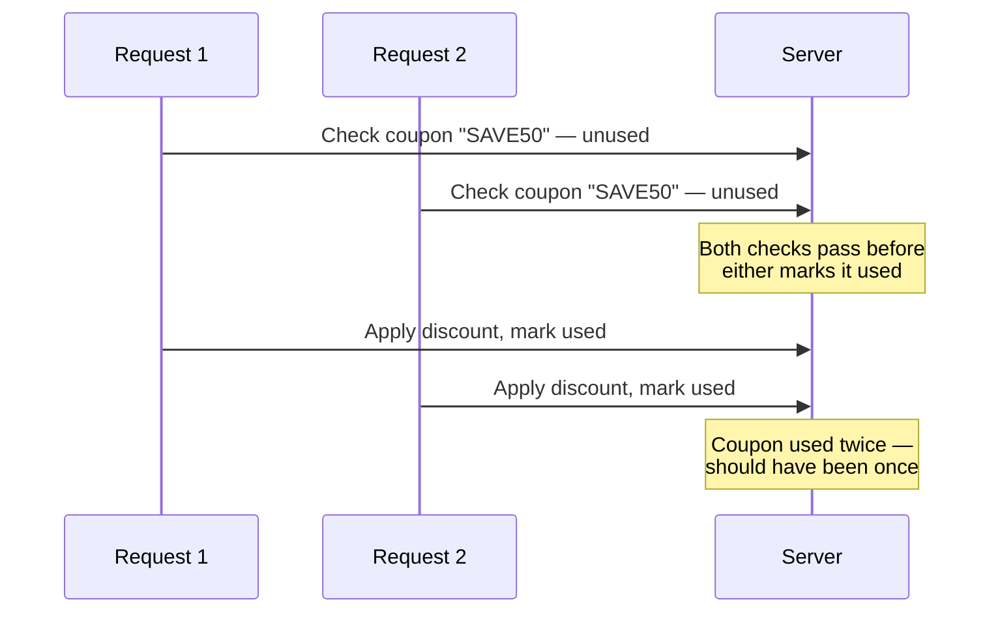

# Race Conditions, Deep Dive

The logic-and-chains lesson mentioned race conditions briefly among several business logic bug types. This lesson goes deep into them specifically — a genuinely high-value, high-severity bug category that remains widely underreported precisely because it requires a different testing mindset than most other web vulnerabilities.

## What a race condition actually is

A **race condition** occurs when an application's correctness depends on operations happening in a specific order or with proper isolation, but the application fails to enforce that ordering — letting two or more requests processed simultaneously interfere with each other in ways the developer never intended or tested for. Directly connecting to Path 17's concurrency-adjacent malware-analysis coverage of process timing: this is fundamentally a timing problem, not a logic problem in the traditional sense.

## The classic example: the coupon redemption bug

The single most commonly cited real-world race condition: an application checks "has this coupon code been used?" and then, in a separate step, marks it as used. If an attacker sends the exact same redemption request **simultaneously**, dozens of times, multiple requests can pass the "has this been used?" check before any single one completes the "mark as used" step — resulting in the same one-time coupon being redeemed far more times than intended, sometimes with real financial impact if the coupon has monetary value.

## Where race conditions show up beyond coupons

- **Account balance operations** — simultaneous withdrawal or transfer requests against the same account, potentially withdrawing more than the actual balance allows
- **Rate limit bypass** — sending many requests simultaneously to a rate-limited endpoint (a password reset request, an OTP verification attempt) before the rate limiter's counter has actually incremented
- **Referral/reward systems** — simultaneous signup or referral-claim requests exploiting the same "has this been claimed?" check-then-act pattern as the coupon example
- **One-time-use tokens** — password reset tokens, email verification links, or invite codes intended for single use, redeemed multiple times before invalidation completes

## Testing methodology: the single-packet attack

Modern race condition testing (popularized by PortSwigger's research, referenced below) uses a technique sometimes called the **single-packet attack**: rather than sending requests sequentially and hoping they happen to overlap by chance, tools send many requests within the same TCP connection, arriving at the server as close to truly simultaneously as HTTP/2 allows — directly connecting to the automation-nuclei lesson's tooling philosophy, since Burp's own **Turbo Intruder** extension automates exactly this technique.

## Why this bug class is genuinely underreported

Directly connecting to the hunting-xss-and-injection lesson's point about scanner limitations: automated scanners essentially never find race conditions, since detecting one requires deliberately sending carefully-timed concurrent requests and comparing results against expected single-request behavior — a fundamentally different testing pattern than the single-request-response analysis most scanning tools are built around. This is exactly why race conditions remain a genuinely valuable specialization for hunters willing to test for them deliberately, rather than relying on tooling to surface them automatically.

:::challenge Test yourself
Why do automated vulnerability scanners essentially never find race condition bugs, even sophisticated ones?

Show answer
Most automated scanners are architecturally built around a single-request, single-response testing model — sending one crafted request, examining the one response, and matching it against known vulnerable patterns (exactly the model behind nuclei's template-based approach from the automation lesson). A race condition, by definition, only manifests when multiple requests interfere with each other during truly concurrent, overlapping execution — there's no single malicious request-response pair a scanner could pattern-match against, because the vulnerability exists in the gap between a check and a subsequent action across two or more near-simultaneous requests. Finding one requires deliberately sending multiple carefully-timed concurrent requests (via a tool like Turbo Intruder) and comparing the aggregate outcome (was the coupon used once or five times?) against expected behavior — a fundamentally different testing methodology that most general-purpose scanners simply aren't built to perform, which is exactly why manual, deliberate race condition testing remains a genuinely valuable, differentiated skill in bug bounty hunting.

:::

## Key terms

- **Race condition** — a bug where simultaneous, unsynchronized requests interfere with intended check-then-act logic.
- **Single-packet attack** — sending many requests within one TCP/HTTP2 connection to maximize true request concurrency.
- **Turbo Intruder** — a Burp Suite extension purpose-built for automating race condition testing.

## Recap

- Race conditions exploit the gap between a "check" step and an "act" step when requests are processed concurrently rather than in strict order.
- Coupon redemption, account balances, rate limits, and one-time tokens are the most common real-world vulnerable patterns.
- The single-packet attack technique, automated by tools like Turbo Intruder, maximizes true request concurrency for reliable testing.
- Automated scanners essentially never find this bug class, making deliberate manual testing a genuinely valuable specialization.

**Next up →** [Automation with Nuclei](#/lesson/15-bug-bounty/automation-nuclei)
