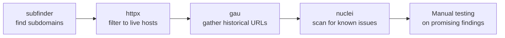

# Recon Pipeline Lab

This is the capstone lab for Path 15 — building the real, automated recon pipeline referenced throughout this path's earlier lessons, chaining several free tools together the exact way professional bug bounty hunters actually work at scale.

## Tools

- **[subfinder](https://github.com/projectdiscovery/subfinder)** or **[amass](https://github.com/owasp-amass/amass)** — passive subdomain enumeration.
- **[httpx](https://github.com/projectdiscovery/httpx)** — probes a list of hosts and reports which are actually alive and serving HTTP(S).
- **[gau](https://github.com/lc/gau)** or **[waybackurls](https://github.com/tomnomnom/waybackurls)** — pulls historical URLs for a domain from public archives, often surfacing old/forgotten endpoints.
- **[nuclei](https://github.com/projectdiscovery/nuclei)** — fast vulnerability scanning using community-maintained detection templates.

## Exercise

1. **Choose a public bug bounty program in scope.** Pick a program on HackerOne or Intigriti with a genuinely wide scope (a wildcard domain like `*.example.com` is ideal for practicing a full recon pipeline) — read its policy fully before doing anything.
2. **Run subdomain enumeration.**
   ```bash
   subfinder -d example.com -o subs.txt
   ```
   This passively queries dozens of public sources (certificate transparency logs, DNS databases, search engines) without ever directly touching the target's infrastructure.
3. **Probe for live hosts.**
   ```bash
   cat subs.txt | httpx -o live.txt
   ```
   Not every discovered subdomain is actually serving anything — `httpx` filters your list down to only the hosts actually responding, which is what you'll actually spend time testing.
4. **Gather URLs and parameters.**
   ```bash
   cat live.txt | gau > urls.txt
   ```
   Historical archive data frequently surfaces old API endpoints, forgotten admin panels, or parameters that current site navigation never links to directly — genuinely high-value reconnaissance that active crawling alone would miss.
5. **Run nuclei for common vulnerabilities.**
   ```bash
   nuclei -l live.txt -t cves/ -o findings.txt
   ```
   This checks every live host against thousands of community-maintained templates covering known CVEs, misconfigurations, and exposed panels — an efficient first pass before manual testing begins.



6. **Screenshot your live hosts for visual triage.** Once you have `live.txt`, run a screenshotting tool against the full list rather than opening each one manually:
   ```bash
   cat live.txt | gowitness file -f - --screenshot-path ./screenshots
   ```
   Scroll through the resulting screenshots looking specifically for anything that looks like an admin login page, an error page revealing a stack trace, or a default "it works!" placeholder page — these visual signals are often faster to spot by eye across dozens of hosts than by reading raw HTTP responses one at a time.

:::tip Pipe everything together into one script
Once you're comfortable with each tool individually, chain them into a single bash script (exactly the skill practiced in Path 03's Advanced Terminal Lab) that takes a domain as an argument and runs the full pipeline automatically — a genuinely useful, portfolio-worthy tool referenced directly in this path's Automation lesson.
:::

:::challenge Document your pipeline and results
Run the full pipeline against your chosen in-scope target and write up: how many subdomains were found, how many were actually live, any interesting historical URLs surfaced by `gau`, and any nuclei findings — even if nothing turned out to be immediately exploitable, document the process and results, exactly as a real reconnaissance phase would be recorded.
:::

## Key takeaway

This exact `subfinder → httpx → gau → nuclei` chain, or close variants of it, is genuinely how a large share of real-world bug bounty hunting happens at scale — automating the wide, repetitive first pass across a large scope, freeing up manual testing time and attention for the promising findings automation surfaces.

**Explore more →** [Path 16 — Advanced Cyber Topics](#/lesson/16-advanced)
