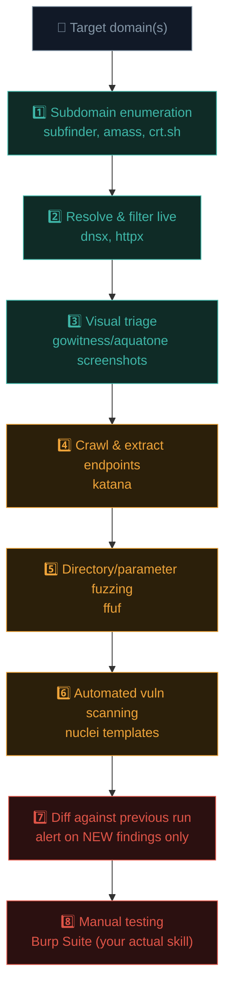

# Building a recon pipeline

Path 11.3 and Path 14.3 taught recon concepts and tools individually. This lesson builds them into a genuine, automated **pipeline** — the exact kind of tooling that separates hobbyist bug hunting from serious, sustained practice, and directly mirrors Ishfaq's own real Burp Suite + MCP + Cline automation setup.

## Why automation is essential in bug bounty specifically

Recall Path 15.2 — a broad-scope program (`*.example.com`) might have hundreds of subdomains. Manually running each recon step from Path 11.3 against every one of them, repeatedly, as the target changes over time, simply doesn't scale. Serious hunters build **automated pipelines** that run continuously or on a schedule, surfacing new attack surface and changes automatically.

## The pipeline architecture



## Step-by-step build

### 1. Subdomain enumeration, combined from multiple sources

```bash
# Combine several tools for maximum coverage — no single source finds everything:
subfinder -d example.com -silent > subs1.txt
amass enum -passive -d example.com > subs2.txt
curl -s "https://crt.sh/?q=%.example.com&output=json" | jq -r '.[].name_value' > subs3.txt

cat subs1.txt subs2.txt subs3.txt | sort -u > all-subs.txt
```

### 2. Resolve and filter to live hosts

```bash
# httpx checks which subdomains actually respond, and grabs useful metadata:
cat all-subs.txt | httpx -silent -status-code -title -tech-detect -o live-hosts.txt
```

### 3. Visual triage — screenshot everything

When you have hundreds of live hosts, screenshots let you rapidly spot interesting targets (admin panels, error pages, forgotten dev environments) without manually visiting each one:

```bash
cat live-hosts.txt | gowitness file -f - --screenshot-path ./screenshots
```

### 4. Crawl for endpoints and parameters

```bash
cat live-hosts.txt | katana -d 3 -jc -o all-urls.txt
# -jc also crawls JavaScript files for additional embedded endpoints/URLs
```

### 5. Directory and parameter fuzzing

```bash
# For each live host, fuzz common paths:
ffuf -u https://FUZZ_HOST/FUZZ -w /usr/share/seclists/Discovery/Web-Content/common.txt \
  -recursion -recursion-depth 2 -o fuzz-results.json -of json
```

### 6. Automated vulnerability scanning with Nuclei

**Nuclei** (mentioned in Path 11.9 and Path 12.8) runs thousands of community-maintained, YAML-defined templates checking for known vulnerability patterns, misconfigurations, and exposed panels:

```bash
cat all-urls.txt | nuclei -t ~/nuclei-templates/ -severity medium,high,critical -o nuclei-results.txt

# Or targeted at a specific category:
nuclei -l live-hosts.txt -t exposures/ -o exposure-findings.txt
```

### 7. Diffing — the key to sustainable, ongoing hunting

The single highest-leverage automation technique: comparing **today's** recon results against **yesterday's**, and only alerting on what's genuinely **new**.

```python
#!/usr/bin/env python3
"""
diff-recon.py — Compare today's subdomain list against the previous run,
alerting only on genuinely new discoveries.
"""
import sys

def load_set(path: str) -> set[str]:
    with open(path) as f:
        return set(line.strip() for line in f if line.strip())

def main():
    if len(sys.argv) != 3:
        print("Usage: diff-recon.py <previous.txt> <current.txt>")
        sys.exit(1)

    previous = load_set(sys.argv[1])
    current = load_set(sys.argv[2])

    new_items = current - previous
    removed_items = previous - current

    if new_items:
        print(f"[+] {len(new_items)} NEW subdomains found:")
        for item in sorted(new_items):
            print(f"    {item}")
    if removed_items:
        print(f"[-] {len(removed_items)} subdomains no longer resolving:")
        for item in sorted(removed_items):
            print(f"    {item}")

if __name__ == "__main__":
    main()
```

```bash
python3 diff-recon.py subs-yesterday.txt subs-today.txt
```

A newly-appeared subdomain is disproportionately likely to be an under-tested, freshly-deployed system — often the single highest-value signal in an entire ongoing recon pipeline, precisely because it hasn't yet been picked over by other hunters.

## Wrapping it all into a scheduled pipeline

```bash
#!/bin/bash
# recon-pipeline.sh — Full daily recon pipeline for a target domain

set -euo pipefail
TARGET=$1
DATE=$(date +%Y%m%d)
OUTDIR="recon-$TARGET-$DATE"
mkdir -p "$OUTDIR"

echo "[*] Subdomain enumeration..."
subfinder -d "$TARGET" -silent > "$OUTDIR/subs.txt"

echo "[*] Resolving live hosts..."
httpx -l "$OUTDIR/subs.txt" -silent -o "$OUTDIR/live.txt"

echo "[*] Crawling..."
katana -list "$OUTDIR/live.txt" -jc -o "$OUTDIR/urls.txt"

echo "[*] Nuclei scan..."
nuclei -l "$OUTDIR/live.txt" -severity medium,high,critical -o "$OUTDIR/nuclei.txt"

echo "[*] Diffing against previous run..."
PREV=$(ls -d recon-"$TARGET"-* 2>/dev/null | sort | tail -2 | head -1)
if [ -n "$PREV" ] && [ -f "$PREV/subs.txt" ]; then
    python3 diff-recon.py "$PREV/subs.txt" "$OUTDIR/subs.txt"
fi

echo "[+] Done. Results in $OUTDIR/"
```

```bash
# Run daily via cron (recall Path 03.11's cron lesson):
0 3 * * * /home/kali/recon-pipeline.sh example.com >> /home/kali/recon.log 2>&1
```

This exact pattern — cron-scheduled, diffed, alerting only on genuine change — is precisely how experienced hunters (and Ishfaq's own real Burp Suite + MCP + Cline automation setup) sustain ongoing coverage across multiple programs without manually re-running everything from scratch every single day.

## Notification integration — closing the loop without babysitting a terminal

A pipeline that only writes results to a text file still requires you to remember to go look at it — the final piece that makes automation genuinely sustainable is pushing new findings somewhere you'll actually notice them, without needing to manually check in:

```bash
# Send a Slack/Discord webhook notification only when the diff script finds something new:
if [ -s new-findings.txt ]; then
    curl -s -X POST -H 'Content-type: application/json' \
      --data "{\"text\":\"New recon findings for $TARGET: $(cat new-findings.txt | wc -l) items\"}" \
      "$WEBHOOK_URL"
fi
```

This closes the loop the diffing step opened: subdomain enumeration finds candidates, diffing filters down to what's genuinely new, and a notification makes sure that signal actually reaches you promptly rather than sitting silently in a log file on a cron-scheduled machine you only check once a week. For a target with real time-sensitivity — a newly-deployed subdomain is at its most under-tested in the first few days after appearing — the gap between "the pipeline found it" and "a human actually looked at it" is exactly where competitive advantage over other hunters lives.

## Respecting scope and rate limits in automation

Recall Path 15.2's scope discipline — automation makes it dangerously easy to accidentally exceed a program's authorized scope or rate limits:

```bash
# Always filter discovered subdomains against the EXACT program scope
# before running any active tooling against them:
grep -f allowed-scope-patterns.txt all-subs.txt > in-scope-subs.txt

# Respect stated rate limits explicitly (recall Path 15.2's example: max 10 req/sec):
ffuf -u https://FUZZ_HOST/FUZZ -w wordlist.txt -rate 10
nuclei -l live.txt -rate-limit 10
```

Automated tools have no judgment of their own — the discipline and scope-awareness must be built into the pipeline itself, or enforced by careful manual review before any automated step runs against newly-discovered assets.

## 🧪 Lab — Build your own mini pipeline

Using the program you shortlisted in Path 15.2's lab (only if its scope and policy explicitly permit automated scanning — always check this first):

1. Run subdomain enumeration and combine results from at least two sources.
2. Filter to live hosts with httpx.
3. Run Nuclei with a conservative rate limit against the `exposures/` and `misconfiguration/` template categories specifically (lower risk, high signal categories to start with).
4. Save today's results, and write the diff script above so tomorrow's run only shows you what's new.

Even this modest pipeline represents genuine, sustainable bug bounty infrastructure — far beyond what most beginning hunters ever build, and a real differentiator in practice.

:::challenge Test yourself
Why is the "diff against previous run" step considered one of the highest-value parts of an ongoing recon pipeline, rather than just a nice-to-have convenience feature?

<details><summary>Show answer</summary>A newly-appeared subdomain or endpoint is disproportionately likely to be <strong>freshly deployed and under-tested</strong> — precisely the kind of target other hunters haven't yet discovered or picked over. Re-scanning the same, already-stable attack surface repeatedly wastes time rediscovering what's already been tested (by you or others); diffing surfaces exactly the new, high-opportunity signal automatically, letting you focus limited manual testing time where it's most likely to find something genuinely new.</details>
:::

## Key terms

- **Recon pipeline** — an automated, often scheduled sequence of recon tools feeding into each other.
- **Nuclei** — a template-driven automated vulnerability scanner with thousands of community templates.
- **Diffing** — comparing successive recon runs to surface only new discoveries.
- **Rate limiting** — deliberately throttling automated tools to respect program policy and avoid disruption.

## Recap

- Broad-scope bug bounty programs require automation to achieve sustainable, ongoing coverage.
- A full pipeline chains subdomain enum → resolution → screenshotting → crawling → fuzzing → Nuclei scanning.
- Diffing successive runs surfaces newly-appeared, under-tested attack surface — often the highest-value signal available.
- Cron scheduling (Path 03.11) turns a one-off pipeline into sustained, continuous coverage.
- Automated tooling must respect scope and rate limits explicitly — it has no judgment of its own.

???refs
- [ProjectDiscovery tools](https://github.com/projectdiscovery) — subfinder, httpx, katana, nuclei, and the full ecosystem used throughout this lesson.
- [Nuclei Templates repository](https://github.com/projectdiscovery/nuclei-templates) — thousands of community-maintained detection templates.
- [gowitness](https://github.com/sensepost/gowitness) — the screenshotting tool referenced in step 3.
- [Awesome Bug Bounty Tools (GitHub)](https://github.com/vavkamil/awesome-bugbounty-tools) — a comprehensive, curated tool list beyond what's covered here.
???

**Next up →** [Writing effective bug bounty reports](#/lesson/15-bug-bounty/report-writing)
