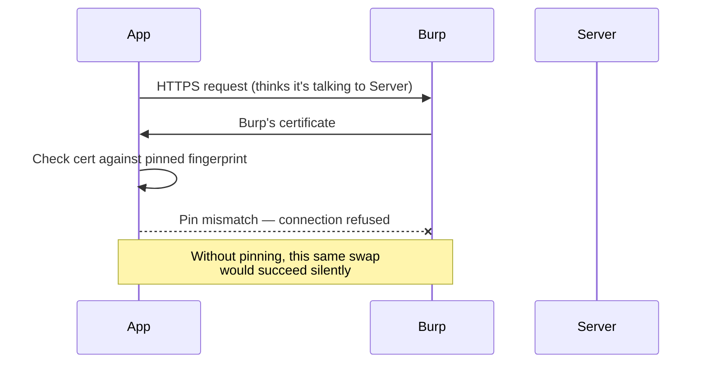

# Intercepting Mobile Traffic

Path 15's lab setup lesson got Burp configured to see mobile traffic in principle. This lesson covers the reality: many production apps actively fight back against exactly this, using **certificate pinning**, and you'll learn how (and why) to work around it in your own authorized lab.

## Why apps resist interception

A standard Burp Suite MITM setup works by presenting Burp's own certificate to the app instead of the real server's — the app trusts it (because you installed Burp's CA certificate, per the lab setup lesson), decrypts through Burp, and Burp forwards the traffic on. **Certificate pinning** defeats this specific technique: the app hardcodes which exact certificate (or public key) it expects from its real server, and rejects *any* other certificate — including a perfectly valid one from your device's trusted certificate store — refusing to connect if the fingerprint doesn't match exactly.



## Bypassing pinning with Frida

**[Frida](https://frida.re/)** is a free, powerful dynamic instrumentation toolkit — it lets you inject JavaScript into a running app's process and hook (intercept and modify) specific function calls at runtime, without needing the app's source code.

```bash
pip install frida-tools
frida-ps -U                                    # list processes on a connected/rooted device
frida -U -f com.example.vulnerableapp -l ssl-pinning-bypass.js --no-pause
```

A popular, actively maintained community script — often called `ssl-pinning-bypass.js` or similar, widely available for free — hooks into the app's certificate-checking function and forces it to always report "valid," regardless of what certificate is actually presented. This isn't circumventing cryptography at all — it's simply patching, at runtime, the specific code the app uses to *decide* whether to trust a certificate, which is exactly why it requires root and a live, instrumentable process rather than any cryptographic weakness.

## Objection — a more targeted alternative

**[Objection](https://github.com/sensepost/objection)**, built on top of Frida, packages many common bypasses (including SSL pinning) into ready-made commands, making this workflow considerably faster once you understand what's happening underneath:

```bash
objection -g com.example.vulnerableapp explore
# Inside the objection shell:
android sslpinning disable
```

## Network Security Config — pinning without touching code

On modern Android, certificate pinning is increasingly configured declaratively rather than in application code, through a **Network Security Config** XML file referenced from the manifest — worth checking for specifically during the APK analysis pass from Path 15.4, since it's often faster to identify (and sometimes even to patch out) than hunting for pinning logic buried in decompiled Java:

```xml
<!-- res/xml/network_security_config.xml -->
<network-security-config>
    <domain-config>
        <domain includeSubdomains="true">api.example.com</domain>
        <pin-set expiration="2027-01-01">
            <pin digest="SHA-256">7HIpactkIAq2Y49orFOOQKurWxmmSFZhBCoQYcRhJ3Y=</pin>
        </pin-set>
    </domain-config>
</network-security-config>
```

Because this file is plain, unobfuscated XML sitting in the decompiled resources folder, a tester can — with apktool's rebuild capability from Path 15.4 — simply delete or relax the `pin-set` entry, then re-sign and reinstall the modified APK, bypassing pinning entirely without touching Frida at all. This is a genuinely faster path than runtime instrumentation whenever it's available, and worth checking for before reaching for Frida/Objection as the default first move.

## What to look for once traffic is visible

Once pinning is bypassed and Burp can see the app's real traffic, apply everything from Path 07 directly: unencrypted parameters, IDOR opportunities in API calls (Path 07/10), tokens or API keys visible in headers (this course's CTF Zone's hidden-headers challenge), and — specifically mobile-relevant — whether the app falls back to *any* plaintext HTTP endpoints at all, even briefly during startup or analytics calls.

:::tip Not every app pins certificates
Certificate pinning adds real engineering overhead and complicates an app's own maintenance (the pinned certificate must be updated before the server's real certificate expires, or the app breaks entirely) — many apps, especially smaller or less security-mature ones, skip it entirely, meaning the basic Burp setup from the lab setup lesson works immediately with no bypass needed at all.
:::

:::danger Root/jailbreak detection often needs bypassing too
Some apps check whether they're running on a rooted/jailbroken device and refuse to function (or silently limit functionality) if so — Objection includes bypass commands for common root-detection techniques as well (`android root disable`), and this exact cat-and-mouse dynamic between apps trying to detect tampering and testers bypassing that detection is a recurring theme throughout real mobile security work.
:::

:::challenge Bypass pinning on a practice app
Using your rooted emulator and Frida (or Objection), attempt to bypass certificate pinning on one of this path's recommended vulnerable practice apps, or any app you've built yourself with pinning deliberately enabled. Confirm success by capturing its traffic in Burp afterward and finding at least one interesting request/response pair.
:::

## Key takeaway

Certificate pinning raises the bar for traffic interception but doesn't make it impossible — runtime instrumentation tools like Frida can patch an app's own trust decision at the exact moment it's made, which is exactly why defense-in-depth (proper server-side authorization, not relying on pinning alone) matters as much on mobile as everywhere else in this course.

**Next up →** [iOS App Security Basics](#/lesson/15-mobile-security/ios-security-basics)
