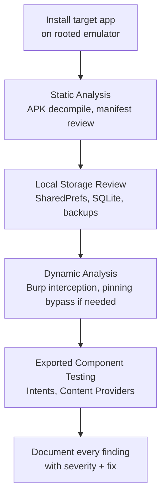

# Mobile Security Capstone Lab

This lab pulls together every lesson in this path — static analysis, insecure storage, traffic interception, and exported components — into one full assessment against a real, deliberately vulnerable app, mirroring how an actual mobile security engagement unfolds.

## Recommended targets

- **[DIVA (Damn Insecure and Vulnerable App)](https://github.com/payatu/diva-android)** — free, open-source, built specifically as a structured set of mobile vulnerability challenges, an excellent first target.
- **[InsecureBankv2](https://github.com/dineshshetty/Android-InsecureBankv2)** — free, open-source, simulates a banking app with realistic, chained vulnerabilities across storage, network, and authentication.
- **[OWASP MASTG's Crackmes](https://github.com/OWASP/owasp-mastg/tree/master/Crackmes)** — free, official OWASP practice targets specifically built alongside the Mobile Top 10 and testing guide referenced throughout this path.

## The full assessment workflow

## Tasks

1. **Static analysis pass.** Decompile the APK with jadx (from the APK analysis lesson) and review the manifest for exported components, requested permissions, and `allowBackup` status. Grep the decompiled source for hardcoded secrets.
2. **Local storage review.** Using root access, inspect `shared_prefs/` and any local SQLite databases (from the insecure data storage lesson) for sensitive data stored without encryption — DIVA and InsecureBankv2 both have deliberately planted findings here.
3. **Dynamic traffic analysis.** Configure Burp per the lab setup lesson, install its certificate, and use the app normally while capturing traffic — check for plaintext HTTP, missing authorization checks on API calls (the mobile equivalent of Path 07's IDOR), and any sensitive data visible in requests or responses. If certificate pinning is present, apply the Frida bypass technique from the traffic interception lesson.
4. **Exported component testing.** Use `dumpsys package` and `adb shell am start` (from the privesc/root-detection lesson) to identify and attempt to directly launch any exported activities, bypassing the app's intended flow.
5. **Assemble a full report.** For every finding across all four tasks, use the same reporting structure from Path 09: title, severity (justify using OWASP Mobile Top 10 category and real-world impact), steps to reproduce, and a specific fix.

:::challenge Complete a full assessment
Working through a full target app (DIVA is the recommended starting point — it's structured as a numbered set of specific challenges, making it easy to track progress), find and document at least 4 distinct vulnerabilities spanning at least 3 different categories from this path (storage, network, exported components, hardcoded secrets). Present your findings as a complete report, sorted by severity.
:::

## Where to go from here

Mobile security is a genuinely deep specialization on its own — this path covers the essential foundation, but platforms like **TryHackMe** and **Hack The Box** now host dedicated mobile security learning tracks, and the free **OWASP MASTG** goes considerably deeper into both Android and iOS technique than this path's scope allows. If mobile security specifically resonates with you, it pairs naturally with the web security skills from Path 07 (since most mobile apps talk to web-style APIs) and the reverse engineering foundations from Path 11's malware analysis material.

## Key takeaway

A complete mobile security assessment isn't any single technique — it's systematically working through static analysis, local storage, network traffic, and inter-app communication, exactly the four-part structure this lab just walked you through, and exactly how real mobile security engagements are actually scoped and delivered.

## 🎓 Path complete

You've now covered Android and iOS security fundamentals, static APK analysis, insecure storage, traffic interception with certificate pinning bypass, root detection, exported component vulnerabilities, and completed a full assessment against a real vulnerable app. Combined with Path 07's web security foundation, you have a genuinely solid base for mobile-focused security work.

???refs
- [OWASP MASTG](https://mas.owasp.org/MASTG/) — the definitive, free, comprehensive mobile testing guide for going deeper than this path's scope.
- [DIVA Android](https://github.com/payatu/diva-android) and [InsecureBankv2](https://github.com/dineshshetty/Android-InsecureBankv2) — the free practice targets used throughout this lab.
???

**Explore more →** [Back to all paths](#/course) · [CTF Zone](#/lesson/14-ctf-challenges)
