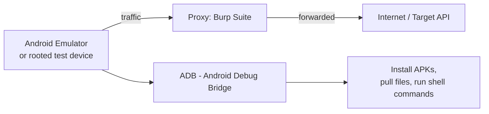

# Setting Up a Mobile Testing Lab

Before testing a single app, you need a proper lab — a controlled, safe environment where you can install, inspect, and intercept traffic from mobile apps without risking a real device or real accounts. This lesson gets that environment fully working.

## The core components



## 1. An Android emulator

**Android Studio's built-in emulator** (free, from [developer.android.com/studio](https://developer.android.com/studio)) is the standard starting point — it lets you create virtual Android devices (AVDs) of any Android version, with root access available on emulator images without Google Play Services (choose a "Google APIs" image, not a "Google Play" image, specifically because the Play Store variant blocks root access by design).

```bash
# List available emulators once set up:
emulator -list-avds
# Launch one:
emulator -avd Pixel_6_API_33
```

:::tip Genymotion is a solid alternative
[Genymotion](https://www.genymotion.com/) offers a free personal-use tier with generally faster performance than the stock Android Studio emulator, and is popular specifically among security testers for this reason.
:::

## 2. ADB — Android Debug Bridge

**ADB** is the command-line bridge between your computer and an Android device (emulated or physical) — it's how you'll install apps, pull files off the device, and run shell commands, and it ships with Android Studio's SDK tools.

```bash
adb devices                          # confirm your emulator/device is connected
adb install path/to/app.apk          # install an APK for testing
adb shell                            # get an interactive shell on the device
adb pull /data/data/com.example.app/ ./extracted/   # pull an app's private data (requires root)
```

## 3. Burp Suite configured for mobile traffic

Intercepting mobile app traffic uses the exact same Burp Suite skills from Path 07 — the only new part is routing the *device's* traffic through Burp's proxy instead of a desktop browser's:

1. In your emulator's Wi-Fi settings, set a manual proxy pointing to your host machine's IP and Burp's listening port (default `8080`).
2. Install Burp's CA certificate on the device so it can intercept HTTPS traffic without triggering certificate errors — visit `http://burp` from the emulator's browser and download the certificate, then install it under the device's security settings.
3. On modern Android (7+), apps by default only trust *system*-installed certificates for network security, not user-installed ones — you may need to install Burp's cert as a **system** certificate (requires root) rather than a user certificate for it to work against apps targeting recent Android API levels.

## 4. A rooted environment for deeper analysis

Root access lets you read any app's private storage, bypass certain protections, and install tools like **Frida** (covered later in this path) for runtime instrumentation. On an emulator, use a non-Play-Store system image and run:

```bash
adb root
adb remount
```

On a genuinely dedicated physical test device (never your primary phone), tools like **Magisk** provide root access while keeping the modification cleanly manageable and reversible.

:::danger Never test against real, unauthorized targets
Everything in this path should be practiced against apps you've built yourself, deliberately vulnerable practice apps (covered in this path's capstone lab), or apps with an explicit, current bug bounty program covering mobile testing. The same golden rule from Path 01 applies here without exception — mobile app testing against apps you don't have authorization for is unauthorized access, full stop.
:::

## 5. A deliberately vulnerable practice app

Install **DIVA (Damn Insecure and Vulnerable App)** or **InsecureBankv2** — both free, open-source, deliberately flawed Android apps built specifically for learning mobile security hands-on, referenced again in this path's capstone lab.

:::challenge Verify your lab end to end
Set up an emulator, confirm ADB can see and shell into it, configure Burp's proxy and certificate, and install one of the deliberately vulnerable practice apps. Capture and inspect one piece of network traffic from that app in Burp as a confirmation your full pipeline works.
:::

## Key takeaway

A properly configured mobile lab — emulator, ADB, Burp with its certificate installed, and root access — is the foundation every other lesson in this path builds on. Getting this right once, carefully, saves significant frustration in every hands-on exercise that follows.

**Next up →** [OWASP Mobile Top 10](#/lesson/15-mobile-security/owasp-mobile-top-10)
