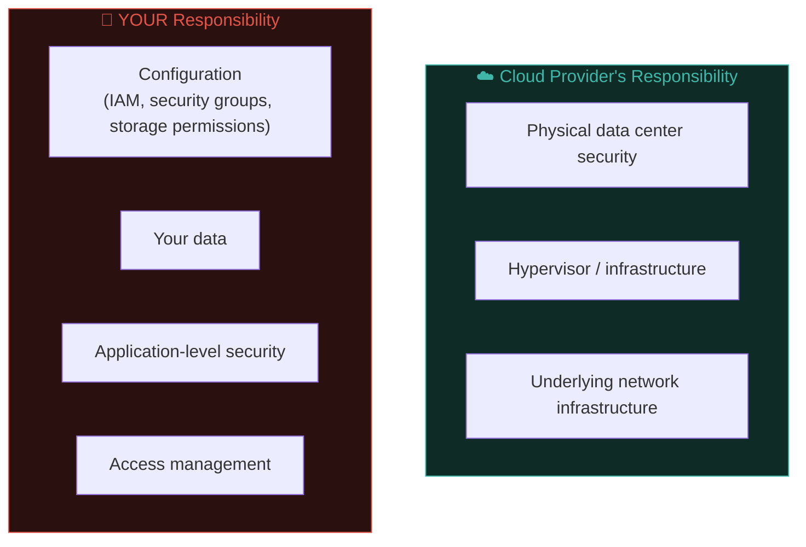

# Cloud security fundamentals

Recall Path 12.1's brief mention — cloud environments have their own networking and access-control concepts, distinct enough from traditional on-premise infrastructure to warrant dedicated treatment. This lesson covers the fundamentals across AWS, Azure, and GCP, with a focus on the misconfigurations that show up constantly in both bug bounty programs (Path 15) and real breaches.

## The shared responsibility model

The single most important cloud security concept to internalise first:



Cloud providers secure the underlying infrastructure — but **you** remain fully responsible for how you configure everything built on top of it. The overwhelming majority of real cloud security incidents stem from **customer misconfiguration**, not a flaw in AWS/Azure/GCP's own infrastructure — a crucial distinction that shapes this entire lesson.

## IAM — Identity and Access Management

Cloud IAM controls **who can do what** to **which resources** — the cloud-native evolution of the access control concepts from Path 11.1 (A01: Broken Access Control) and Path 10's authorization principles, now applied to infrastructure itself rather than application data.

### The principle of least privilege, cloud-style

```json
// AWS IAM policy - DANGEROUS, overly permissive:
{
  "Effect": "Allow",
  "Action": "*",
  "Resource": "*"
}

// AWS IAM policy - properly scoped:
{
  "Effect": "Allow",
  "Action": ["s3:GetObject"],
  "Resource": "arn:aws:s3:::my-specific-bucket/*"
}
```

The wildcard (`"Action": "*"`, `"Resource": "*"`) pattern grants **every possible action on every possible resource** — a catastrophic over-permission that, if the associated credentials leak, gives an attacker essentially unlimited control over the entire cloud account. This exact pattern is depressingly common in real-world audits and a leading root cause in major cloud breaches.

### Privilege escalation via IAM misconfigurations

Just like Linux/Windows privesc (previous lessons), cloud IAM has its own escalation patterns — a low-privilege user with permission to, say, modify their **own** IAM policy, or attach a more-privileged role to themselves, can often escalate to full account control:

```bash
# Example AWS enumeration technique (using an authorized test account):
aws iam get-user
aws iam list-attached-user-policies --user-name current-user
aws iam simulate-principal-policy --policy-source-arn <user-arn> --action-names iam:CreateAccessKey
```

Tools like **PMapper** and **Pacu** (AWS-specific offensive security frameworks) automate discovering exactly these kinds of IAM privilege escalation paths, conceptually identical to BloodHound's role in AD (previous lesson) — mapping a graph of who-can-become-who.

## Misconfigured storage — the classic, recurring incident pattern

**Publicly-readable cloud storage buckets** (AWS S3, Azure Blob Storage, GCP Cloud Storage) remain one of the single most common, most damaging cloud misconfigurations in real breach history:

```bash
# Checking if an S3 bucket is publicly accessible (only against your own
# or explicitly authorized buckets):
aws s3 ls s3://target-bucket-name --no-sign-request

# Or via a direct HTTP request:
curl https://target-bucket-name.s3.amazonaws.com/
```

```bash
# Tools built specifically for discovering exposed cloud storage at scale:
# (only run against explicitly authorized scope, per Path 15.2's discipline)
s3scanner scan --bucket-file discovered-bucket-names.txt
```

Bucket names are often guessable — following predictable company-name patterns — making this a genuine, ongoing bug bounty and real-attacker reconnaissance technique (echoing Path 11.3/10.3's recon philosophy, applied to cloud storage specifically).

## SSRF-to-metadata — revisiting Path 11.8 in full cloud context

Recall Path 11.8's introduction — this remains one of the highest-impact cloud-specific attack chains:

```
SSRF vulnerability → http://169.254.169.254/latest/meta-data/iam/security-credentials/
→ Temporary AWS credentials returned, no authentication required
→ Attacker now has whatever permissions that instance's IAM role holds
```

The defensive fix, reinforced here: **IMDSv2** (AWS), which requires a session token obtained via a PUT request before metadata can be queried — specifically designed to defeat simple SSRF-based metadata theft, since a basic SSRF vulnerability typically can't easily perform the required PUT request as part of its exploitation.

## Cloud-native networking — VPCs and security groups

Recall Path 12.4's firewall concepts, now in their cloud-native form:

- **VPC (Virtual Private Cloud)** — an isolated, logically-defined network within the cloud provider, the cloud equivalent of a traditional private network segment.
- **Security groups** — stateful, instance-level virtual firewalls (directly analogous to Path 12.4's stateful firewall concept) controlling inbound/outbound traffic.
- **Network ACLs** — subnet-level, stateless traffic filtering, a coarser-grained complement to security groups.

```bash
# A dangerously permissive security group rule (0.0.0.0/0 = the entire internet):
aws ec2 describe-security-groups --filters Name=ip-permission.cidr,Values=0.0.0.0/0
```

Auditing for security groups that expose sensitive ports (database ports, SSH/RDP) to `0.0.0.0/0` (the entire internet, recall Path 02's CIDR notation) rather than restricting to specific known IP ranges is one of the highest-value, most common cloud security audit findings.

## Secrets management — avoiding hardcoded credentials

A theme recurring throughout this entire course (Path 10.5, 09.6, 11.2) — cloud environments introduce their own dedicated secrets management services specifically to avoid hardcoding credentials in code or configuration:

- **AWS Secrets Manager / Parameter Store**
- **Azure Key Vault**
- **GCP Secret Manager**
- **HashiCorp Vault** (cloud-agnostic, popular in multi-cloud/hybrid environments)

```python
# BAD — hardcoded credential directly in source code:
DATABASE_PASSWORD = "SuperSecret123!"

# GOOD — retrieved from a proper secrets manager at runtime:
import boto3
client = boto3.client('secretsmanager')
secret = client.get_secret_value(SecretId='prod/database/password')
```

Hardcoded credentials accidentally committed to public GitHub repositories remain a persistent, ongoing real-world incident source — and scanning for exactly this pattern (leaked secrets in code and CI pipelines) is a core AppSec responsibility.

## Cloud logging and monitoring — CloudTrail and its equivalents

Recall Path 12.5's SIEM/logging concepts, applied here to the cloud control plane itself: **AWS CloudTrail**, **Azure Activity Log**, and **GCP Cloud Audit Logs** record every API call made against a cloud account — who did what, when, from where. A genuinely common and dangerous finding in real cloud audits is CloudTrail either **disabled entirely** or scoped to only a subset of regions, meaning an attacker who compromises credentials can operate in an unmonitored region with zero audit trail at all. Beyond simply having logging enabled, mature cloud security practice ships those logs to a separate, access-restricted account or storage location — since an attacker with sufficiently broad IAM permissions in a compromised account can otherwise simply delete or disable the very logs that would reveal their activity, precisely the kind of "the attacker controls their own evidence" problem that centralized, separately-permissioned logging is designed to prevent.

## Container and serverless considerations, briefly previewed

Cloud security increasingly extends into containers (Kubernetes, covered in depth in the next lesson) and serverless functions (AWS Lambda, Azure Functions) — each introducing their own specific misconfiguration patterns (overly permissive Lambda execution roles, exposed container registries) that build directly on the IAM and networking fundamentals in this lesson.

## 🧪 Lab — Cloud security self-audit (using a free-tier account)

If you have (or create) a free-tier AWS/Azure/GCP account for learning purposes:

1. Review your account's IAM users/roles — are any policies using wildcard (`*`) permissions unnecessarily?
2. Check any storage buckets you've created — are any accidentally publicly readable?
3. Review security group rules on any running instances — is anything unnecessarily open to `0.0.0.0/0`?
4. If you're using IMDSv1-compatible instances, research how to enforce IMDSv2 specifically.
5. Search your own code repositories (even personal projects) for accidentally hardcoded credentials — this is a genuinely valuable habit-building exercise regardless of cloud provider.

:::danger FREE-TIER ACCOUNTS AND COST AWARENESS
Cloud free tiers have usage limits — always monitor your usage and set up billing alerts to avoid unexpected charges while experimenting. Never scan or test cloud infrastructure you don't own or have explicit authorization for, exactly as established throughout this entire course.
:::

:::challenge Test yourself
An IAM policy grants a user permission to attach any IAM policy to their own user account. Why is this specific permission itself a serious privilege escalation risk, even if their current explicit permissions seem limited?

<details><summary>Show answer</summary>A user with permission to <strong>attach policies to themselves</strong> can simply attach a highly-privileged (or fully administrative) policy to their own account, instantly escalating their effective permissions far beyond whatever they were originally granted — regardless of how limited their <em>starting</em> explicit permissions appeared. This is directly analogous to a Linux user who can modify their own sudoers entry, or a Windows user who can modify their own group memberships — the specific <em>permission to grant more permissions</em> is itself the vulnerability, a pattern IAM privilege escalation tools like Pacu specifically hunt for.</details>
:::

## Key terms

- **Shared responsibility model** — the division between provider-secured infrastructure and customer-secured configuration.
- **IAM (Identity and Access Management)** — cloud-native access control, the infrastructure-level analogue of application authorization.
- **VPC / security group** — cloud-native isolated networks and instance-level stateful firewalls.
- **IMDSv2** — AWS's token-based metadata service protocol, defeating basic SSRF-to-metadata attacks.
- **Secrets manager** — dedicated services (AWS Secrets Manager, Azure Key Vault) avoiding hardcoded credentials.

## Recap

- The shared responsibility model means customer misconfiguration, not provider infrastructure flaws, causes most real cloud incidents.
- Overly permissive IAM policies (wildcard actions/resources) and self-privilege-escalation permissions are recurring, serious findings.
- Publicly-readable storage buckets remain one of the most common and damaging cloud misconfigurations in breach history.
- SSRF-to-metadata attacks (Path 11.8) remain a critical cloud-specific escalation chain, mitigated by IMDSv2.
- Dedicated secrets managers prevent the persistent, ongoing risk of hardcoded credentials in code and CI pipelines.

???refs
- [AWS — Shared Responsibility Model](https://aws.amazon.com/compliance/shared-responsibility-model/) — official documentation.
- [Pacu — AWS exploitation framework](https://github.com/RhinoSecurityLabs/pacu) — the AWS-specific equivalent of Metasploit for IAM/cloud attack paths.
- [HackTricks — AWS Pentesting](https://cloud.hacktricks.xyz/pentesting-cloud/aws-security) — extensive cloud-specific technique reference.
- [AWS IMDSv2 documentation](https://docs.aws.amazon.com/AWSEC2/latest/UserGuide/configuring-instance-metadata-service.html) — the official SSRF-to-metadata mitigation reference.
???

**Next up →** [IAM, deep dive](#/lesson/16-advanced/iam-deep-dive)
