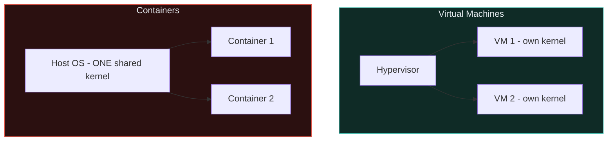
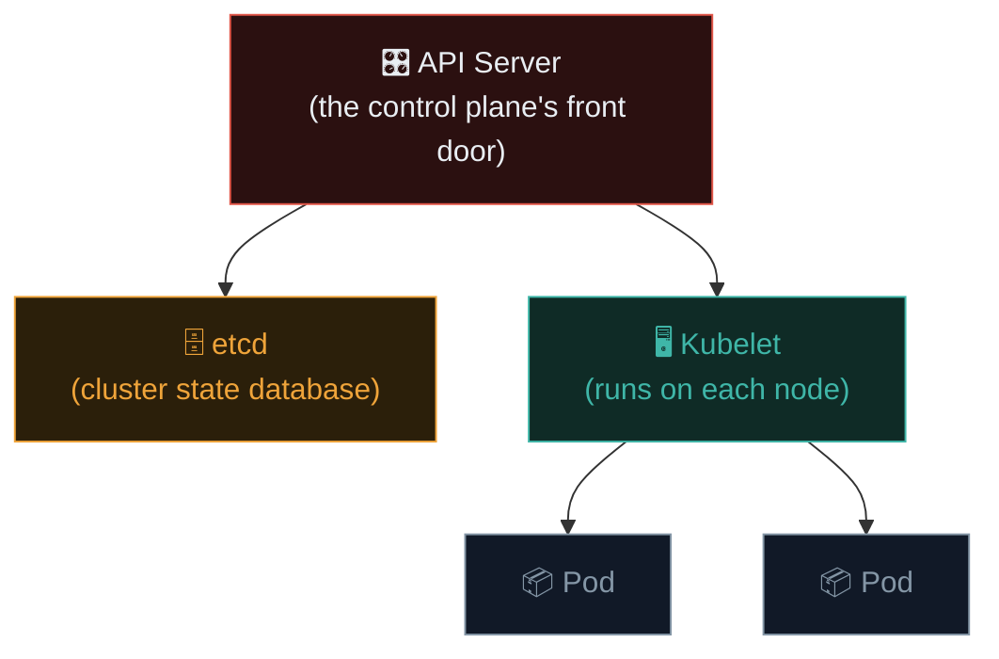

# Containers & Kubernetes security

Modern applications increasingly run in containers, orchestrated by Kubernetes — introducing an entirely new layer of infrastructure with its own distinct security model, building directly on the Linux fundamentals from Path 03 and the cloud concepts from the previous lesson.

## What containers actually are, security-wise

Recall Path 03.4's virtualization lesson — a container is **not** a full virtual machine. Containers share the **host machine's kernel**, isolated from each other via Linux kernel features (namespaces, cgroups) rather than full hardware virtualization. This distinction has a direct security consequence: a container escape can potentially compromise the **host itself**, not just "another VM" — the isolation boundary is fundamentally thinner than full virtualization.



## Common Docker misconfigurations

### Running containers as root

By default, many container images run their main process as **root** inside the container — if an attacker achieves code execution within that container and then finds an escape vector, they escape as root on the host too.

```dockerfile
# VULNERABLE — runs as root by default:
FROM ubuntu:22.04
COPY app /app
CMD ["/app"]

# BETTER — explicitly run as a non-root user:
FROM ubuntu:22.04
RUN useradd -m appuser
COPY app /app
USER appuser
CMD ["/app"]
```

### Exposed Docker daemon socket

The Docker daemon socket (`/var/run/docker.sock`) grants **full control** over the Docker host — accidentally mounting it into a container, or exposing the Docker API over the network without authentication, is equivalent to granting root access on the entire host:

```bash
# If a container has the Docker socket mounted, it can control ALL
# containers on the host, including spinning up new privileged ones:
docker -H unix:///var/run/docker.sock run -v /:/host -it alpine chroot /host sh
# This escapes to a full root shell on the underlying host
```

### Privileged containers

```bash
# DANGEROUS — grants the container nearly all host kernel capabilities:
docker run --privileged -it ubuntu

# A privileged container can, among other things, directly access host
# devices and, in many configurations, mount the host filesystem:
docker run --privileged -it ubuntu chroot /host_mount sh
```

`--privileged` should be treated as an emergency-only escape hatch, essentially equivalent to disabling container isolation almost entirely — a huge red flag in any security review.

### Vulnerable base images and dependencies

Directly connecting to Path 11.1's A06 (Vulnerable and Outdated Components) — container images built from outdated base images inherit **every** unpatched vulnerability in that base layer:

```bash
# Scan a container image for known vulnerabilities — Ishfaq's own
# professional toolchain includes exactly this tool:
trivy image example-app:latest

# Scan a Dockerfile itself for misconfigurations:
trivy config Dockerfile
```

**Trivy** (mentioned in Ishfaq's own professional context around the trivy-action supply-chain incident referenced earlier in this course's development) is a widely-used open-source scanner checking both known CVEs in image layers and misconfigurations in the Dockerfile/Kubernetes manifests themselves — directly relevant to the SCA (Software Composition Analysis) concept from Path 11.1.

## Kubernetes — orchestrating containers at scale, and its own attack surface

**Kubernetes (K8s)** manages large numbers of containers across many machines — introducing its own control plane, API, and permission model on top of the container concepts above.



### RBAC misconfigurations — the Kubernetes IAM equivalent

Directly analogous to the cloud IAM concepts from the previous lesson, Kubernetes uses **RBAC (Role-Based Access Control)** to govern what each user/service account can do within the cluster:

```yaml
# DANGEROUS — grants full cluster-admin-equivalent permissions:
apiVersion: rbac.authorization.k8s.io/v1
kind: ClusterRoleBinding
metadata:
  name: overly-permissive-binding
subjects:
- kind: ServiceAccount
  name: my-app-service-account
  namespace: default
roleRef:
  kind: ClusterRole
  name: cluster-admin
  apiGroup: rbac.authorization.k8s.io
```

A compromised pod running with an overly-permissive service account can potentially control the **entire cluster** — precisely mirroring the cloud IAM privilege escalation concerns from the previous lesson, just scoped to the Kubernetes control plane instead.

### Exposed Kubernetes dashboard/API

An unauthenticated or weakly-authenticated Kubernetes API server exposed to the internet is a critical, often actively-scanned-for misconfiguration:

```bash
# Shodan search for exposed Kubernetes API servers (Path 11.3's technique,
# applied to this specific service):
shodan search "product:kubernetes"

# Checking your own cluster's exposure (only against authorized clusters):
kubectl cluster-info
```

### Container escape techniques

Beyond the Docker-level escapes above, Kubernetes-specific escape vectors include:

- **hostPath volume mounts** — mounting sensitive host directories directly into a pod, similar in spirit to the Docker socket mount issue above.
- **Privileged pods** (the Kubernetes equivalent of `docker run --privileged`).
- **Node compromise via kubelet API** — an exposed, unauthenticated kubelet API can allow direct command execution on the underlying node.

## Kubernetes Secrets — less secret than the name suggests

A common source of misplaced confidence: Kubernetes **Secrets** are, by default, only **base64-encoded**, not encrypted — anyone with API access to read a Secret object (or with `etcd` access, since Secrets are stored there) can trivially decode it back to plaintext:

```bash
kubectl get secret my-secret -o jsonpath='{.data.password}' | base64 -d
```

This matters directly for the RBAC discussion above — a service account with overly broad read permissions on Secrets across namespaces effectively has read access to every credential stored in the cluster, base64 encoding providing essentially zero real protection against anyone who already has that access. Production clusters should enable **encryption at rest** for etcd specifically, and increasingly, teams route secrets through a dedicated external secrets manager (the same AWS Secrets Manager / HashiCorp Vault tools from the previous lesson) rather than relying on native Kubernetes Secrets as the sole protection layer.

## Image signing and supply chain integrity

Beyond scanning an image's *contents* for known vulnerabilities (Trivy's job above), a separate and increasingly important question is whether an image is genuinely the one your team built at all, or whether it's been tampered with somewhere in the registry/pull chain. Tools like **cosign** (part of the Sigstore project) let teams cryptographically sign container images at build time and verify that signature before ever deploying them:

```bash
cosign sign --key cosign.key example-registry/example-app:latest
cosign verify --key cosign.pub example-registry/example-app:latest
```

This directly extends the software supply-chain security theme threaded throughout this course (the trivy-action incident referenced above, Path 04's PyPI typosquatting mention) — a perfectly scanned, vulnerability-free image is still a risk if there's no cryptographic guarantee it's actually the image your CI/CD pipeline produced, rather than a substituted one injected somewhere between build and deployment.

## The defender's view

- **Never run containers as root** unless there's a specific, well-understood reason — set an explicit non-root `USER` in every Dockerfile.
- **Never mount the Docker socket** into a container unless absolutely necessary, and treat any container that does as equivalent to full host root access.
- **Avoid `--privileged`** entirely in production; use specific, minimal Linux capabilities instead if elevated access is genuinely required.
- **Scan images continuously** with Trivy (or similar) integrated directly into CI/CD pipelines — exactly the kind of SAST/DAST/SCA pipeline integration work central to Ishfaq's own professional role.
- **Apply least-privilege RBAC** — avoid `cluster-admin` bindings for application service accounts; scope permissions to exactly what each workload needs.
- **Never expose the Kubernetes API or dashboard** without strong authentication and network restriction (recall Path 12.4's firewall/VPN concepts, applied here).
- **Use Pod Security Standards** (Kubernetes' built-in mechanism for restricting privileged/risky pod configurations cluster-wide).

## 🧪 Lab — Container security practice

```bash
# 1. Scan a public image with Trivy:
trivy image nginx:1.18   # a deliberately older version, likely to show known CVEs

# 2. Experiment with container escape concepts in an isolated lab
#    (never against production systems):
docker run --rm -it --privileged alpine sh
# Inside the container, explore what host-level access --privileged actually grants:
ls /dev
mount

# 3. If you have access to a personal/learning Kubernetes cluster (minikube
#    or kind are free, local options), review the default RBAC bindings:
kubectl get clusterrolebindings -o wide
kubectl auth can-i --list --as=system:serviceaccount:default:default
```

Also revisit Path 03.4's Docker installation from earlier in this course, and try building a genuinely hardened Dockerfile (non-root user, minimal base image, explicit least-privilege) for any small project you've built during this course — directly applying this lesson's defensive guidance.

:::challenge Test yourself
A container has the host's Docker socket (`/var/run/docker.sock`) mounted inside it "for convenience," so the application can manage other containers programmatically. Why does this effectively grant the container full root access to the entire host, not just to Docker itself?

<details><summary>Show answer</summary>The Docker socket provides <strong>full control over the Docker daemon</strong>, which itself runs with root privileges on the host. A process with access to this socket can instruct Docker to start a <em>new</em> container with the host's entire root filesystem mounted inside it (e.g., <code>-v /:/host</code>) and then <code>chroot</code> into that mount — effectively achieving a full root shell on the underlying host machine, entirely bypassing container isolation. This is why mounting the Docker socket into any container is functionally equivalent to granting that container unrestricted root access to the host itself, regardless of how limited the container's own explicit permissions appear.</details>
:::

## Key terms

- **Container escape** — breaking out of container isolation to access or control the underlying host.
- **Docker socket** — the Docker daemon's control interface; access to it is equivalent to host root access.
- **Trivy** — the widely-used open-source container image and configuration vulnerability scanner.
- **Kubernetes RBAC** — the cluster-level, Kubernetes-native access control system, analogous to cloud IAM.
- **Pod Security Standards** — Kubernetes' built-in mechanism restricting privileged/risky pod configurations.

## Recap

- Containers share the host kernel — a thinner isolation boundary than full virtual machines, making escapes more consequential.
- Root-running containers, exposed Docker sockets, and `--privileged` flags are the most common, most severe Docker misconfigurations.
- Trivy scans both image vulnerabilities (SCA) and configuration misconfigurations, directly relevant to real CI/CD pipeline security work.
- Kubernetes RBAC mirrors cloud IAM concerns — overly-permissive service account bindings can compromise entire clusters.
- Defensive practice directly mirrors every offensive technique in this lesson — non-root users, minimal privileges, continuous scanning, least-privilege RBAC.

???refs
- [Trivy official documentation](https://trivy.dev/) — comprehensive scanning tool reference.
- [Docker Security documentation](https://docs.docker.com/engine/security/) — official best practices.
- [Kubernetes — Pod Security Standards](https://kubernetes.io/docs/concepts/security/pod-security-standards/) — official documentation.
- [HackTricks — Docker/Kubernetes Security](https://book.hacktricks.xyz/pentesting/pentesting-docker) — extensive practical escape/attack technique reference.
???

**Next up →** [Malware analysis basics](#/lesson/16-advanced/malware-analysis)
