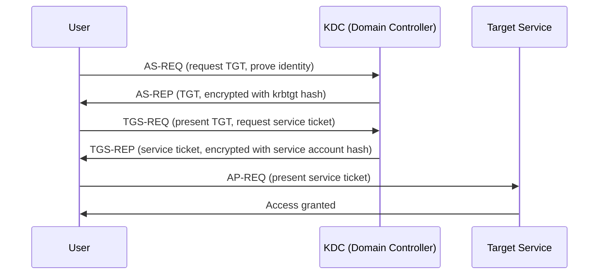

# Kerberos Attacks, Deep Dive

The Active Directory lesson introduced Kerberoasting and AS-REP Roasting by name. This lesson goes deeper into how Kerberos authentication actually works mechanically, since understanding the protocol makes every attack against it click as a logical consequence rather than a memorized trick — directly connecting to Path 14's lateral-movement-techniques lesson's Kerberos coverage from the credential-theft angle.

## How Kerberos authentication actually works

Kerberos is a **ticket-based** authentication protocol built around a trusted third party — the **Key Distribution Center (KDC)**, running on every Domain Controller. The core flow: a user authenticates once to get a **Ticket Granting Ticket (TGT)**, then presents that TGT to request **service tickets (TGS)** for specific resources, without ever re-entering a password for each new service accessed.

## Kerberoasting, now mechanically explained

The Active Directory lesson named Kerberoasting; here's exactly why it works: any authenticated domain user can request a service ticket (TGS) for **any** service account registered with a Service Principal Name (SPN), and the KDC issues it — no special privilege required. That service ticket is encrypted using the **service account's own password hash**. Since any user can request this ticket, and it's encrypted offline-crackable material, an attacker with no privileges beyond a basic domain account can harvest tickets for every SPN-registered service account and attempt to crack them offline, entirely without triggering the failed-login detection a direct password-guessing attack would.

## AS-REP Roasting, the pre-authentication gap

AS-REP Roasting targets a narrower, specific misconfiguration: accounts with **Kerberos pre-authentication disabled**. Normally, requesting a TGT (the AS-REQ step above) requires proving knowledge of the password first; with pre-authentication disabled, the KDC issues the AS-REP (containing crackable material) to *anyone* who simply requests it for that specific username, no proof of any password required at all — a genuinely more severe gap than Kerberoasting, since it requires zero prior authentication whatsoever, just knowledge of a valid username.

## Why offline cracking is the shared mechanism

Directly connecting to Path 00's hashing and cracking lesson: both attacks share the exact same fundamental weakness — the KDC returns material encrypted with a password-derived key, and that material can be taken offline and attacked with unlimited, undetected guessing attempts (via `hashcat`), unlike an online login attempt that would trigger account lockout policies after a small number of failures. This is precisely why both attacks are so effective against weak service account passwords specifically — those accounts are frequently set once, years ago, and never rotated, unlike a human user's password that account-lockout and complexity policies push toward reasonable strength.

## Golden and Silver Tickets, revisited with real mechanics

The Active Directory lesson's Golden Ticket coverage becomes clearer with the flow above in mind: since the TGT itself is encrypted with the **krbtgt account's** password hash, an attacker who obtains that specific hash (typically requiring Domain Admin-level access already) can forge a completely valid TGT for *any* user, including ones that don't actually exist, entirely offline — this is why Golden Ticket persistence is so severe and why the only true remediation is rotating the krbtgt password (twice, per Microsoft's guidance, since it retains two valid password generations simultaneously).

:::challenge Test yourself
Why is AS-REP Roasting considered a more severe finding than Kerberoasting, even though both ultimately produce offline-crackable material?

Show answer
Kerberoasting requires the attacker to already hold valid domain credentials of some kind — a basic, low-privileged domain account is enough to request service tickets, but authentication as *some* user is still a prerequisite before the attack can even begin. AS-REP Roasting requires no prior authentication at all: because the targeted account has Kerberos pre-authentication disabled, the KDC will issue the crackable AS-REP material to literally anyone who requests it for that specific username, without that requester ever needing to prove any credential whatsoever first. This means AS-REP Roasting can be attempted by someone with zero domain access — just a list of possibly-valid usernames, itself often obtainable through OSINT (Path 14) — making it a genuinely more severe exposure than Kerberoasting, which at minimum requires the attacker to have already obtained some valid, if low-privileged, foothold in the domain.

:::

## Key terms

- **KDC (Key Distribution Center)** — the trusted Kerberos authentication service running on every Domain Controller.
- **TGT (Ticket Granting Ticket)** — the initial ticket obtained after authenticating, used to request further service tickets without re-entering a password.
- **AS-REP Roasting** — harvesting offline-crackable authentication material from accounts with Kerberos pre-authentication disabled, requiring no prior credentials.

## Recap

- Kerberos is a ticket-based protocol where a TGT, obtained once, is exchanged for service-specific tickets without repeated password entry.
- Kerberoasting exploits that any user can request a crackable service ticket for any SPN-registered account.
- AS-REP Roasting exploits accounts with pre-authentication disabled, requiring no prior credentials at all — a more severe gap than Kerberoasting.
- Both attacks share the same underlying weakness as offline password cracking generally: no online lockout policy limits guessing attempts once material is captured.

**Next up →** [Active Directory persistence & detection](#/lesson/16-advanced/ad-persistence-and-detection)
