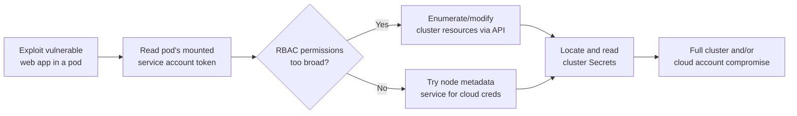

# Kubernetes Attack Paths

The containers-and-Kubernetes lesson introduced RBAC misconfiguration briefly. This lesson chains together a full, realistic Kubernetes compromise path from a single vulnerable pod to full cluster control — directly connecting to Path 14's lateral-movement-techniques lesson's "foothold to full compromise" framing, applied here to container orchestration specifically.

## The realistic starting point: one compromised pod

Nearly every real-world Kubernetes attack begins the same way the previous lesson's container-escape techniques described: a vulnerable application running inside a single pod gets compromised (through an exploited web vulnerability, exactly like the ones Path 11 covers) — the attacker's actual goal from there is escalating from "control of one application pod" to "control of the entire cluster," and Kubernetes offers several distinct paths to get there.

## Path one: the service account token

Every pod, by default, has a **service account token** mounted into its filesystem (`/var/run/secrets/kubernetes.io/serviceaccount/token`) — this token authenticates to the Kubernetes API server as that pod's assigned service account. If that service account has been granted overly broad RBAC permissions (directly connecting to the previous lesson's least-privilege coverage), an attacker who reads this token from a compromised pod can use it to query or modify cluster resources far beyond that single pod, entirely through the legitimate Kubernetes API rather than any further exploitation.

```
kubectl --token=$(cat /var/run/secrets/kubernetes.io/serviceaccount/token) \
  --server=https://kubernetes.default get pods --all-namespaces
```

## Path two: the metadata service, again

Directly connecting to Path 11's SSRF-to-cloud-metadata lesson and the previous IAM lesson: Kubernetes clusters running on cloud infrastructure (EKS, GKE, AKS) sit on top of cloud compute instances with their own metadata service — a compromised pod that can reach that underlying node's metadata endpoint may be able to steal the **node's own cloud IAM credentials**, potentially escalating from "cluster access" to "cloud account access" entirely, a genuinely severe escalation that crosses from container security into the cloud security lesson's territory.

## Path three: exposed dashboards and etcd

Kubernetes clusters occasionally expose administrative interfaces without proper authentication — the **Kubernetes Dashboard**, if misconfigured with excessive default permissions, or **etcd** (the cluster's backing datastore, storing every Secret in the cluster, sometimes in plaintext depending on encryption-at-rest configuration) left reachable without authentication represents one of the most severe possible findings, since etcd access is effectively equivalent to full cluster compromise — every Secret, every ConfigMap, every credential the cluster manages is stored there.

## Chaining it together: a realistic attack narrative



## Why this matters for real-world defense

Directly connecting to the previous lesson's Trivy and RBAC coverage: this chained attack narrative is precisely why Kubernetes security can't be reduced to "scan container images for vulnerabilities" alone — the actual severe compromise path in most real incidents runs through RBAC over-permissioning and metadata service exposure, not through a vulnerable base image, meaning defensive priority has to include the identity and network layers this lesson covers, not just image scanning alone.

:::challenge Test yourself
Why does a compromised pod's default service account token represent a genuine escalation risk even when the pod itself was never granted any explicit permissions by name?
<details><summary>Show answer</summary>Kubernetes mounts a default service account token into every pod automatically unless explicitly disabled, and that default service account frequently has RBAC bindings attached at the namespace or cluster level that were configured for entirely different purposes — sometimes bound broadly during initial cluster setup for convenience, sometimes inherited from a namespace-wide default that was never revisited once the cluster moved from testing into production. An attacker who compromises the application doesn't need the pod itself to have been granted anything special by name; they simply need to read the token file already sitting on disk in every pod by default, then use it to authenticate as whatever that default service account already happens to be permitted to do — meaning the actual risk isn't about what permissions the vulnerable application was intentionally given, it's about what permissions the cluster's overall RBAC configuration happens to grant to the service account that pod runs under, which is exactly why auditing default service account bindings is a standard first step in any real Kubernetes security review.</details>
:::

## Key terms

- **Service account token** — a credential automatically mounted into every pod, authenticating it to the Kubernetes API as its assigned service account.
- **etcd** — Kubernetes' backing datastore, storing every Secret and ConfigMap; unauthenticated access is equivalent to full cluster compromise.
- **Node metadata service** — the underlying cloud instance's metadata endpoint, reachable from a compromised pod and potentially exposing the node's own cloud credentials.

## Recap

- Real Kubernetes compromise chains typically escalate from one compromised pod through its default service account token to broader cluster access.
- Cloud-hosted clusters add a further escalation path through the underlying node's metadata service, potentially exposing cloud IAM credentials entirely.
- Unauthenticated etcd or dashboard access is effectively equivalent to full cluster compromise, since every cluster Secret lives there.
- Defensive priority must include RBAC and network-layer hardening, not just container image vulnerability scanning alone.

**Next up →** [Malware analysis basics](#/lesson/16-advanced/malware-analysis)
