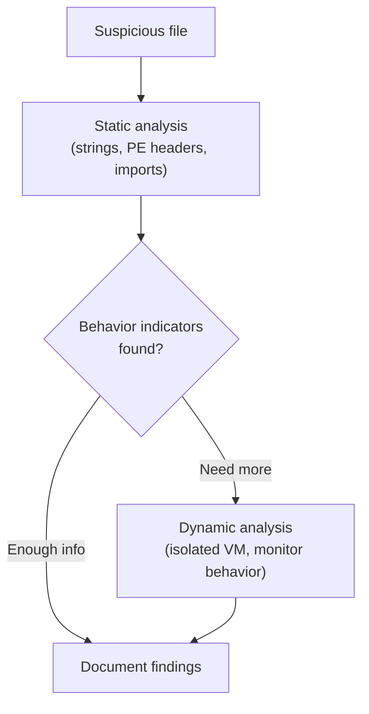

# Malware Analysis Lab

This lab practices the two core malware analysis techniques — **static** (examining a file without running it) and **dynamic** (observing behavior while it runs) — safely, using tools any analyst uses daily.

## Recommended setup

:::danger Safety first — this is non-negotiable
Real malware analysis requires a dedicated, fully isolated analysis VM with **no network bridge to your host or the internet** (host-only or fully isolated networking mode), and you should snapshot it before every session so you can instantly roll back. Never run untrusted samples on your main machine, ever, under any circumstance. For this lab, use only samples explicitly provided as safe training material — never download arbitrary "real" malware from the open internet.
:::

- **Tools**: [PEStudio](https://www.winitor.com/) (free static analysis for Windows executables), Process Monitor / Process Explorer (Sysinternals, free), Wireshark (Path 12), and [VirusTotal](https://www.virustotal.com/) for checking known-sample reputation.
- **Safe samples**: [MalwareBazaar](https://bazaar.abuse.ch/) provides real, defanged malware samples specifically for researcher use, or use any of the many free "training" samples built specifically for teaching static/dynamic analysis basics (search "malware analysis practice sample," several security training sites provide these safely, pre-defanged).

## Tasks

1. **Static analysis — strings.** Before ever running a sample, extract readable strings from it:
   ```bash
   strings suspicious.exe | grep -i "http\|\.dll\|password\|admin"
   ```
   Even this simple command frequently reveals hardcoded URLs, suspicious DLL imports, or credential-related strings — genuinely useful intelligence before any dynamic step.
2. **Static analysis — PE headers and imports.** Open the sample in PEStudio and review its imported functions. Watch specifically for suspicious API combinations: `VirtualAlloc` + `WriteProcessMemory` + `CreateRemoteThread` together is a classic process-injection pattern; `InternetOpen` + `InternetConnect` suggests network communication ("phoning home").
3. **Dynamic analysis — behavior monitoring.** In your isolated VM, run the sample while Process Monitor is capturing, and observe: what files does it create or modify? What registry keys does it touch? Does it spawn child processes? Filter Process Monitor's noisy output down to just your sample's process name to keep this manageable.
4. **Dynamic analysis — network behavior.** With Wireshark capturing on your isolated VM's network adapter, note whether the sample attempts any outbound connection at all — even in a fully isolated network, you'll see the *attempt*, which is itself valuable intelligence about intended command-and-control behavior.



5. **Check for packing before trusting your strings output.** Before drawing conclusions from Task 1's strings output, do a quick sanity check: does the sample have a suspiciously small number of readable strings relative to its file size? A packed or obfuscated sample often produces almost nothing useful from `strings` alone, which is itself a meaningful finding — it tells you dynamic analysis will likely carry most of the real weight for this specific sample, rather than static analysis being incomplete or done wrong.

:::tip Cross-check with VirusTotal
Once you've done your own static/dynamic work, check the sample's hash against VirusTotal — comparing your own findings against what dozens of established antivirus engines and sandboxes already know is a genuinely useful sanity check and a normal part of real analyst workflow, not "cheating."
:::

:::challenge Document like a real analyst
Write up your findings: what the sample appears to do (based on your static and dynamic observations), a list of **Indicators of Compromise (IOCs)** — file hashes, dropped file names/paths, registry keys, network indicators — and how you'd detect this specific sample in an environment (what would a detection rule look for?).
:::

## Key takeaway

Static and dynamic analysis are complementary, not competing techniques — static analysis is fast and safe but can be defeated by obfuscation or packing; dynamic analysis reveals real behavior but only shows what actually executes during your observation window. Real analysts default to both, in that order, exactly as practiced in this lab.

**Next up →** [Practical Linux Privilege Escalation Lab](#/lesson/16-advanced/practical-linux-privesc-lab)
