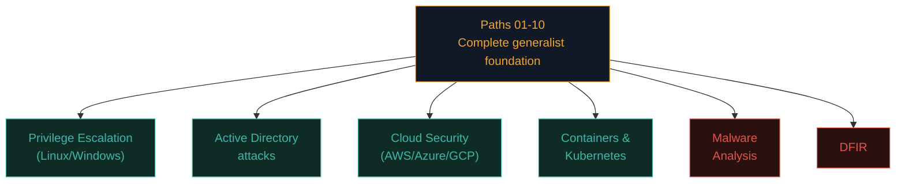
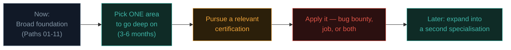

# Choosing your specialisation

You've now covered Linux/Windows privilege escalation, Active Directory, cloud security, containers/Kubernetes, malware analysis, and DFIR — a genuinely broad advanced toolkit. This closing lesson helps you decide where to focus next, and connects everything back to the final path ahead.

## The advanced landscape, assembled

## Mapping topics to career specialisations

| If you enjoyed... | Consider specialising in... | Typical roles |
|---|---|---|
| Linux/Windows privesc, AD attacks | **Offensive security / red teaming** | Penetration tester, red teamer |
| Cloud IAM, containers/K8s | **Cloud security** | Cloud security engineer, DevSecOps |
| Malware analysis | **Threat research / reverse engineering** | Malware analyst, threat intelligence researcher |
| DFIR | **Blue team / incident response** | SOC analyst, incident responder, forensics investigator |
| A mix, with strong dev/pipeline instincts | **Application security** | AppSec engineer |

There's no requirement to pick just one permanently — many experienced professionals (it is common to span AppSec engineering, penetration testing, and bug bounty hunting at the same time) maintain skills across several of these areas, moving between them as projects and interests evolve.

## How this path connects back to bug bounty (Path 15)

Recall Path 15.8's specific mention — this path directly expands what you can **chain** into a bug bounty report:

- Finding an SSRF (Path 11.8) that reaches cloud metadata (Path 16.4) and extracts IAM credentials with excessive permissions turns a "medium" SSRF into a "critical" full cloud account compromise finding.
- Finding an IDOR (Path 11.4/10.5) that happens to expose an internal admin panel, which itself has a default credential (Path 14.4) leading to a privilege escalation path (Path 16.1/11.2), builds exactly the kind of high-impact chained narrative Path 15.6 described.
- Active Directory knowledge (Path 16.3) is directly monetisable in bug bounty programs that include internal network or VPN-accessible scope, an increasingly common program type.

## How this path connects to formal certifications

Recall Path 14.1's certification list — the content in this path maps directly onto the practical exam content of the more advanced certifications:

- **OSCP** — heavily tests Linux/Windows privilege escalation (Path 16.1/11.2) and general exploitation methodology (Path 14).
- **CPENT** — explicitly tests AD attack chains, privilege escalation, IoT, binary exploitation, and pivoting.
- **GCFE/GCFA (SANS/GIAC)** — dedicated forensics certifications building directly on Path 16.7's DFIR content.
- **GREM (SANS/GIAC)** — dedicated malware reverse engineering certification building on Path 16.6.
- **Cloud-specific certifications** (AWS Certified Security - Specialty, Azure Security Engineer) — building on Path 16.4's cloud security content specifically.

## A realistic specialisation timeline

Resist the urge to try to master everything in this path simultaneously — genuine depth in one area, demonstrated through a certification or a real portfolio of work (Path 14.8/10.8's advice, reinforced here), consistently outperforms shallow familiarity spread across all six topics at once, especially early in a career.

## A note on the topic you haven't covered yet

One more genuinely distinct, rapidly-growing specialisation remains: **AI/LLM security** — covered in full in the final path of this course. Given how recently this field has matured, it represents a genuinely different kind of opportunity than the six areas in this path: less established literature, fewer experienced practitioners, and correspondingly more room for someone starting now to become a genuine early expert rather than one of thousands of established professionals in a mature field.

## Matching specialisation to work style, not just interest

Beyond which topic felt most intellectually engaging, it's worth honestly considering *how* you like to work, since these six areas genuinely differ in daily rhythm, not just subject matter. Offensive work (privesc, AD attacks) tends to be project-based and adversarial — deep focus for days or weeks on a single target, then moving on. DFIR and SOC-adjacent blue team work tends to be reactive and unpredictable — periods of routine monitoring punctuated by genuine urgency when an incident hits, often requiring comfort with being on-call. Malware analysis and threat research reward patient, methodical, almost puzzle-solving temperament, often working solo for extended stretches. Cloud/AppSec engineering work sits closer to traditional software engineering — more collaborative, more focused on building durable systems and pipelines than one-off investigations. None of these work styles is objectively better, but a genuine mismatch between your preferred pace and a specialisation's actual daily reality is a common, avoidable source of career dissatisfaction — worth weighing directly alongside pure topic interest.

## Purple teaming as a blended path

Recall Path 14.2's introduction to purple teaming — worth mentioning again here as a genuine specialisation option in its own right, not just a methodology. Some practitioners build careers specifically at the intersection of offense and defense: understanding attacker techniques deeply enough to simulate them (this path's offensive content) while also understanding detection engineering well enough to translate each technique into a concrete SIEM rule or Sysmon-based detection (Path 16.7's DFIR content). This blended role is genuinely well-suited to someone who found *both* the offensive privesc/AD material and the DFIR material equally engaging in this path, rather than clearly preferring one over the other — it's a smaller, more specialised niche than pure red or blue team work, but one that's increasingly valued as organisations mature past simply hiring separate offensive and defensive teams that rarely talk to each other.

## 🧪 Lab — Write your own specialisation plan

Drawing on everything from this path:

1. Which single topic from this path (privesc, AD, cloud, containers, malware analysis, DFIR) did you find most genuinely engaging — not just "important," but actually enjoyable to work through?
2. What's one certification or structured learning path (from this lesson's list, or Path 14.1's list) that would formalise and validate that specific interest?
3. What's one concrete project you could build or contribute to (a GOAD lab writeup, a Trivy-scanned hardened Dockerfile, a Volatility-based memory analysis writeup) that demonstrates this specific interest publicly?
4. How does this specialisation choice connect to your existing bug bounty practice (Path 15) or professional work?

This kind of deliberate, written specialisation plan — rather than passively continuing to consume content broadly — is exactly what turns a strong generalist foundation into genuine, demonstrable career depth.

:::challenge Reflection
Of everything covered in Path 16, which topic do you think has the steepest learning curve from here to genuine professional competence, and why might that same difficulty represent an opportunity rather than just an obstacle?

A thought on this
Malware analysis/reverse engineering and deep Active Directory attack-chain expertise are often considered to have the steepest genuine learning curves in this path — both require sustained, deliberate practice well beyond what any single course (including this one) can fully provide. But that same difficulty is precisely why professionals with genuine depth in these areas remain consistently in high demand — the skill's scarcity directly reflects its difficulty to acquire, which is exactly the kind of "steep curve now, strong differentiation later" tradeoff worth weighing deliberately when choosing where to invest your specific limited time and effort.

:::

## Key terms

- **Specialisation** — deliberately going deep in one advanced area rather than remaining broadly shallow across all of them.
- **GCFE/GCFA/GREM** — SANS/GIAC certifications specifically covering forensics and malware reverse engineering.

## Recap

- Path 16's six topics map onto distinct, real career specialisations — offensive security, cloud security, threat research, blue team/IR, and AppSec.
- This path's content directly expands what can be chained into higher-impact bug bounty findings (Path 15).
- Advanced certifications (OSCP, CPENT, GCFE/GCFA, GREM, cloud-specific certs) map directly onto this path's specific lesson content.
- Genuine depth in one chosen area consistently outperforms shallow breadth across all six, especially early in a career.
- Path 18's AI/LLM security represents a distinctly different, less-saturated opportunity given the field's early maturity.

???refs
- [SANS — Cybersecurity career roadmap](https://www.sans.org/cyber-security-careers/) — comprehensive specialisation and certification guidance.
- [Offensive Security — certification paths](https://www.offsec.com/courses-and-certifications/) — OSCP and related offensive certifications.
- [GIAC certifications](https://www.giac.org/certifications/) — GCFE, GCFA, GREM and the broader SANS/GIAC certification catalogue.
- [EC-Council — CPENT](https://www.eccouncil.org/train-certify/certified-penetration-testing-professional-cpent/) — the advanced practical certification referenced throughout this path.
???

## 🎉 You've finished Path 16

You now have advanced, hands-on exposure to privilege escalation on both major operating systems, Active Directory attack methodology, cloud and container security, malware analysis fundamentals, and digital forensics/incident response — the deep, specialised layer built on top of the complete generalist foundation from Paths 01-10.

**Next up →** [Cloud Security Lab](#/lesson/16-advanced/cloud-security-lab)
