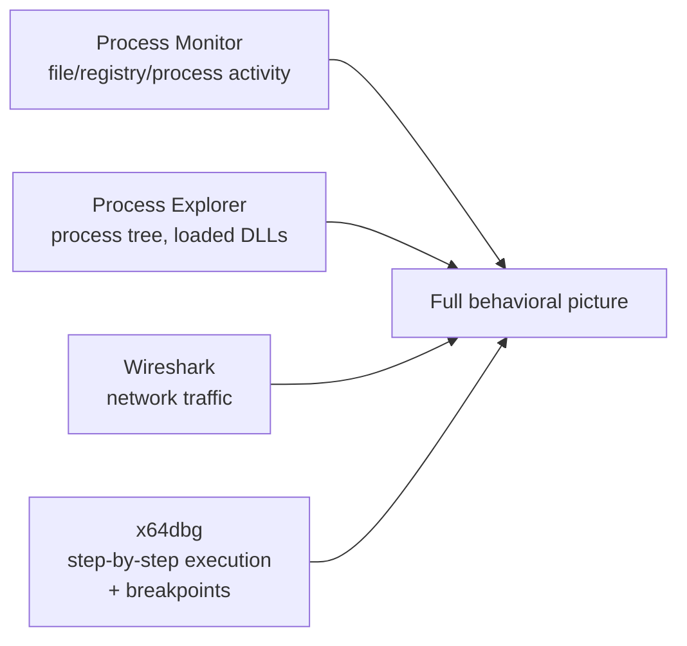

# Dynamic Analysis & Sandboxing

Static analysis and Ghidra get you a long way, but some questions are answered far faster (and some obfuscated/packed code is only meaningfully readable at all) by actually running a sample and watching what it does. This lesson covers building a proper sandbox and the core dynamic analysis workflow.

## Building a proper malware sandbox

:::danger This is non-negotiable, revisited
Path 11's malware analysis lab already established this, and it bears repeating with more force at this deeper level: a malware sandbox needs **full network isolation** from your host and the wider internet (host-only virtual networking, or fully air-gapped), and you should snapshot the VM before every single run so you can instantly revert. Never run untrusted samples anywhere else, ever.
:::

## Automated sandboxes — the fast first pass

Before manual dynamic analysis, automated sandboxes give you a fast behavioral summary:

- **[any.run](https://any.run/)** — a free-tier, browser-based interactive sandbox; you can watch a sample execute in real time and even interact with it, with automatic behavioral reporting.
- **[Cuckoo Sandbox](https://cuckoosandbox.org/)** (or its actively maintained forks like CAPEv2) — free, open-source, self-hosted automated malware analysis, producing a structured report of file system changes, registry modifications, and network activity.
- **VirusTotal's behavioral tab** — beyond the static hash-reputation lookup from Path 11's lab, VirusTotal also runs samples through several automated sandboxes and displays a behavioral summary directly.

These tools are an excellent fast triage step — often answering "is this worth deeper manual analysis, and roughly what does it do" in minutes, before you invest hours in manual work.

## Manual dynamic analysis — the toolkit

1. **Process Monitor (ProcMon)** — Sysinternals' free tool, captures every file system, registry, and process/thread event system-wide in real time. Filter down to just your sample's process name and watch its activity unfold live — this is dramatically more granular than the basic monitoring covered in Path 11's lab.
2. **Process Explorer** — shows the full process tree (what spawned what), loaded DLLs per process, and — critically for detecting process injection (the pattern flagged via imports in this path's static analysis lesson) — lets you spot a legitimate-looking process (like `svchost.exe`) that's unexpectedly hosting suspicious injected code.
3. **Wireshark** (Path 08, revisited here) — captures actual network traffic, confirming what a sample's imports merely suggested it *might* do (like the `InternetOpenA` import from the static analysis lesson).
4. **x64dbg** — a real debugger, letting you set breakpoints at specific addresses (often ones you identified as interesting during Ghidra static analysis) and step through execution instruction by instruction, inspecting register and memory values at each step — this is where static and dynamic analysis directly meet: form a hypothesis in Ghidra, verify it by breakpointing that exact address in x64dbg.

## API monitoring — a middle ground between ProcMon and a full debugger

Between ProcMon's system-wide event log and x64dbg's instruction-by-instruction stepping sits a genuinely useful middle tool: an **API monitor** (like the free API Monitor tool, or Frida's scripting capability from Path 15's mobile lessons, which works on desktop targets too) hooks specific Windows API functions and logs every call to them — the exact arguments passed and the value returned — without requiring you to manually set and manage breakpoints one at a time. Where ProcMon shows *that* a file was written or a registry key was touched, an API monitor shows the actual function-level narrative: which specific `CreateFile`, `RegSetValueEx`, or `HttpSendRequest` calls happened, in what order, with what parameters — often revealing the exact URL, file path, or registry value a sample used without needing to reconstruct it from lower-level file-system events. This is frequently the fastest way to confirm a specific hypothesis from static analysis (does this sample actually call `CryptEncrypt` on real file data, and with what key material) without committing to a full manual debugging session.

## Memory dumping and injected-code detection

When Process Explorer (above) reveals a suspicious process — a legitimate-looking `svchost.exe` hosting unexpected, unsigned code — the next step is confirming and extracting exactly what's been injected. Tools like **Process Hacker** (a more security-focused Process Explorer alternative) let you enumerate a running process's memory regions directly, flagging ones marked both writable *and* executable (`PAGE_EXECUTE_READWRITE`) — a combination legitimate code rarely needs but injected shellcode almost always requires, since the injector needs to write the payload into memory and then execute it from that same region. Dumping that specific memory region to disk and loading it into Ghidra as a raw binary lets you analyze the injected payload directly, entirely separate from the legitimate host process it was hiding inside — the same "extract the real code from its unpacking shell" principle from the packer workflow below, just applied to process injection instead of a file-level packer.

## A combined workflow example

Say static analysis (Path 16's static analysis lesson) flagged a high-entropy `.text` section — a likely packer. Rather than trying to statically reason through obfuscated code, the efficient move is:

1. Run the sample in your isolated sandbox under x64dbg, with execution paused at the entry point.
2. Set a breakpoint on `VirtualAlloc` (packers commonly allocate memory to unpack their real payload into) and let execution continue.
3. When the breakpoint hits, the packer has likely just finished decompressing the real payload into that newly allocated memory — dump that memory region and load *it* into Ghidra for static analysis, now working with the actual unobfuscated code instead of the packed shell.

This exact technique — using dynamic analysis specifically to defeat static analysis's blind spots, then handing the result back to static tools — is standard practice and covered further in this path's dedicated unpacking lesson.

:::tip Watch for time-based and environment-aware behavior
Some malware deliberately delays its malicious behavior (sleeping for minutes or checking the system date) specifically to outlast automated sandboxes, which typically only observe a sample for a short, fixed window. If an automated sandbox reports "no malicious behavior observed" for a sample whose static indicators (Path 16's static analysis lesson) still look suspicious, consider this possibility rather than concluding it's benign — this connects directly to the anti-analysis techniques covered later in this path.
:::

:::challenge Full dynamic analysis pass
Using a safe training sample (from a source like MalwareBazaar's training samples, referenced in Path 11's lab), run it in your isolated sandbox with Process Monitor and Wireshark both capturing. Document every file, registry, process, and network event attributable to the sample, and cross-reference this against what its static analysis (imports, strings) suggested beforehand — did the actual behavior match your static hypothesis?
:::

## Key takeaway

Dynamic analysis reveals ground truth quickly but only for the specific path actually executed — combining it deliberately with static analysis (using each to overcome the other's blind spot, as in the packer example above) is what real reverse engineering workflow actually looks like, far more than either technique used in isolation.

**Next up →** [Unpacking & Obfuscation](#/lesson/16-malware-re/unpacking-and-obfuscation)
