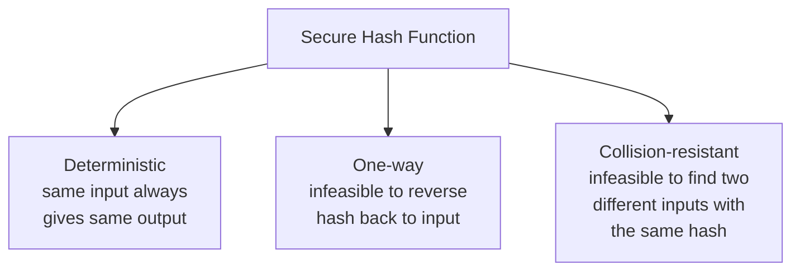
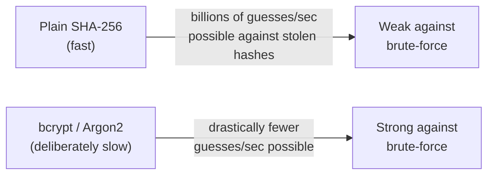

# Hashing Explained

Path 17's first lesson introduced hashing as a one-way "fingerprint" function. This lesson goes deeper — the properties that make a hash function actually secure, why password storage relies on it so heavily, and the specific mistakes that keep showing up in real breaches.

## The three properties a secure hash function needs



- **Deterministic** — the same input always produces the exact same hash, every single time, on any machine. This is what makes password verification work at all: hash whatever the user just typed, compare it to the stored hash from signup, and a match proves they typed the same original value.
- **One-way (pre-image resistant)** — given a hash output, it should be computationally infeasible to work backward and find the input that produced it, other than by brute-force guessing.
- **Collision-resistant** — it should be infeasible to find two *different* inputs that happen to produce the identical hash. A **collision** would let an attacker substitute one file/message for another while keeping the same hash "fingerprint," defeating the entire point of using a hash to verify integrity.

## SHA-256 and the evolution away from MD5/SHA-1

**SHA-256** (part of the SHA-2 family) is the current widely-used standard, producing a 256-bit (64 hex character) output regardless of input size:

```
SHA-256("") = e3b0c44298fc1c149afbf4c8996fb92427ae41e4649b934ca495991b7852b855
SHA-256("KashSec") = a genuinely different, unpredictable 64-character string, every time you hash "KashSec" specifically
```

Older algorithms **MD5** and **SHA-1** are now considered **cryptographically broken** — researchers have demonstrated practical collision attacks against both, meaning two different inputs producing the identical hash is no longer just theoretically possible but has been *actually done*. Neither should be used for any security-relevant purpose today, though you'll still encounter them in older systems and non-security contexts (like simple file integrity checks where collision resistance against a deliberate adversary isn't the concern).

## Why passwords need something beyond plain hashing

Here's a genuinely important nuance beyond "just hash it": plain SHA-256 alone is actually a poor choice for password storage, for a specific reason — it's *designed to be fast*, which is exactly the wrong property for password hashing. A fast hash function lets an attacker who steals a password database try billions of guesses per second against it.

The fix: **purpose-built password hashing algorithms** — **bcrypt**, **scrypt**, and **Argon2** — which are deliberately, tunably *slow* and memory-intensive, specifically to make large-scale guessing attacks impractically expensive even with powerful hardware.



## Salting — defeating precomputed attacks

Even a slow hash function has a remaining weakness if used naively: an attacker can precompute hashes for millions of common passwords once, then instantly look up any matching hash across *every* stolen database ever leaked (a **rainbow table**). The fix is a **salt** — a unique, random value generated per user and combined with their password before hashing, stored alongside the hash. This forces an attacker to crack each user's password individually, since identical passwords across different users now produce completely different hashes.

:::tip This is all handled automatically by good libraries
You never need to implement salting or choose iteration counts by hand in real applications — libraries like bcrypt's own implementation handle salt generation and storage automatically as part of a single function call. The critical takeaway is knowing *why* this matters (so you recognize a genuinely dangerous anti-pattern, like plain unsalted MD5 password storage, immediately when you see it) rather than implementing it from scratch yourself.
:::

## Hashing beyond passwords

Hashing shows up constantly beyond password storage: **file integrity verification** (downloading a file and comparing its published hash to confirm it wasn't tampered with in transit), **digital signatures** (Path 17's previous lesson — signing a hash of a message rather than the whole message, for efficiency), and **malware identification** (Path 16's malware analysis — a file's hash uniquely identifies it for lookup on VirusTotal without needing to share the actual file).

:::challenge Test yourself
Why does using a fast, general-purpose hash function like plain SHA-256 for password storage create a real security weakness, even though SHA-256 itself is a cryptographically secure hash function with no known collision attacks?
<details><summary>Show answer</summary>SHA-256 being cryptographically secure means it's collision-resistant and one-way in the mathematical sense — but "secure" in that sense says nothing about <em>speed</em>, and speed is exactly what matters for password-guessing resistance. SHA-256 is deliberately engineered to be extremely fast, since that's a desirable property for its many non-password uses (file integrity checks, blockchain applications). That same speed becomes a liability for password storage specifically: if an attacker steals a database of SHA-256-hashed passwords, modern hardware can compute billions of SHA-256 hashes per second, making brute-force guessing against common or moderately weak passwords genuinely fast and practical. Purpose-built password hashing functions like bcrypt or Argon2 are deliberately, tunably slow and memory-intensive specifically to make that same brute-force approach computationally expensive even at scale — the algorithm's cryptographic security isn't the issue, its speed characteristics are.</details>
:::

## Key terms

- **Hash collision** — two different inputs producing the identical hash output.
- **SHA-256** — the current widely-used standard general-purpose hash function.
- **bcrypt / Argon2** — purpose-built, deliberately slow password hashing algorithms.
- **Salt** — a unique random value per user, combined with a password before hashing to defeat precomputed lookup attacks.
- **Rainbow table** — a precomputed lookup table of hashes for common passwords, defeated by salting.

## Recap

- A secure hash function is deterministic, one-way, and collision-resistant; MD5 and SHA-1 are now broken and shouldn't be used for security purposes.
- Fast general-purpose hashes like SHA-256 are actually a poor password-storage choice, precisely because their speed helps attackers brute-force stolen hashes.
- bcrypt, scrypt, and Argon2 are purpose-built, deliberately slow password hashing algorithms designed specifically to resist this.
- Salting (a unique random value per user) defeats precomputed rainbow table attacks, forcing attackers to crack each password individually.

???refs
- [OWASP Password Storage Cheat Sheet](https://cheatsheetseries.owasp.org/cheatsheets/Password_Storage_Cheat_Sheet.html) — the authoritative, free, practical reference.
- [MD5 and SHA-1 collision research (Google's SHAttered)](https://shattered.io/) — a real, documented practical collision attack against SHA-1.
???

**Next up →** [Digital Signatures & Certificates](#/lesson/17-crypto-fundamentals/digital-signatures-certificates)
