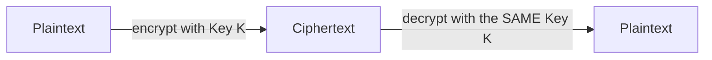

# Symmetric Encryption

The previous lesson introduced encryption as "scrambling data with a recoverable key." This lesson covers the first of the two major families: **symmetric encryption**, where the exact same key both locks and unlocks the data — the type of encryption you've already seen mentioned throughout this course, from ransomware's file encryption (Path 16) to HTTPS's actual data transfer (Path 02).

## The core idea — one shared key

Symmetric encryption is fast and efficient — genuinely fast enough to encrypt large files or entire network connections in real time, which is exactly why it's used for the actual bulk data transfer in HTTPS, disk encryption, and file encryption generally. The tradeoff is the **key distribution problem**: both parties need the exact same secret key beforehand, and getting that key safely from one party to the other, without anyone intercepting it along the way, is genuinely difficult — this exact problem is what the next lesson's asymmetric encryption elegantly solves.

## AES — the modern standard

**AES (Advanced Encryption Standard)** is the algorithm actually used almost everywhere symmetric encryption appears today — it's fast, extremely well-studied by cryptographers worldwide, and, when used correctly, has no known practical weaknesses. You've already encountered it by name: Path 16's ransomware lesson described exactly how AES encrypts victim files, and Path 15's mobile security lessons referenced AES-based encrypted storage.

AES works on fixed-size chunks of data called **blocks** (128 bits at a time), repeatedly scrambling each block through multiple rounds of substitution and mixing, controlled by the key. You don't need to understand the internal math to use AES correctly — but you absolutely need to understand the ways it's commonly misused, covered below.

## The XOR cipher — a simple, breakable illustration

This course's CTF Zone already had you break a repeating-key XOR cipher using a known-plaintext attack — worth revisiting here as a genuine (if weak) symmetric cipher: the same key repeatedly combined with plaintext via the XOR operation, and that identical key reverses it. It illustrates the core symmetric idea perfectly while also demonstrating exactly *why* real symmetric ciphers need to be far more sophisticated than simple repeating-key XOR — the CTF challenge's entire solve relied on XOR's structural weakness against known-plaintext attacks, a weakness AES is specifically engineered to resist.

## Modes of operation — where real mistakes happen

AES itself only defines how to scramble a single 128-bit block. Real data is almost always larger than one block, so a **mode of operation** defines how to chain many blocks together — and this is where a huge share of real-world symmetric encryption mistakes actually happen, not in AES itself.

:::danger ECB mode — a classic, visually demonstrable mistake
**ECB (Electronic Codebook) mode** encrypts each block completely independently, with no connection between them. This means identical plaintext blocks always produce identical ciphertext blocks — so patterns in the original data remain visible in the encrypted output. The canonical demonstration: encrypting an image with ECB mode still shows the image's outline, because large uniform color areas (identical blocks) encrypt to identical (still uniform-looking) ciphertext blocks. **CBC** and **GCM** modes fix this by chaining each block's encryption to the previous one (or using a unique value per encryption), eliminating this pattern-preservation entirely. Never use ECB mode for anything beyond a single block.
:::

## GCM mode — authenticated encryption, and why it's the modern default

CBC mode (mentioned above) fixes ECB's pattern-leakage problem, but it has its own quieter gap worth understanding: CBC alone provides confidentiality (the data is scrambled) but not **authenticity** — nothing stops an attacker from tampering with the ciphertext in transit in ways that produce predictable, exploitable changes to the decrypted plaintext, even without knowing the key. **GCM (Galois/Counter Mode)**, increasingly the default recommendation for new systems, solves this by combining encryption with a built-in **authentication tag** — a short, cryptographically-computed value appended to the ciphertext that lets the receiving side verify the data hasn't been tampered with at all before ever trusting the decrypted result. This combined property is called **authenticated encryption**, and it directly closes a class of real, historically-exploited attacks (padding oracle attacks against CBC being the classic example) where an attacker who can send crafted, tampered ciphertext to a system and observe how it responds can sometimes decrypt data without ever knowing the key at all — a genuinely subtle, non-obvious failure mode that GCM's built-in integrity check eliminates by design rather than requiring developers to bolt on a separate integrity check themselves (which, historically, was itself a common source of real-world mistakes).

## Key size matters — but bigger isn't always better

AES is typically used with 128-bit, 192-bit, or 256-bit keys — longer keys resist brute-force attacks more thoroughly (echoing the length-over-complexity password principle from Path 00), but AES-128 is already considered computationally infeasible to brute-force with any foreseeable technology; the difference between AES-128 and AES-256 matters far less in practice than *how* the encryption is actually implemented (correct mode of operation, unique values per encryption, secure key storage).

:::tip The real-world weak point is almost never the algorithm
When a "AES-encrypted" system gets broken in practice, the cause is overwhelmingly implementation error, not a flaw in AES itself: a hardcoded key baked into an app (Path 15's mobile insecure storage lesson), a reused "nonce" (a value meant to be unique per encryption, referenced in secure implementations), or ECB mode's pattern leakage above. This is exactly why "never roll your own crypto" (Path 07, Path 16) extends beyond just the algorithm choice to every detail of how it's actually implemented.
:::

:::challenge Test yourself
Why does ECB mode leak patterns in the original data, while CBC mode does not, even though both use the exact same underlying AES algorithm on each block?

Show answer
ECB mode encrypts every block completely independently using only the key — meaning two identical plaintext blocks anywhere in the data will always produce two identical ciphertext blocks, since the encryption process for each block has no awareness of any other block. CBC (Cipher Block Chaining) mode instead XORs each plaintext block with the <em>previous block's ciphertext</em> before encrypting it, meaning the encryption of any given block depends on everything that came before it in the data. Two identical plaintext blocks appearing at different points in a CBC-encrypted message will almost certainly produce completely different ciphertext, because each is combined with a different preceding ciphertext block before encryption — eliminating the pattern leakage that makes ECB mode visually and structurally insecure for anything beyond a single isolated block.

:::

## Key terms

- **Symmetric encryption** — encryption where the same key both encrypts and decrypts.
- **AES** — the modern standard symmetric encryption algorithm.
- **Block / mode of operation** — the fixed-size chunk AES processes at a time, and the scheme for chaining many blocks together.
- **ECB / CBC / GCM** — specific modes of operation, with ECB being the classic insecure choice for multi-block data.

## Recap

- Symmetric encryption uses one shared key for both encryption and decryption — fast, but requiring secure key distribution beforehand.
- AES is the modern standard, extremely well-studied and secure when implemented correctly.
- The mode of operation (how multiple blocks chain together) is a common real-world failure point — ECB mode leaks data patterns and should never be used for multi-block data.
- Real-world symmetric encryption breaks almost always come from implementation mistakes, not flaws in AES itself.

???refs
- [NIST: Advanced Encryption Standard (AES)](https://www.nist.gov/publications/advanced-encryption-standard-aes) — the official standard specification.
- [The ECB Penguin](https://blog.filippo.io/the-ecb-penguin/) — the famous, genuinely illustrative visual demonstration of ECB's pattern leakage.
???

**Next up →** [Asymmetric Encryption](#/lesson/17-crypto-fundamentals/asymmetric-encryption)
