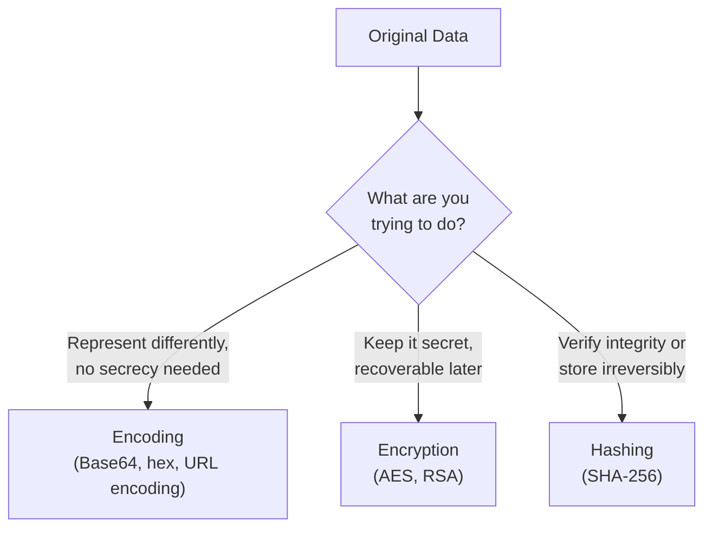

# What is cryptography?

You've already met cryptography scattered throughout this course — Base64 encoding in the CTF Zone, password hashing in Path 06, AES and RSA in ransomware's mechanics (Path 16). This path starts from zero and builds the foundation that makes every one of those moments make real sense, rather than feeling like scattered vocabulary.

## The three things people confuse constantly

Almost everyone new to security mixes up three genuinely different concepts. Getting this distinction solid, right now, will save you real confusion for the rest of this course:

| Concept | What it does | Can it be reversed? |
|---|---|---|
| **Encoding** | Represents data in a different format | Yes, by anyone — no secret needed |
| **Encryption** | Scrambles data using a secret key | Yes, but only with the correct key |
| **Hashing** | Produces a fixed-size fingerprint of data | No — one-way, by design |



## Encoding — not security at all

This course's CTF Zone crypto challenges already demonstrated this directly: Base64 is **encoding**, not encryption — anyone can decode it instantly, with no secret required. Encoding exists purely to represent data in a different, more convenient format (binary data as printable text, for instance) — it provides zero confidentiality. Treating encoded data as "protected" is a genuinely common, genuinely dangerous real-world mistake.

## Encryption — scrambling with a recoverable secret

**Encryption** transforms readable data ("plaintext") into unreadable data ("ciphertext") using a **key** — and critically, it's designed to be reversed by anyone holding the correct key, and only by them. This path's next two lessons cover the two major families in depth: **symmetric** encryption (one shared key locks and unlocks) and **asymmetric** encryption (a public key locks, a different private key unlocks).

A simple, ancient example to build intuition — the **Caesar cipher**, referenced back in this course's CTF Zone: shift every letter forward by a fixed number of positions in the alphabet.

```
Plaintext:  ATTACK AT DAWN
Key:        shift by 3
Ciphertext: DWWDFN DW GDZQ
```

This is genuinely, trivially breakable (there are only 25 possible shifts to try), but it demonstrates the core idea every modern cipher builds on: a transformation, controlled by a key, that's easy to reverse *if you know the key* and hard to reverse if you don't.

## Hashing — the one-way fingerprint

**Hashing** takes data of any size and produces a fixed-size output (a "hash" or "digest") — and, critically, this process is deliberately **one-way**: there's no key to recover the original data from its hash, by design. This is exactly why Path 06's passwords-and-hashing lesson insists passwords be *hashed*, never encrypted, for storage: even the service storing your password should never be able to recover its plaintext value, only verify a match by hashing whatever you type and comparing.

```
SHA-256("password123") = ef92b778bafe771e89245b89ecbc08a44... (always the same output for this exact input)
SHA-256("password124") = 8a9c1b5a...  (completely different output — even a tiny input change scrambles everything)
```

That last property — a tiny input change producing a completely different output — is called the **avalanche effect**, and it's exactly what makes hashing useful for detecting *any* tampering with data, not just passwords.

:::tip A quick way to remember the distinction
Ask: "Do I need to get the original data back?" If yes, and you don't mind anyone being able to reverse it, that's **encoding**. If yes, but only someone with a secret should be able to, that's **encryption**. If no — you only ever need to *verify*, never *recover* — that's **hashing**.
:::

:::challenge Test yourself
Why is it a serious security mistake to "encrypt" a password with a reversible scheme instead of hashing it, even if the encryption key itself is kept perfectly secret?
<details><summary>Show answer</summary>Encryption is designed to be reversible by anyone holding the key — which means whoever controls that key (the service operator, or an attacker who steals it) can recover every user's actual plaintext password at once. Hashing has no key to steal in the first place; even the service itself cannot recover the original password, only verify a match. Since password reuse across sites is extremely common (Path 00's passwords lesson), a reversible scheme turns a single leaked key into a mass password-recovery event across every user, while a properly hashed database (even if stolen) requires attackers to crack each hash individually — dramatically slower and, with a strong unique password, often practically infeasible.</details>
:::

## Key terms

- **Plaintext / ciphertext** — readable original data, and its encrypted, unreadable form.
- **Key** — the secret value controlling an encryption/decryption operation.
- **Encoding** — a reversible data format transformation with no secrecy property.
- **Avalanche effect** — a tiny input change producing a drastically different hash output.

## Recap

- Encoding, encryption, and hashing are three genuinely different tools, distinguished by whether a secret is involved and whether the transformation is meant to be reversed.
- Encoding (like Base64) provides zero confidentiality — it's a format change, not protection.
- Encryption is reversible only with the correct key; hashing is deliberately one-way, with no key to recover the original at all.
- This distinction underlies password storage (hash, never encrypt), data confidentiality (encrypt), and data transmission formats (encode) throughout the rest of this course.

???refs
- [Khan Academy: Journey into cryptography](https://www.khanacademy.org/computing/computer-science/cryptography) — a free, excellent, beginner-friendly video series.
- [Crypto101](https://www.crypto101.io/) — a free, approachable introductory cryptography book.
???

**Next up →** [Symmetric Encryption](#/lesson/17-crypto-fundamentals/symmetric-encryption)
