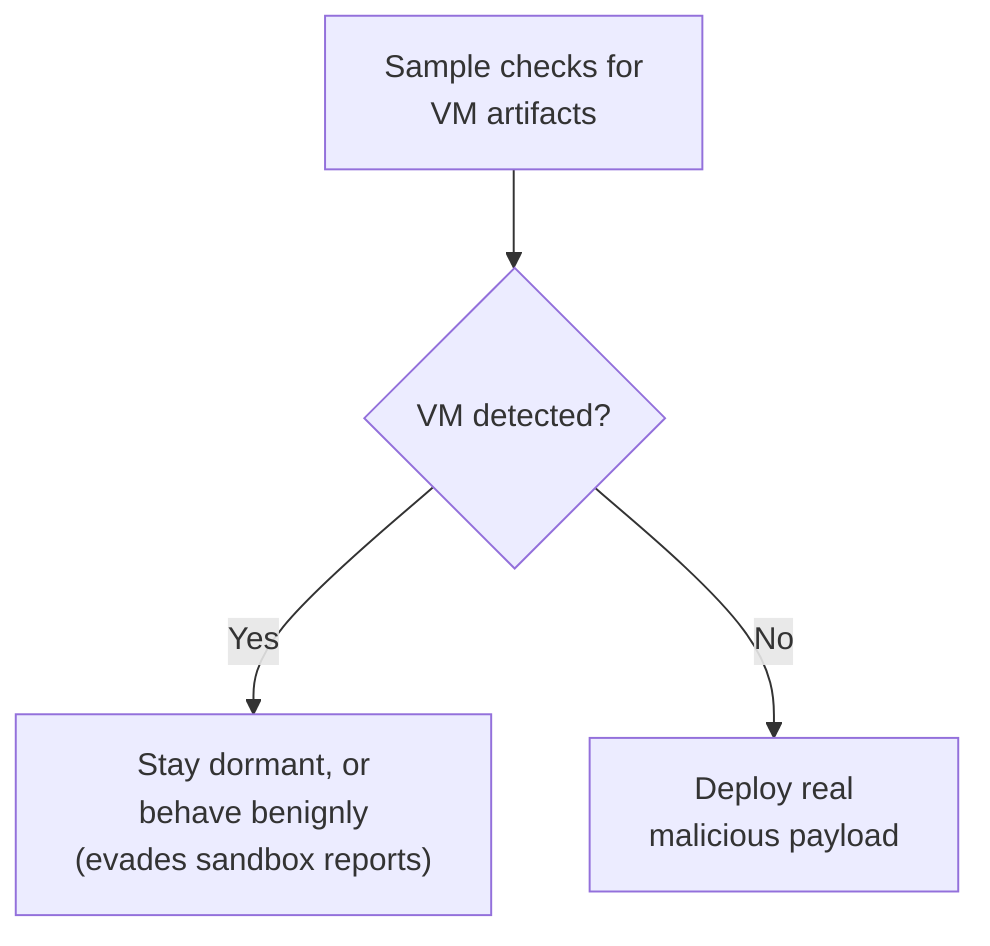

# Anti-Analysis Techniques

Sophisticated malware doesn't just try to hide what it does — it actively tries to detect *that it's being analyzed at all*, and changes its behavior accordingly (staying dormant, or even actively misleading the analyst). This lesson covers the most common techniques and, critically, how to recognize and work around each.

## Anti-debugging — detecting a debugger is attached

Malware analysts frequently attach a debugger (x64dbg, from this path's dynamic analysis lesson) to step through execution — so malware authors build in checks specifically designed to detect that:

```c
// A simplified example of what a decompiled anti-debug check looks like
if (IsDebuggerPresent()) {
    ExitProcess(0);   // or, worse: silently behave differently
}
```

Common techniques include the direct `IsDebuggerPresent()` / `CheckRemoteDebuggerPresent()` API calls (flagged as a static indicator in this path's static analysis lesson table), timing checks (debugging execution is measurably slower than native execution — a program measuring its own execution time and bailing if it's suspiciously slow), and checking specific debugger-related memory flags (the `PEB.BeingDebugged` field, a low-level Windows structure debuggers set).

**Bypassing this**: x64dbg has built-in and plugin-based anti-anti-debug features that patch these checks — the same "patch the check, don't fight the underlying mechanism" philosophy from Path 13's root-detection bypass lesson, applied here to debugger detection instead of root detection.

## Anti-VM — detecting a virtual machine environment

Since analysts almost universally run suspicious samples in a VM (per this path's dynamic analysis sandboxing lesson), malware frequently checks for VM-specific artifacts before doing anything malicious:

- **Registry/file artifacts** — VMware and VirtualBox leave distinctive registry keys, driver names, and installed tools that a real physical machine wouldn't have.
- **MAC address prefixes** — virtualization platforms use well-known, publicly documented MAC address ranges for virtual network adapters.
- **CPUID instruction checks** — certain low-level CPU instructions behave subtly differently (or reveal hypervisor-specific flags) inside a VM versus real hardware.
- **Hardware fingerprinting** — unusually small disk sizes, generic/placeholder hardware model names ("VMware Virtual Platform") visible through basic system queries.



**Bypassing this**: some sandboxes (Cuckoo/CAPEv2, referenced in the dynamic analysis lesson) support VM artifact "cleaning" — modifying telltale registry keys and hardware identifiers to more closely resemble a real machine. For manual analysis, being aware that a sample reporting "no malicious activity" might simply have detected your VM (rather than genuinely being benign) is itself the critical defensive insight — it should prompt deeper static analysis rather than a clean bill of health.

## Anti-sandbox — detecting automated analysis specifically

Beyond generic VM detection, malware increasingly targets the specific characteristics of automated sandboxes: checking for a suspiciously short system uptime (real user machines have been running for hours/days; freshly-spun sandbox VMs often haven't), checking for a lack of recent user activity (mouse movement, document history, browser bookmarks — things a real user's machine accumulates and a sandbox typically lacks), and time-delay tactics (sleeping for longer than a typical automated sandbox's observation window, exactly as flagged in this path's dynamic analysis lesson).

:::tip Time-delay is often the simplest to defeat
If you suspect a sample is simply waiting out an automated sandbox's observation window, manually extending your own dynamic analysis session (or, in a debugger, patching/skipping the sleep call entirely) frequently reveals the real payload that an automated report missed entirely.
:::

## Anti-tampering and self-checksumming code

A distinct category from environment detection: some malware verifies its own integrity at runtime, computing a checksum or hash over its own code in memory and comparing it against an expected value — if an analyst has patched out an anti-debug check (exactly the bypass technique described above) or set a software breakpoint (which works by temporarily overwriting a byte of the target instruction with a special interrupt opcode), that modification changes the computed checksum, and the self-check detects the tampering and can react by crashing, behaving differently, or silently corrupting its own execution in a way designed to waste the analyst's time. This is precisely why experienced reverse engineers prefer **hardware breakpoints** (implemented via dedicated CPU debug registers, which don't modify the target code's actual bytes at all) over simple software breakpoints when analyzing samples suspected of self-checksumming — a hardware breakpoint leaves the code genuinely untouched in memory, defeating this specific detection technique by never triggering it in the first place.

## Anti-disassembly tricks

Beyond runtime detection, some malware embeds code specifically crafted to confuse disassemblers *statically* — inserting bytes that are valid data in one interpretation but decode into a completely different (and misleading) set of instructions if a disassembler misaligns its starting point. Modern tools like Ghidra handle most common variants of this reasonably well, but it remains a real technique worth knowing exists when a decompiled function looks nonsensical despite the binary clearly being purposeful.

:::challenge Test yourself
Why might an automated sandbox report "no malicious behavior detected" for a sample that a human analyst, using the same sandbox environment but with more time and patience, later confirms IS malicious?
<details><summary>Show answer</summary>Automated sandboxes typically observe a sample for a short, fixed time window (often just a few minutes) to keep throughput high across large volumes of submitted samples. Malware employing anti-analysis techniques from this lesson — a time-delay before activating, a VM/sandbox artifact check that causes it to stay deliberately dormant when it detects an analysis environment, or an anti-debugging check triggered by the sandbox's own instrumentation — can pass straight through that observation window without ever executing its real malicious payload, producing a clean-looking automated report. A human analyst manually extending the observation time, patching out detected anti-analysis checks, or specifically hardening the sandbox environment to look more like a real machine can trigger the payload that the automated, time-boxed pass entirely missed — which is exactly why automated sandbox reports are a fast triage signal, not a final, trustworthy verdict on their own.</details>
:::

## Key takeaway

Anti-analysis techniques are an active arms race, not a one-time obstacle — the same underlying principle applies across every variant covered here (anti-debug, anti-VM, anti-sandbox, anti-disassembly): sophisticated malware tries to detect the specific environment it's being watched in and behaves differently as a result, which is exactly why experienced analysts stay skeptical of clean-looking automated reports and treat manual, patient, environment-aware analysis as the real final word.

**Next up →** [Malware Triage Methodology](#/lesson/17-malware-re/malware-triage-methodology)
