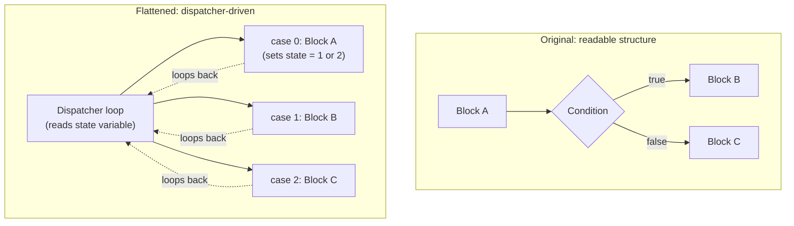

# Control Flow Obfuscation, Deep Dive

The previous lesson introduced control flow flattening in a single paragraph among several obfuscation types. This lesson goes considerably deeper into how flattened, obfuscated control flow actually looks and how analysts systematically fight through it — directly connecting to the disassembly-with-ghidra lesson's "rename and re-annotate as you go" discipline, now applied specifically to logic that's been deliberately scrambled.

## What clean control flow looks like, as a baseline

Ordinary, unobfuscated compiled code preserves a program's original logical structure fairly transparently — an `if/else` in source code produces a recognizable comparison-then-conditional-jump pattern in assembly, and Ghidra's decompiler (from earlier in this path) can usually reconstruct something close to readable pseudocode. Control flow obfuscation deliberately destroys this transparency without changing what the program actually does.

## Control flow flattening, illustrated

**Control flow flattening** restructures a function's logic so every original basic block becomes a case inside one giant dispatcher loop, with a state variable determining which "case" runs next — rather than blocks naturally following one another in a readable sequence, execution constantly jumps back to a central dispatcher that decides where to go next based on that state variable's current value.

## Opaque predicates — conditions that always resolve the same way

A related, frequently-paired technique: an **opaque predicate** is a conditional check that looks like it could genuinely go either way but, due to mathematical properties the obfuscator deliberately constructed, always evaluates to the same result every single time the program actually runs. This adds fake branches that never really execute, cluttering the control flow graph with dead paths a static analyzer has to waste time considering, even though a human (or the malware's own logic) would never actually take them.

## Systematic deobfuscation strategy

Directly connecting to the previous lesson's "obfuscation slows analysis, it doesn't stop it" framing:

1. **Identify the dispatcher pattern first** — a large loop containing a switch/case structure driven by a single state variable is the telltale signature of flattening; recognizing this pattern immediately reframes the entire analysis approach
2. **Track the state variable's value at each case** — annotate (directly connecting to Ghidra's renaming discipline from earlier) which state value corresponds to which original block, effectively reconstructing the original block ordering by hand
3. **Use dynamic analysis to shortcut ambiguity** — directly connecting to the api-hooking-and-monitoring lesson, setting a breakpoint that logs the state variable's value on each dispatcher iteration during actual execution reveals the *real* execution order directly, often far faster than statically tracing every possible path
4. **Evaluate opaque predicates dynamically** — rather than trying to mathematically prove a suspicious-looking condition always resolves one way, simply observing which branch actually executes during real runs settles the question immediately

## Why this connects directly to VMProtect/Themida from the previous lesson

Control flow flattening and opaque predicates are frequently just one layer among several a commercial protector like VMProtect applies — understanding them as a standalone technique here builds the exact pattern-recognition skill needed to notice "this is flattening" versus "this is full code virtualization" quickly, which matters enormously for accurately estimating how much analysis effort a given sample actually requires, exactly the "gauge where a sample sits on the difficulty spectrum early" principle the previous lesson closed on.

:::challenge Test yourself
Why does dynamically observing a flattened function's actual execution (tracking the state variable at runtime) often resolve ambiguity faster than statically tracing every possible dispatcher path by hand?

Show answer
A flattened function's dispatcher loop, viewed purely statically, presents every case as a theoretically reachable path — from the disassembly or decompiled pseudocode alone, an analyst generally can't immediately tell which specific sequence of cases the program actually executes under real conditions versus which paths exist but are rarely or never taken (including any opaque-predicate-guarded dead branches from this lesson). Tracing every theoretical path by hand to build a complete picture can require exploring a combinatorially large number of possible state-variable sequences, especially in a function with many cases. Running the actual sample with a breakpoint or hook logging the state variable's value on each dispatcher iteration (directly connecting to the previous lesson's API hooking coverage) instead reveals the one specific, real sequence the program actually followed for that particular execution — collapsing what might be an enormous space of theoretical possibilities down to the single concrete path that mattered, in exactly the time it takes to run the sample once. This is precisely the same static-versus-dynamic tradeoff this path's dynamic-analysis-sandboxing lesson established generally, just applied specifically to untangling flattened control flow rather than to overall program behavior.

:::

## Key terms

- **Control flow flattening** — restructuring a function's blocks into a single dispatcher loop driven by a state variable, obscuring original logical structure.
- **Opaque predicate** — a conditional check constructed to always evaluate the same way, adding fake branches that never actually execute.
- **Dispatcher loop** — the central loop-and-switch structure a flattened function's execution constantly returns to between blocks.

## Recap

- Control flow flattening replaces natural block sequencing with a dispatcher loop driven by a state variable, and opaque predicates add branches that never actually execute.
- Recognizing the dispatcher pattern immediately is the first, most important step in systematically deobfuscating flattened code.
- Dynamic tracking of the state variable's real runtime values resolves ambiguity far faster than statically tracing every theoretical path by hand.
- This same pattern-recognition skill directly transfers to gauging how much of a commercial protector's difficulty comes from flattening versus full code virtualization.

**Next up →** [YARA Rules & Detection](#/lesson/17-malware-re/yara-rules-and-detection)
