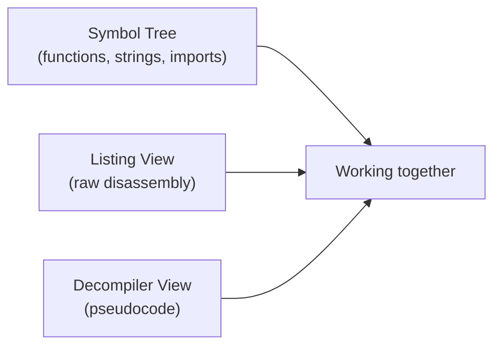

# Disassembly with Ghidra

This lesson gets you actually navigating and reading a real binary's disassembled code in Ghidra — the free, powerful tool introduced in this path's fundamentals lesson — moving from theory into genuine hands-on practice.

## Setting up your first project

1. Download [Ghidra](https://ghidra-sre.org/) (free, cross-platform, requires Java) and launch it.
2. **File → New Project** — create a non-shared project and give it a name.
3. **File → Import File** — bring in a binary to analyze. For learning, start with something safe and legal: a small compiled program you write yourself in C (`gcc mytest.c -o mytest`), or one of the many free, legal "crackme" practice binaries built specifically for reverse-engineering practice.
4. Double-click the imported file to open it, and when prompted, let Ghidra **auto-analyze** it — this runs its full suite of analysis passes (function identification, string extraction, cross-reference building) automatically.

## The core windows you'll use constantly



- **Symbol Tree** (left panel) — lists every function Ghidra identified, plus imports, exports, and strings. This is your navigation map.
- **Listing View** (center) — the actual disassembled instructions, address by address.
- **Decompiler View** (right panel) — Ghidra's attempt to reconstruct C-like pseudocode from the assembly. This is genuinely one of Ghidra's most valuable features (a fully free capability that used to require expensive commercial tools) and is where most practical reading happens, falling back to the raw Listing View only when the decompiler's output is unclear or you need to see exact instructions.

## A practical reading workflow

1. **Start with the string window** (`Window → Defined Strings`). Find an interesting string (an error message, a URL, a suspicious-looking value) and double-click it.
2. **Follow cross-references.** Right-click the string → **References → Show References to Address** — this shows every function that actually uses this string, immediately narrowing your focus from "the entire binary" to "the handful of functions that matter."
3. **Read the decompiler view for that function.** Ghidra auto-names functions generically (`FUN_00401230`) unless it can infer a real name — rename functions and variables as you understand them (right-click → Rename), building your own readable map of the binary as you go. This habit compounds fast: a function you've renamed `check_license_key` is immediately meaningful every time it's referenced elsewhere, unlike its original generic address-based name.
4. **Trace function calls outward.** Once you understand one function, look at what calls it and what it calls — building understanding outward from a clear starting point is far more efficient than trying to read a binary linearly from its entry point.

## Reading a simple decompiled function

```c
// Ghidra decompiler output, lightly cleaned up
undefined4 FUN_00401230(char *param_1) {
    int local_8;
    local_8 = strcmp(param_1, "SuperSecretPass123");
    if (local_8 == 0) {
        return 1;
    }
    return 0;
}
```

Even without any assembly knowledge, this decompiled output is immediately readable: it's comparing an input string against a hardcoded value and returning success/failure — a genuinely common pattern in simple "crackme" practice binaries, and a reminder of exactly the hardcoded-secret risk covered in Path 13's mobile APK analysis lesson, here applied to a desktop binary instead.

## Bookmarks and comments — building a durable analysis trail

Beyond renaming functions and variables, Ghidra supports **bookmarks** (right-click any address → Bookmark) and inline **comments** (press `;` at any instruction) — both worth using liberally as you work, since a large binary analyzed over multiple sessions is easy to lose your place in without them. A practical habit: bookmark every function whose purpose you're still uncertain about with a note like "TODO: check callers, looks like a crypto routine," and leave a comment at any instruction whose purpose took real effort to figure out, explaining your reasoning rather than just the conclusion — future-you (or a colleague picking up your analysis) benefits far more from "this XOR loop matches the RC4 key-scheduling algorithm's structure" than from silence at that exact line. This mirrors the same documentation discipline from Path 14.7's reporting lesson, just applied continuously during analysis rather than written up only at the end.

## Using the Function Graph view for control flow

Beyond the linear Listing and Decompiler views, Ghidra's **Function Graph** (Window → Function Graph, or the toolbar icon) renders a function as a visual flowchart of its basic blocks and the jumps/branches between them — genuinely useful for quickly grasping a function's overall shape (a simple linear sequence versus a complex nest of loops and conditionals) before diving into line-by-line detail. A function with many diverging branches converging back to a handful of exit points often signals validation or decision logic worth scrutinizing carefully (exactly the "compare against a hardcoded value" pattern from the crackme example below); a function that's almost entirely one straight path with no branching is more likely simple, mechanical work (data copying, straightforward calculations) not worth spending equal analytical attention on. Learning to glance at a function's graph shape first, before committing to a full read-through, is a genuine time-saving triage habit professional analysts rely on constantly.

:::tip Rename as you go, relentlessly
Ghidra's function and variable renaming isn't just cosmetic — it's how you externalize your growing understanding of a binary into something persistent and readable, exactly like taking notes during any other investigation in this course. A well-renamed Ghidra project of a complex binary is, itself, a genuinely valuable analysis artifact.
:::

:::challenge Analyze a real crackme
Find a free, legal "crackme" binary (search "beginner crackme" — several sites host these specifically for practice, ranging from trivial to genuinely challenging), import it into Ghidra, and use the strings → cross-reference → decompiler workflow above to find the logic that determines success or failure. Document what you found and how you found it.
:::

## Key takeaway

Ghidra's decompiler turns what would otherwise be a slow, assembly-level reading exercise into something much closer to reading real (if oddly-named) C code — combined with disciplined renaming and a strings-first workflow, this dramatically speeds up understanding even fairly complex binaries.

**Next up →** [Ghidra Scripting Basics](#/lesson/17-malware-re/ghidra-scripting-basics)
