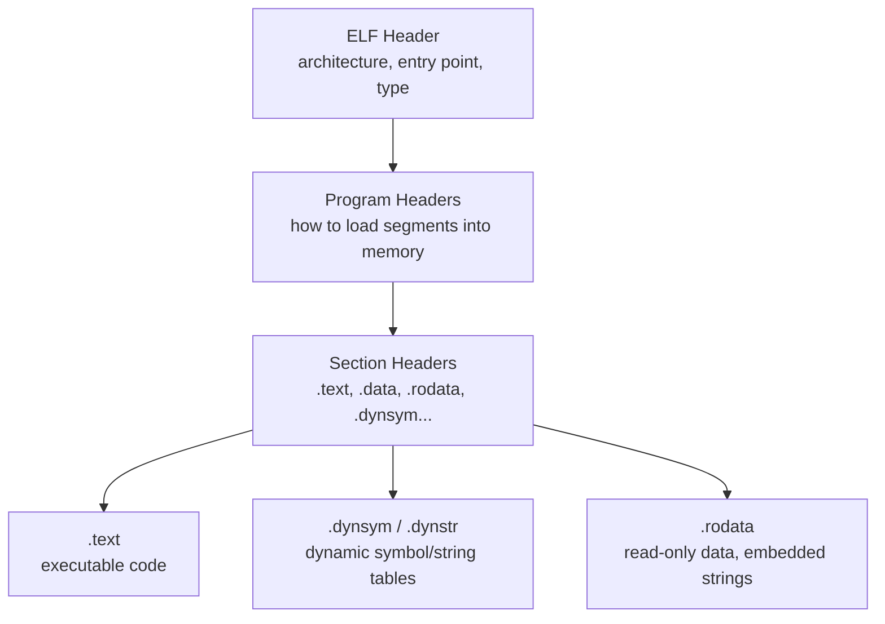

# ELF Format & Linux Malware

The previous lesson went deep into the Windows PE format. This lesson covers its Linux counterpart — directly connecting to Path 16's containers-and-Kubernetes and cloud-security lessons, since the overwhelming majority of cloud, container, and IoT infrastructure runs Linux, making ELF-format malware analysis an increasingly essential skill rather than a niche one.

## Why Linux malware analysis matters more every year

Directly connecting to Path 16's kubernetes-attack-paths lesson: as more infrastructure moves to cloud-native, containerized, Linux-based environments, malware targeting Linux specifically — cryptominers deployed via compromised container images, botnet agents targeting exposed cloud services — has grown substantially, even though Windows malware still receives disproportionately more public analysis and tooling attention historically.

## The ELF format, structurally

Linux executables use the **ELF (Executable and Linkable Format)**, structurally analogous to Windows PE but with different terminology and layout:

## Reading ELF headers with free tools

Directly connecting to the previous lesson's PEStudio/CFF Explorer coverage: `readelf` and `objdump` (both standard on essentially every Linux distribution, no separate download needed) serve the same function for ELF files that those Windows tools serve for PE files — `readelf -h` shows the header, `readelf -d` shows dynamic linking information (Linux's rough equivalent of the Windows Import Address Table), and `objdump -d` produces a disassembly listing directly from the command line, without needing to open Ghidra at all for a quick first look.

## Dynamic symbols — Linux's import table equivalent

Where Windows PE has an explicit Import Address Table, Linux ELF binaries typically use **dynamic linking** against shared libraries (`.so` files, Linux's equivalent of Windows DLLs) — the `.dynsym` section lists which external functions a binary calls at runtime. The same behavioral-inference principle from the previous lesson's IAT coverage applies directly: a binary importing `connect`, `socket`, and `recv` suggests network communication, exactly parallel to `InternetOpenA` on Windows; imports like `ptrace` are worth particular attention, since it's both a legitimate debugging API and a common anti-analysis technique (covered later in this path) used to detect whether a debugger is attached.

## Cryptominers — the most common real-world Linux malware

Directly connecting to Path 16's cloud-security lesson: the single most common category of Linux malware encountered in real cloud/container incident response is **cryptomining malware** — deployed after a cloud credential leak, an exposed Docker API, or a Kubernetes RBAC misconfiguration (exactly the escalation paths Path 16's kubernetes-attack-paths lesson described), then silently consuming compute resources to mine cryptocurrency for the attacker, often for weeks before detection since it doesn't necessarily exfiltrate any data or cause obvious application-level disruption — just an unexplained spike in CPU usage and cloud billing.

## Fileless and memory-only Linux malware

Directly connecting to Path 16's malware-persistence-mechanisms lesson: Linux malware increasingly favors **fileless** techniques — using `memfd_create` (a Linux system call that creates an anonymous, in-memory file with no filesystem path at all) to execute a payload entirely in memory, leaving nothing on disk for traditional file-scanning antivirus to ever detect, a genuinely more evasive technique than the disk-based persistence mechanisms that lesson covered for Windows.

:::challenge Test yourself
Why has Linux malware historically received less public analysis attention than Windows malware, despite Linux's dominance in cloud and server infrastructure?

Show answer
Historically, the majority of financially-motivated malware (ransomware targeting individual users, banking trojans, and similar) has targeted Windows specifically because Windows has long dominated consumer desktop usage — the platform where the largest population of individual, less security-hardened end users existed to victimize, giving attackers writing that kind of malware the largest possible target pool. Linux systems, by contrast, have historically been predominantly server and infrastructure systems administered by more technically sophisticated operators, with a correspondingly smaller and differently-motivated attack surface — though this has shifted substantially as cloud and container infrastructure (almost universally Linux-based, per Path 16's coverage) has become an enormously valuable target in its own right, particularly for cryptomining and infrastructure-hijacking attacks that don't require tricking an individual end user into anything at all, just finding a single exposed credential or misconfiguration. This shift is exactly why Linux-specific malware analysis skill, while still less mature in public tooling and community resources than Windows-focused analysis, has become a genuinely valuable and increasingly necessary specialization rather than a niche one.

:::

## Key terms

- **ELF (Executable and Linkable Format)** — the executable file format used on Linux, structurally analogous to Windows PE.
- **Dynamic symbols (.dynsym)** — Linux's equivalent of the Windows Import Address Table, listing externally-called functions.
- **memfd_create** — a Linux system call enabling fileless, memory-only malware execution with no on-disk footprint.

## Recap

- ELF is Linux's executable format, structurally parallel to PE but read with different, typically pre-installed tools (`readelf`, `objdump`).
- The `.dynsym` section serves the same behavioral-inference role as the Windows IAT, revealing intended functionality through imported functions.
- Cryptomining is the most common real-world Linux malware category, frequently deployed via cloud credential leaks or Kubernetes misconfiguration.
- Fileless techniques like `memfd_create` represent a genuinely more evasive persistence approach than traditional disk-based mechanisms.

**Next up →** [Disassembly with Ghidra](#/lesson/17-malware-re/disassembly-with-ghidra)
