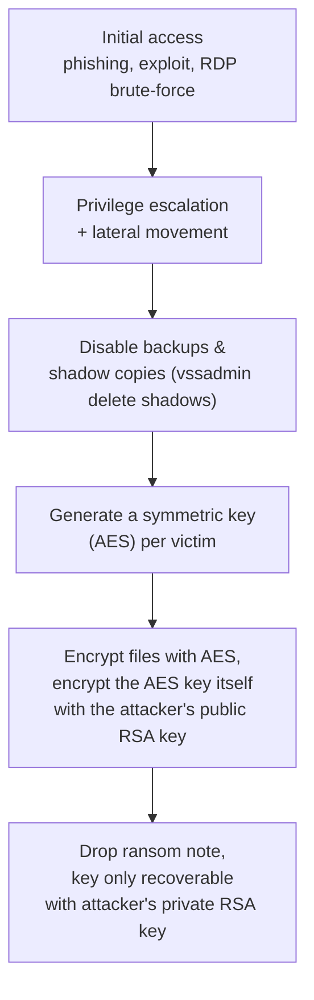

# Malware Families Deep Dive

Path 10 introduced malware families at a survey level — virus, worm, trojan, ransomware, in a few sentences each. This lesson goes deeper into the actual technical mechanisms behind the most consequential families, the depth a real malware analyst needs.

## Ransomware — the technical mechanics

Modern ransomware typically follows a consistent technical pattern:

The **hybrid encryption** scheme in step D/E is worth understanding precisely: files are encrypted with fast symmetric AES (Path 11 references this), but the AES key itself is then encrypted with the attacker's RSA *public* key — meaning only the attacker's matching *private* key (which never leaves their control) can recover it. This is exactly why ransomware without a discovered implementation flaw is, cryptographically, genuinely unrecoverable without paying (or without a backup) — the math itself is sound, even though the actor deploying it is criminal.

## Rootkits — hiding by subverting the OS itself

A **rootkit** doesn't just hide as a normal process — it modifies the operating system's own reporting mechanisms so that standard tools (Task Manager, `ps`, antivirus scanners) simply don't see it at all. Techniques include:

- **User-mode hooking** — intercepting API calls (like `ListDirectoryFiles`) and filtering out entries related to the rootkit before returning results to the calling application.
- **Kernel-mode rootkits** — operating at a far more privileged level, directly modifying kernel data structures (like the list of running processes the OS itself maintains), making detection dramatically harder since even the OS's own trusted reporting is compromised.
- **Bootkits** — the most persistent variant, infecting the boot process itself (the Master Boot Record or UEFI firmware), surviving even a full OS reinstall in extreme cases.

## Worms — the self-propagation mechanism

Unlike a trojan (which relies on tricking a human into running it) or a virus (which needs to attach to an existing file), a **worm** spreads autonomously by actively exploiting vulnerabilities across a network — no human interaction required at all after the initial infection. The 2017 WannaCry outbreak is the canonical example: it combined ransomware payload delivery with a worm's self-propagating exploit (EternalBlue, an SMB protocol vulnerability), spreading to hundreds of thousands of machines within days with zero user interaction on subsequent infections.

## Botnets — malware as distributed infrastructure

A **botnet** is a network of compromised machines ("bots" or "zombies") under an attacker's remote control, typically coordinated through **command-and-control (C2)** infrastructure. Modern C2 architectures range from a single centralized server (simple but easy to take down by blocking one IP/domain) to peer-to-peer designs (bots relay commands to each other, with no single point of failure) and **domain generation algorithms (DGAs)** — malware that mathematically generates hundreds of possible C2 domain names per day, registering only one at a time from the attacker's side, making blocklist-based defense far harder since defenders can't predict which domain will be live tomorrow.

:::tip Recognizing DGA traffic
A host repeatedly querying DNS for large numbers of algorithmically-generated-looking domain names (random-looking strings, high entropy, most resulting in NXDOMAIN "not found" responses) is a strong indicator of DGA-based malware — exactly the kind of pattern Path 16's threat hunting lab trains you to spot.
:::

## Infostealers and banking trojans — the credential-harvesting economy

A distinct, commercially significant category worth understanding on its own: **infostealers** are purpose-built to systematically harvest everything of resale value from an infected machine — saved browser passwords and cookies, cryptocurrency wallet files, saved gaming/streaming credentials, and autofill form data — then exfiltrate it all in one bundled "log" to the attacker, who typically resells these logs in bulk on underground marketplaces rather than using them directly. **Banking trojans** are a more targeted evolution, specifically designed to intercept and manipulate online banking sessions in real time — classic techniques include **form-grabbing** (capturing login credentials as they're typed, before the browser even encrypts and sends them) and **web injects** (modifying a legitimate bank's webpage content, in the victim's own browser, to insert fake additional-verification fields that trick the victim into providing extra authentication data the attacker needs). Both categories illustrate a broader economic point worth internalizing: much of modern malware isn't built by the same actor who ultimately profits from it — access brokers, log resellers, and ransomware operators increasingly form a specialized criminal supply chain, each monetizing a different stage of the same underlying compromise.

## Supply chain malware — compromising the distribution channel itself

Recall Path 16.5's software supply chain security material — the same risk applies directly to malware distribution, and it's worth understanding as its own category since the *delivery mechanism* is fundamentally different from phishing or exploit-based infection. Rather than tricking an individual victim, supply chain malware compromises a **trusted distribution channel** itself — a popular npm/PyPI package taken over and modified, a legitimate software vendor's update server breached to push a malicious update to every one of its customers simultaneously (the 2020 SolarWinds incident, referenced elsewhere in this course, is the canonical large-scale example), or a compromised build pipeline injecting malicious code before an application is even signed and shipped. This category is disproportionately dangerous precisely because it inherits the trust of the legitimate channel it rides in on — a user who diligently avoids clicking phishing links and only installs software from official sources can still be compromised, since the compromise happened upstream of any decision the victim made.

## Fileless malware — living entirely in memory

An increasingly common technique: malware that never writes a traditional executable file to disk at all, instead living entirely in memory or abusing legitimate system tools (PowerShell, WMI) to execute its payload — directly connecting to the **living-off-the-land** concept from Path 16's threat hunting lab. This evades traditional signature-based antivirus (which scans files on disk) but is still detectable through behavioral monitoring and memory forensics (Path 16's DFIR lab).

:::challenge Test yourself
Why is a kernel-mode rootkit fundamentally harder to detect than a user-mode one, even though both aim to hide malicious activity from the user?

Show answer
A user-mode rootkit intercepts API calls at the application level — tools that query the OS directly through lower-level, unhooked pathways can sometimes still see what the rootkit is hiding, and the rootkit itself runs with the same privilege level as the security tools trying to detect it. A kernel-mode rootkit instead operates at the same privileged level as the operating system itself, directly manipulating the core data structures (like the kernel's own internal process list) that even trusted, privileged security tools ultimately rely on for ground truth. When the source of truth itself is compromised, detection requires either external verification (comparing what the live, potentially-compromised system reports against an offline memory dump analyzed on a separate, trusted machine — exactly the memory forensics technique from Path 16's DFIR lab) or specialized kernel-level integrity checks, both considerably harder than simply calling a higher-level API and trusting its answer.

:::

## Key terms

- **Hybrid encryption** — combining fast symmetric encryption for bulk data with asymmetric encryption to protect the symmetric key itself.
- **Rootkit** — malware that subverts OS-level reporting to hide its own presence.
- **Command-and-control (C2)** — the infrastructure an attacker uses to remotely control compromised machines.
- **Domain generation algorithm (DGA)** — malware that algorithmically generates many candidate C2 domain names to evade blocklisting.
- **Fileless malware** — malware that operates without writing a traditional executable to disk.

## Recap

- Ransomware's hybrid AES+RSA scheme is cryptographically sound, which is exactly why recovery without the attacker's private key (or a backup) is generally infeasible.
- Rootkits range from user-mode API hooking to kernel-mode and even bootkit-level persistence, each progressively harder to detect.
- Worms spread autonomously via vulnerabilities, unlike trojans or viruses that require some form of human action.
- Botnets and DGA-based C2 infrastructure, plus fileless techniques, represent the evolution of malware toward evading traditional, signature-based detection.

???refs
- [WannaCry technical analysis (various security vendor writeups)](https://www.cisa.gov/news-events/cybersecurity-advisories) — search CISA advisories for detailed, authoritative incident analysis.
- [MITRE ATT&CK](https://attack.mitre.org/) — the industry-standard, free knowledge base of real-world adversary techniques referenced throughout this path.
???

**Next up →** [C2 Frameworks and Infrastructure](#/lesson/17-malware-re/c2-frameworks-and-infrastructure)
