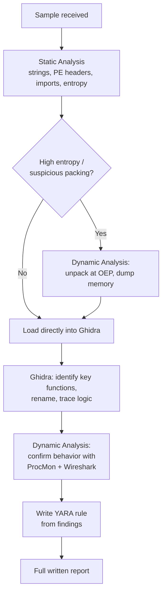

# Malware & RE Capstone Lab

This lab pulls together every lesson in this path — static analysis, Ghidra disassembly, dynamic analysis, unpacking, and YARA rule writing — into one complete analysis workflow, mirroring how a real malware analyst approaches an unfamiliar sample from first contact to final detection rule.

## Recommended targets

- **Safe training samples from [MalwareBazaar](https://bazaar.abuse.ch/)**, tagged specifically for training/education use, or any of the many free "malware analysis practice" samples built specifically for teaching purposes (search "malware analysis CTF sample," several security training organizations host these legally and safely, pre-defanged).
- **Your own compiled crackme binaries** — for the RE-specific tasks (Ghidra reading, unpacking), a self-compiled or downloaded legal crackme works just as well and carries zero risk.

## The full workflow

## Tasks

1. **Initial static triage.** Run `strings`, check PE headers and entropy (PEStudio), and review the import table for this path's flagged categories: process injection APIs, networking APIs, crypto APIs, anti-debugging APIs. Form an initial hypothesis about the sample's family and purpose.
2. **Unpack if necessary.** If entropy analysis suggests packing, attempt UPX's automated unpacker first; if that fails, use the manual "dump at OEP" technique from this path's unpacking lesson with x64dbg and Scylla.
3. **Ghidra deep dive.** Load the (unpacked, if applicable) sample into Ghidra, use the strings-first cross-reference workflow to find the most security-relevant functions, and rename them as you understand each one's purpose.
4. **Dynamic confirmation.** In your isolated sandbox, run the sample with Process Monitor and Wireshark capturing, and confirm whether the actual observed behavior matches your static hypothesis from Task 1 — note any anti-analysis behavior (from the previous lesson) that might explain a mismatch.
5. **Write a YARA rule.** Using the most distinctive strings and import combinations you found, write a YARA rule that would detect this specific sample and its likely variants, and test it against known-clean files to confirm no false positives.
6. **Produce a full report.** Combine everything into a structured write-up: **Summary** (what the sample is/does in plain language), **Static Findings**, **Dynamic Findings**, **IOCs** (file hashes, dropped files, registry keys, network indicators — echoing Path 16's DFIR lab reporting structure), and your **YARA rule**.

:::challenge Complete a full analysis
Working through a real (safe, training-designated) sample from start to finish, produce the complete report described in Task 6. This is genuinely representative of a real malware analyst's day-to-day deliverable — the kind of artifact that gets shared across a security team or submitted to threat intelligence sharing communities.
:::

## Time-boxing your analysis, realistically

A genuinely important professional habit worth practicing in this capstone, not just reading about: real malware analysts rarely have unlimited time per sample, and a core skill is deciding *when to stop* rather than pursuing perfect, complete understanding of every function. Set yourself a genuine time budget before starting — say, two hours total across all six tasks — and if a specific obfuscation or anti-analysis technique is consuming disproportionate time relative to what it's likely to add to your final report, deliberately step back and ask whether behavioral confirmation (Task 4's dynamic analysis) already answers the practical question ("what does this do, and how do we detect it") even without fully reverse-engineering every static detail. This mirrors exactly the "80% automatable, 20% needs real judgment" principle from Path 04's automation lesson — professional malware analysis is a business function with real deadlines, and the ability to produce a genuinely useful, well-evidenced report within a realistic time budget is a more valuable, more hireable skill than the ability to eventually achieve total, unbounded understanding of a single sample.

## Where this connects across the whole course

This path's skills tie directly into several others: Path 16's DFIR lab uses exactly this kind of analysis to build an incident timeline; Path 16's threat hunting lab uses the behavioral indicators you'd identify here to write detection hypotheses; and this course's CTF Zone's crypto challenges practice the exact "identify the pattern, break it down systematically" mindset this path applies to disassembled code instead of ciphertext.

## Key takeaway

Real malware analysis is a structured pipeline, not a single technique — static triage informs whether unpacking is needed, Ghidra analysis builds understanding, dynamic analysis confirms hypotheses (and catches anti-analysis evasion), and YARA rules turn that one-time understanding into lasting, scalable detection. This lab's six-step workflow is, in miniature, what a real malware analysis team's process looks like.

## 🎓 Path complete

You've now covered reverse engineering fundamentals, deep technical mechanics of major malware families, PE file format internals, hands-on Ghidra disassembly and decompilation, dynamic analysis and sandboxing, unpacking and obfuscation techniques, YARA rule writing, and anti-analysis evasion — and completed a full analysis pipeline against a real sample. Combined with Path 16's DFIR and threat hunting material, you have a genuinely solid foundation for malware analysis and reverse engineering work.

???refs
- [MalwareBazaar](https://bazaar.abuse.ch/) — free, legal, safe training samples referenced throughout this path.
- [Ghidra](https://ghidra-sre.org/) and [x64dbg](https://x64dbg.com/) — the free core toolkit used throughout this path.
- [YARA documentation](https://yara.readthedocs.io/) — the official, detailed rule-writing reference.
???

**Explore more →** [Back to all paths](#/course) · [CTF Zone](#/lesson/19-ctf-challenges)
