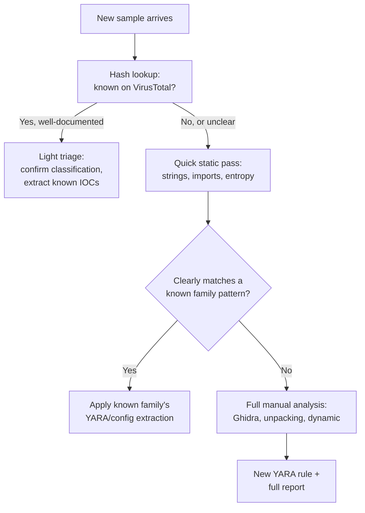

# Malware Triage Methodology

Every lesson in this path so far has taught a specific technique — static analysis, Ghidra, unpacking, YARA, anti-analysis awareness. This lesson ties them together into the decision-making framework a real analyst actually uses to decide *how much* effort a given sample deserves, before the hands-on capstone lab applies that framework to a complete real sample.

## The problem this lesson solves

A genuinely important professional reality: a working analyst rarely has unlimited time to fully reverse-engineer every sample that crosses their desk to the depth this path's Ghidra and unpacking lessons demonstrated. **Triage** is the practice of quickly classifying and prioritizing samples — deciding which ones warrant deep manual analysis, and which can be handled with a much lighter-touch pass — directly connecting to Path 16's DFIR lesson's incident-response triage concept, applied here specifically to individual malware samples rather than an active incident.

## A practical triage decision tree

## Why the hash lookup comes first

Directly connecting to the static-analysis-deep-dive lesson: before spending any analyst time at all, checking a sample's hash against VirusTotal or a similar reputation database (Path 16's malware analysis lab introduced this) instantly reveals whether this exact file has already been analyzed by someone else — a genuinely common outcome, since attackers frequently reuse the same binary across multiple targets. Skipping this step and manually re-analyzing an already-well-documented sample from scratch is one of the most common ways analyst time gets wasted needlessly.

## Family fingerprinting — recognizing what you've seen before

Directly connecting to the ghidra-scripting-basics lesson's automated extraction workflow: an experienced analyst builds a growing mental (and literal, via YARA/Sigma rules from the two previous lessons) library of known malware family characteristics — a distinctive string, a specific API-hashing algorithm, a particular packer configuration. Recognizing "this matches Family X's known pattern" lets an analyst apply already-understood extraction and detection logic immediately, rather than repeating full manual reverse engineering on what's functionally a minor variant of something already analyzed before.

## When full manual analysis is genuinely warranted

Full-depth analysis (the complete Ghidra/unpacking/dynamic workflow this path taught) is worth the time investment specifically when:

- The sample doesn't match any known family pattern, suggesting genuinely novel malware or a significant new variant
- The sample is part of a confirmed, active incident (directly connecting to Path 16's DFIR lesson) where understanding full capability and scope matters for remediation decisions
- The sample targets high-value infrastructure, where understanding the complete attack chain has outsized organizational importance

## Communicating triage decisions, not just findings

:::tip Documenting *why* you stopped analyzing is as valuable as documenting what you found
A genuinely professional habit distinguishing mature analysts: explicitly noting in a report why a sample received light-touch versus full analysis ("hash match to known Family X, config extracted via existing script, no novel behavior observed justifying deeper analysis") — this lets anyone reviewing the report later understand the confidence level behind the conclusions, rather than assuming every report represents the same depth of scrutiny.
:::

:::challenge Test yourself
Why does checking a sample's hash against VirusTotal before doing any manual analysis represent good triage practice, rather than being a shortcut that risks missing something important?

Show answer
A hash match against a well-populated reputation database like VirusTotal confirms that this exact file — byte-for-byte identical, since cryptographic hashes (Path 00) are specifically designed to uniquely identify exact content — has already been submitted and analyzed by other researchers, often including automated sandbox results, community classification, and sometimes even existing YARA/Sigma detection rules already written against it. Re-analyzing an already-well-documented sample from scratch produces no new information the analyst doesn't already have access to for free, while consuming exactly the same hours of skilled analyst time that a genuinely novel, previously-unseen sample would require — time that's a limited resource better spent on samples that actually need it. The risk this triage step deliberately avoids isn't missing something about the specific file (its exact content and prior analysis are already known with certainty via the hash match) — the real risk it protects against is wasting scarce analyst time re-deriving conclusions the security community has already reached, which is precisely the resource-allocation problem triage as a discipline exists to solve.

:::

## Key terms

- **Triage** — quickly classifying and prioritizing samples to decide how much analysis depth each one warrants.
- **Family fingerprinting** — recognizing a sample's malware family from known distinctive characteristics, enabling reuse of existing analysis.
- **Hash lookup** — checking a sample's cryptographic hash against a reputation database before manual analysis begins.

## Recap

- Triage decides how much analysis effort a sample deserves before diving into full manual reverse engineering, given genuinely limited analyst time.
- A hash lookup against VirusTotal should always come first, since it's free and instantly reveals whether a sample is already well-documented.
- Family fingerprinting lets an analyst apply already-understood extraction and detection logic to variants of known malware, reserving full manual analysis for genuinely novel samples.
- Documenting why a triage decision was made is as professionally valuable as documenting the findings themselves.

**Next up →** [Malware & RE Capstone Lab](#/lesson/17-malware-re/malware-re-capstone-lab)
