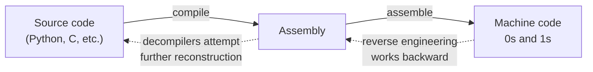

# Reverse Engineering Fundamentals

Path 16 introduced malware analysis at a survey level — static and dynamic basics in a single lesson. This path goes much deeper into one specific skill underlying real malware analysis work: **reverse engineering**, the practice of understanding what a compiled program does without having its source code.

## What reverse engineering actually is

When you write code in Python or Java, you write in a **high-level language** — readable, structured, close to English. That code gets compiled (or interpreted) down through several layers until it becomes **machine code**: raw binary instructions a CPU actually executes. Reverse engineering works backward through that same chain — starting from machine code and reconstructing, as much as possible, what the original logic was doing.



## Why this skill matters beyond malware

Reverse engineering isn't only for analyzing malicious software — it's used to find vulnerabilities in closed-source software (when no source code is available for a security review), understand undocumented file formats or network protocols, verify a compiled binary matches its claimed source, and — the focus of this path — understand exactly what a piece of malware does, how it spreads, and how to detect and stop it.

## Assembly, briefly revisited

You don't need to become a full assembly programmer to reverse engineer effectively, but recognizing common patterns is essential. A few core concepts:

```asm
mov eax, 5      ; move the value 5 into register eax
add eax, 3      ; add 3 to eax (now eax = 8)
cmp eax, 10     ; compare eax to 10
jne loop_start  ; jump to loop_start if not equal
call subroutine ; call a function
ret             ; return from a function
```

Registers (`eax`, `ebx`, etc.) are the CPU's tiny, extremely fast internal storage slots — this is the actual "machine code" level referenced back in Path 00's fundamentals lesson, now revisited with real purpose.

## The essential tool: a disassembler/decompiler

- **[Ghidra](https://ghidra-sre.org/)** — free, open-source, developed by the NSA and released publicly in 2019. Includes both a disassembler (raw assembly view) and a decompiler (attempts to reconstruct C-like pseudocode from the assembly) — genuinely powerful, and the primary tool this path uses.
- **[IDA Free](https://hex-rays.com/ida-free/)** — the free tier of the long-standing industry-standard disassembler; more limited than Ghidra's free offering but widely referenced in professional contexts.
- **[x64dbg](https://x64dbg.com/)** — a free, open-source Windows debugger for dynamic analysis — actually running a binary step-by-step, rather than just reading it statically.

## Calling conventions and the stack — reading function calls fluently

Beyond individual instructions, one structural pattern is worth internalizing early because it appears in essentially every function you'll ever disassemble: **calling conventions** define exactly how a program passes arguments into a function, where the return value goes, and who's responsible for cleaning up afterward. On x86, arguments are commonly pushed onto the **stack** (a region of memory that grows and shrinks as functions call each other, tracked by the `esp`/`rsp` stack-pointer register) before a `call` instruction jumps into the function; the function then reads those stack values as its parameters, does its work, and a `ret` instruction pops the return address back off the stack to resume execution where the call happened. Recognizing this pattern — a cluster of `push` instructions immediately before a `call`, followed by cleanup afterward — lets you quickly identify "this is a function call with N arguments" at a glance, and start reasoning about what those arguments might represent, well before you've fully decompiled the surrounding logic. Modern x64 calling conventions favor passing the first several arguments directly in registers instead of the stack for performance, but the underlying mental model — arguments in, work happens, a value comes back out — stays the same across both.

## Static vs. dynamic analysis, revisited with RE in mind

Path 16's malware analysis lab covered this distinction at a basic level. In reverse engineering specifically:

- **Static analysis** means reading the disassembled/decompiled code without executing it — safer, but you're reasoning about *possible* behavior rather than *observed* behavior, and heavily obfuscated code (covered later in this path) can be genuinely difficult to reason about statically alone.
- **Dynamic analysis** means running the binary (always in an isolated sandbox) and observing its actual behavior — faster to get real answers, but only reveals the specific code path that particular execution actually took, potentially missing conditional logic that never triggered.

Real reverse engineering combines both, constantly moving back and forth: static analysis to form a hypothesis about what a function does, dynamic analysis (setting a breakpoint at that exact function) to confirm it.

:::tip Start with strings, every single time
Before opening a disassembler, always run `strings` against a binary first (introduced in Path 16's malware analysis lab) — readable strings embedded in a binary (URLs, file paths, error messages, sometimes even debug symbols left in by accident) often give you a rough map of what the program does before you've read a single line of assembly.
:::

:::challenge Test yourself
Why do reverse engineers typically move back and forth between static and dynamic analysis rather than relying on just one approach?
<details><summary>Show answer</summary>Static analysis lets you see the entire program's code at once, including code paths that might never execute during a particular run — valuable for completeness, but reasoning about complex logic purely by reading disassembly (especially if obfuscated) is slow and error-prone. Dynamic analysis shows you exactly what really happens during a specific execution — fast and unambiguous for that one path, but it only reveals the behavior actually triggered, potentially missing conditional logic (like a time-bomb that only activates on a specific date, or behavior that only triggers with specific command-line arguments). Combining both lets you form hypotheses statically and verify them dynamically, or use dynamic analysis to quickly find the "interesting" region of code worth reading statically in depth — each compensates for the other's blind spot.</details>
:::

## Key terms

- **Disassembler** — converts machine code back into human-readable assembly instructions.
- **Decompiler** — attempts to reconstruct higher-level, C-like pseudocode from assembly or machine code.
- **Register** — a CPU's small, extremely fast internal storage location (`eax`, `ebx`, etc.).
- **Static / dynamic analysis** — analyzing code without running it, versus observing its actual runtime behavior.

## Recap

- Reverse engineering reconstructs program logic from compiled machine code, working backward through the same layers compilation created.
- Ghidra (free, NSA-developed) is this path's primary tool, offering both disassembly and decompilation.
- Static and dynamic analysis are complementary, not competing — real RE work moves constantly between them.
- Always start with a strings dump before touching a disassembler — it's fast and often surprisingly informative.

???refs
- [Ghidra](https://ghidra-sre.org/) — free download and official documentation.
- [x86 Assembly Guide (UVA CS)](https://www.cs.virginia.edu/~evans/cs216/guides/x86.html) — a solid, free reference for assembly fundamentals.
???

**Next up →** [Malware Families Deep Dive](#/lesson/17-malware-re/malware-families-deep-dive)
