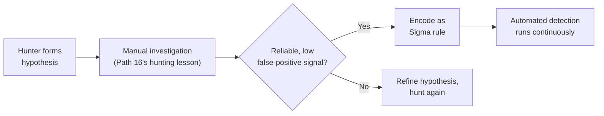

# Sigma Rules & Detection Engineering

The previous lesson covered YARA — matching file content and patterns. This lesson covers the complementary detection format for a different data source entirely: log events, not files — directly connecting to Path 16's threat-hunting-fundamentals lesson, since Sigma rules are frequently the concrete artifact a successful hunt eventually gets encoded into.

## Why YARA alone isn't sufficient for detection

YARA (previous lesson) excels at matching static file content — a byte pattern, a string, a PE header characteristic. But an enormous share of real detection needs operate on an entirely different kind of data: **log events** — a specific sequence of Windows Event IDs, a particular process spawning another unusual process, a registry key being modified in a suspicious way. Directly connecting to Path 16's ad-persistence-and-detection lesson's Event ID coverage: detecting DCSync requires watching for a specific *event pattern*, not scanning any file at all, which is exactly the gap Sigma fills.

## What Sigma actually is

**Sigma** is a generic, vendor-agnostic rule format for describing log-based detection logic in a structured, human-readable YAML format — the key insight being that a single Sigma rule can be automatically converted into the specific query syntax of many different SIEM platforms (Splunk, Elastic, Microsoft Sentinel, and others), directly connecting to Path 12's SIEM coverage. This solves a genuinely real problem: a detection engineer writing a rule once, in Sigma, rather than rewriting the same logical detection separately for every different SIEM platform an organization might use.

## Anatomy of a Sigma rule

```yaml
title: Suspicious Kerberoasting Activity via Event 4769
status: stable
logsource:
  product: windows
  service: security
detection:
  selection:
    EventID: 4769
    TicketEncryptionType: '0x17'   # RC4 — weaker cipher, a red flag
  timeframe: 5m
  condition: selection | count() by TargetUserName > 10
level: high
```

Directly connecting to Path 16's kerberos-attacks-deep-dive lesson: this rule structure encodes exactly the manual hunting hypothesis that lesson's worked example described — RC4-encrypted Kerberos ticket requests at unusual volume — but as an automated, continuously-running detection rather than a one-time manual hunt.

## From hunt to rule — the detection engineering lifecycle

Directly connecting to Path 16's threat-hunting-fundamentals lesson's "found nothing is still valuable" framing: the most mature detection programs treat threat hunting and rule-writing as a continuous loop — a hunter manually investigates a specific hypothesis, and if that hunting method proves reliably effective at finding genuine malicious activity (with an acceptably low false-positive rate), it gets encoded as a permanent, automated Sigma rule so future occurrences of the same pattern get caught automatically, without requiring a human to manually re-run that same hunt again.



## Tuning: the ongoing cost of every detection rule

A genuinely important operational reality: every detection rule, once deployed, requires ongoing **tuning** — adjusting thresholds and conditions as an organization's normal, legitimate activity naturally evolves, to keep the false-positive rate manageable. A rule that fires accurately on day one can become a noisy, ignored nuisance six months later if a legitimate new application happens to produce a similar-looking event pattern, directly connecting to the bb-platforms-deep-dive-adjacent point (Path 15) that noisy, unreliable signals get deprioritized by the humans who have to respond to them regardless of how technically correct the underlying detection logic is.

:::challenge Test yourself
Why does a detection engineering team prefer converting a proven manual hunting method into a Sigma rule rather than simply continuing to run that hunt manually on a regular schedule?
<details><summary>Show answer</summary>A manual hunt, even a well-documented and repeatable one, still requires a human analyst to actually remember to run it, correctly execute each step, and review the results — meaning detection coverage for that specific technique only exists during the windows when someone actually performs the hunt, with real gaps in between hunts where the exact same malicious activity could occur and go completely undetected until the next scheduled hunt happens to catch it. Converting the hunt into an automated Sigma rule deployed in the SIEM means the exact same detection logic runs continuously, in real time, against every new log event as it arrives — closing that gap entirely and freeing the human analyst's time for genuinely new hypothesis-driven hunting work rather than repeatedly re-running a hunt whose underlying logic has already been fully validated and doesn't need a human's judgment to execute correctly anymore. This is precisely the efficient division of labor detection engineering is built around: humans investigate genuinely novel, judgment-requiring hypotheses, while already-proven detection logic gets automated so it runs continuously without further manual effort.</details>
:::

## Key terms

- **Sigma** — a vendor-agnostic YAML rule format for log-based detection, convertible into many different SIEM platforms' native query syntax.
- **Detection engineering** — the discipline of converting validated hunting hypotheses into reliable, automated detection rules.
- **Tuning** — the ongoing process of adjusting a deployed rule's thresholds to control its false-positive rate as normal activity evolves.

## Recap

- Sigma complements YARA by targeting log events rather than file content, and its vendor-agnostic format lets one rule work across multiple SIEM platforms.
- A Sigma rule structurally encodes exactly the kind of hunting hypothesis Path 16's threat-hunting lesson described, as continuous automated detection instead of a one-time manual hunt.
- Mature detection programs treat hunting and rule-writing as a continuous loop, converting proven hunts into permanent automated coverage.
- Every deployed rule requires ongoing tuning to keep pace with an organization's evolving legitimate activity and control false positives.

**Next up →** [Anti-Analysis Techniques](#/lesson/17-malware-re/anti-analysis-techniques)
