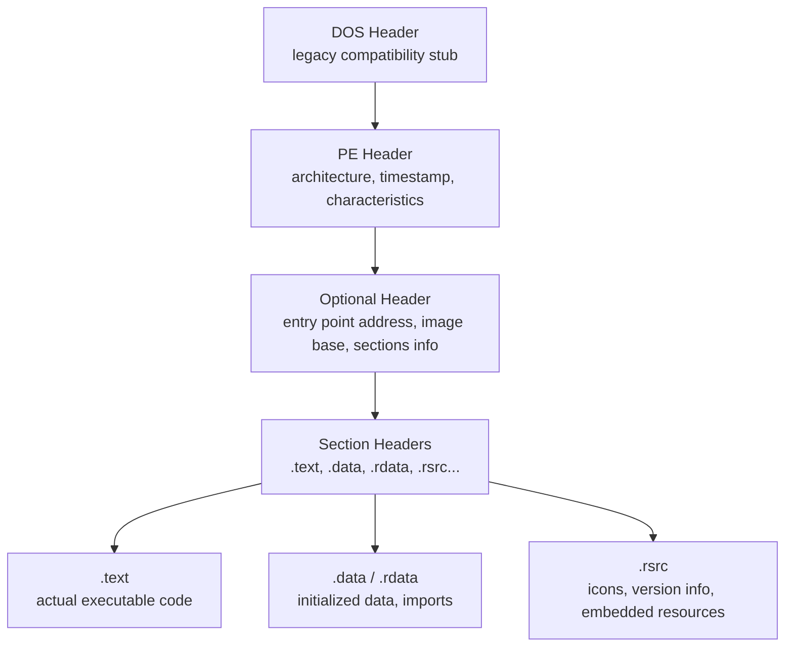
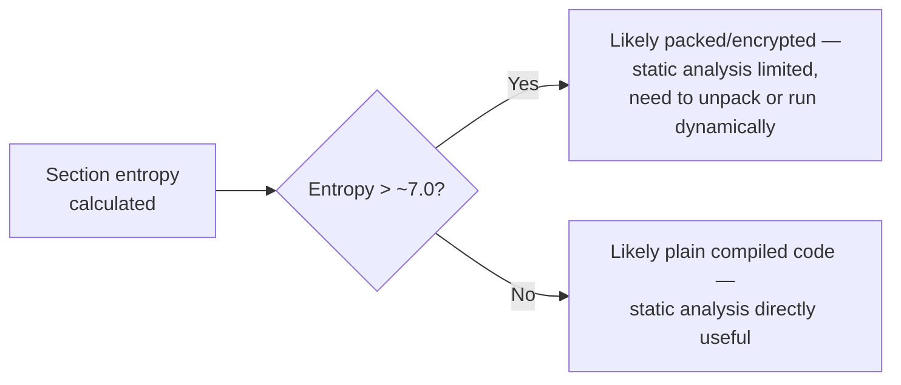

# Static Analysis Deep Dive

Path 16's malware analysis lab introduced static analysis at a basic level — strings, imports, PE headers. This lesson goes considerably deeper into the Windows **PE (Portable Executable)** file format itself, since understanding its structure is what separates surface-level triage from genuine analysis.

## The PE file format, structurally

Every Windows `.exe` and `.dll` follows the PE format — understanding its layout tells you a great deal before you ever look at actual code:

## Reading PE headers with free tools

**[PEStudio](https://www.winitor.com/)** (referenced in Path 16's malware analysis lab) and **[CFF Explorer](https://ntcore.com/?page_id=388)** both parse and display this structure without executing the file. Key fields worth checking immediately:

- **Compile timestamp** — often revealing (though occasionally faked by sophisticated malware authors specifically to mislead analysts, itself a useful signal when the timestamp looks suspiciously "clean" or is set to an impossible future date).
- **Entry point** — where execution actually begins; if this points somewhere unusual relative to the `.text` section (like inside `.data`, which shouldn't normally contain executable code), that's a strong signal of a packer or self-modifying code.
- **Section characteristics** — legitimate compilers produce fairly standard section names and permission flags; a `.text` section marked *writable* (code that can modify itself at runtime) is unusual and worth investigating.

## Imports — a map of intended behavior

The **Import Address Table (IAT)** lists every external function a binary calls from Windows DLLs — and this alone often reveals a huge amount about intended behavior, before reading a single instruction:

| Imported function | Suggests |
|---|---|
| `InternetOpenA`, `URLDownloadToFileA` | Network communication, possibly downloading a second-stage payload |
| `CreateRemoteThread`, `WriteProcessMemory`, `VirtualAllocEx` | Process injection (writing/executing code inside another process) |
| `RegSetValueEx`, `RegCreateKeyEx` | Registry modification, often for persistence |
| `CryptEncrypt`, `CryptGenKey` | Cryptographic operations — worth noting for potential ransomware |
| `IsDebuggerPresent`, `CheckRemoteDebuggerPresent` | Anti-debugging checks (covered in depth later in this path) |

A binary importing `CreateRemoteThread` + `WriteProcessMemory` + `VirtualAllocEx` together, specifically, is one of the most consistently reliable static indicators of process injection — a technique used by an enormous share of real-world malware to hide its execution inside a legitimate process.

## Entropy analysis — detecting packing at a glance

**Entropy** measures how "random" a section of data appears — legitimate compiled code has moderate, fairly predictable entropy, while **packed or encrypted** code (covered in this path's dedicated unpacking lesson) appears close to maximally random. Tools like PEStudio calculate and display per-section entropy automatically; a `.text` section with entropy above roughly 7.0 (on a 0–8 scale) is a strong signal the actual code is compressed or encrypted and only unpacks itself at runtime — meaning static analysis alone won't reveal much until you either unpack it or move to dynamic analysis.

## The resource section — hiding data in plain sight

The `.rsrc` section, normally home to mundane content like icons and version metadata, is also a genuinely common hiding spot for malware's actual payload. A first-stage loader binary sometimes embeds its real, second-stage payload as an ordinary-looking resource — an "icon" or "bitmap" entry that's actually an encrypted or packed executable, extracted and decrypted by the loader's code only at runtime. Tools like Resource Hacker or PEStudio's resource viewer let you enumerate every embedded resource and check its actual size and content against what its declared type would normally warrant — a `.ico` resource that's several megabytes, when a legitimate icon file is typically a few kilobytes at most, is an immediate, easy-to-spot red flag worth extracting and analyzing as its own separate artifact.

## The export table — understanding what a DLL offers

Where the Import Address Table reveals what a binary *consumes* from other libraries, the **Export Table** reveals the opposite: what functions a DLL makes *available* for other programs to call. This matters specifically for analyzing malicious DLLs, since malware distributed as a DLL (rather than a standalone `.exe`) is often loaded via **DLL side-loading** — placing a maliciously-crafted DLL somewhere a legitimate, trusted application will load it automatically, exploiting exactly the Windows DLL search-order weakness covered in Path 16's Windows privesc lesson. Reading a suspicious DLL's export table often reveals a strange mismatch worth flagging on sight: a DLL exporting function names that closely mimic a legitimate system DLL's real exports (sometimes down to matching the exact same function signatures) but with completely different, malicious implementation underneath — a strong signal the file was deliberately crafted to be side-loaded in place of the real thing.

## Digital signatures and certificates

Legitimate software is typically **code-signed** with a certificate from a trusted authority — checking whether a suspicious binary is signed at all, and if so, whether that certificate is valid, unexpired, and from a plausible publisher, is a quick and genuinely useful triage step. Malware authors occasionally steal legitimate signing certificates (a serious, high-effort attack) specifically to bypass this exact check, which is worth being aware of even though it's relatively rare.

:::tip Combine every signal before concluding anything
No single static indicator (an unusual import, high entropy, a missing signature) proves malicious intent on its own — legitimate software occasionally triggers individual flags too (some legitimate installers are packed for size, for instance). Real analysis weighs multiple signals together, exactly the same "combine evidence, form a hypothesis" approach from Path 16's DFIR lab.
:::

:::challenge Test yourself
A binary's PE header shows an entry point pointing into a section with entropy of 7.8, and its only imports (visible in the IAT) are `LoadLibraryA` and `GetProcAddress`. What does this combination most likely indicate, and why would static analysis alone struggle to tell you more?

Show answer
This is the classic signature of a <strong>packed</strong> binary. High entropy (7.8, close to the 8.0 maximum) strongly suggests the actual code is compressed or encrypted rather than plainly compiled. The minimal import list — just <code>LoadLibraryA</code> and <code>GetProcAddress</code> — is exactly what a packer's small "unpacking stub" needs: these two functions let the stub dynamically load whatever <em>other</em> functions the real, hidden payload actually needs at runtime, rather than declaring them upfront in the visible import table. Because the real code only exists in its unpacked form <em>after</em> the program actually runs (the stub decompresses/decrypts it into memory first), static analysis of the file as it sits on disk reveals very little about the payload's real behavior — you'd need to either unpack it manually (this path's next lesson) or run it dynamically and inspect memory after the unpacking stub has done its work.

:::

## Key terms

- **PE (Portable Executable)** — the file format used by Windows `.exe` and `.dll` files.
- **Import Address Table (IAT)** — the list of external functions a binary calls, revealing intended behavior.
- **Entropy** — a measure of data randomness, used to detect packed or encrypted code sections.
- **Code signing** — cryptographically signing software to verify its publisher and integrity.

## Recap

- The PE format's structure (headers, sections) reveals useful information before reading any actual code.
- Specific import combinations (especially around process injection, networking, or cryptography) are strong behavioral indicators.
- High entropy in a code section signals packing or encryption, limiting what static analysis alone can reveal.
- No single indicator is conclusive alone — real analysis combines multiple signals into a coherent hypothesis.

???refs
- [Microsoft PE Format documentation](https://learn.microsoft.com/en-us/windows/win32/debug/pe-format) — the official, detailed technical specification.
- [PEStudio](https://www.winitor.com/) — free static PE analysis tool referenced throughout this path.
???

**Next up →** [ELF Format & Linux Malware](#/lesson/17-malware-re/elf-format-and-linux-malware)
